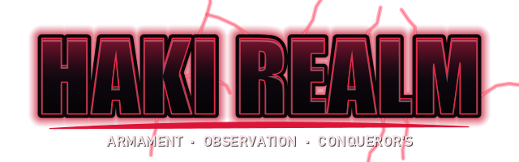

<!-- Generated by tools/build_pack_reference.py. Edit the pack sources and regenerate. -->

# Shimotsuki Clan

{ .entry-page-icon }

[All bloodlines](index.md)

Sword hits are stronger with a sword in your main hand. The lesson discount applies to [sword schools](../schools.md), including Oden Two-Sword Style.

| Stat | Value |
| --- | --- |
| Haki Realm birth roll | 3% |
| Known carriers | Ryuma, Koshiro, Kuina and Zoro |
| Sword damage bonus | +8% |
| Doriki required for sword-school lessons | 25% less |

