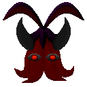
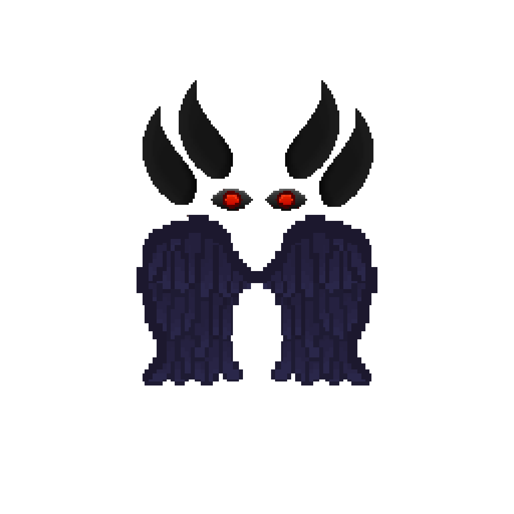
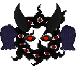
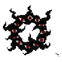
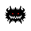
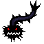
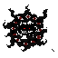
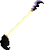
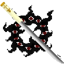
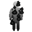

<!-- Generated by tools/build_pack_reference.py. Edit the pack sources and regenerate. -->

# Akuma no Mi

{ .entry-page-icon }

[Fruits](index.md) · [Akuma no Mi](../../reference/content/akuma.md)

<!-- fruit akuma:akuma_no_mi -->

| Stat | Value |
| --- | --- |
| Type | Mythical Zoan |
| Tier | 4 |
| Fruit damage scaling | 1.00× at 10,000 Doriki → 1.75× at 50,000 Doriki |
| Abilities | 21 (19 active, 2 passive) |
| Fruit boxes | [Noble Box](../fruit-boxes.md) |

See [damage calculations](../combat-stats.md#damage-from-doriki).

!!! note "Reading the stats"
    Listed base damage is for the named part of the move. Pack and Doriki multipliers are shown separately. Times assume 20 ticks per second.

<!-- move akuma:akuma_imp_point -->

## Akuma Imp Point

{ .entry-move-icon loading=lazy } *Active · Transformation*

Transforms the user into a hybrid devil

| Stat | Value |
| --- | --- |
| Pack multiplier when dealing damage | 1.2× |

<!-- move akuma:akuma_demon_point -->

## Akuma Demon Point

{ .entry-move-icon loading=lazy } *Active · Transformation*

Transforms the user into a full demon

| Stat | Value |
| --- | --- |
| Pack multiplier when dealing damage | 1.2× |

<!-- move akuma:akuma_devil_point -->

## Akuma Devil Point

{ .entry-move-icon loading=lazy } *Active · Transformation*

Transforms the user into the devil

| Stat | Value |
| --- | --- |
| Pack multiplier when dealing damage | 1.2× |

<!-- move akuma:akuma_tail_jab -->

## Akuma Tail Jab

{ .entry-move-icon loading=lazy } *Active*

The user uses their tail to target an enemy.

| Stat | Value |
| --- | --- |
| Cooldown | 15 s (300 ticks) |
| Pack multiplier when dealing damage | 1.2× |

<!-- move akuma:stigma -->

## Stigma

{ .entry-move-icon loading=lazy } *Active*

The user conjures a Omen that fires into their opponent.

| Stat | Value |
| --- | --- |
| Cooldown | 12 s (240 ticks) |

<!-- move akuma:akuma_flight -->

## Akuma Flight

*Passive*

| Stat | Value |
| --- | --- |
| Pack multiplier when dealing damage | 1.2× |

<!-- move akuma:tzitzimitl -->

## Tzitzimitl

{ .entry-move-icon loading=lazy } *Active*

The user rises into the sky beneath a massive halo that rains omens down upon the land below.

| Stat | Value |
| --- | --- |
| Cooldown | 60 s (1200 ticks) |
| Pack multiplier when dealing damage | 1.2× |

<!-- move akuma:omen_application -->

## Omen Application

{ .entry-move-icon loading=lazy } *Active*

The user shapes omens into a bomb, a spirit, a shield or a blessing for their allies.

| Stat | Value |
| --- | --- |
| Point blank damage | 40 HP |
| Projectile damage | 30 HP |
| Projectile explosion damage | 30 HP |
| Pack multiplier when dealing damage | 1.2× |

<!-- move akuma:omen_augmentation -->

## Omen Augmentation

{ .entry-move-icon loading=lazy } *Active*

The user reshapes their body with omens, swelling to twice their size or stretching their arm to hunt down their foes with every punch.

| Stat | Value |
| --- | --- |
| Limb damage | 20 HP |
| Pack multiplier when dealing damage | 1.2× |

<!-- move akuma:omen_storage -->

## Omen Storage

{ .entry-move-icon loading=lazy } *Active*

The user hides items inside a pocket of omens. Its contents spill out if the user dies or loses the fruit.

| Stat | Value |
| --- | --- |
| Pack multiplier when dealing damage | 1.2× |

<!-- move akuma:glaive_of_god -->

## Glaive of God

{ .entry-move-icon loading=lazy } *Active*

Summons the Glaive of God, withering anything it cuts. In Devil Point the user can instead draw the Sword of God.

| Stat | Value |
| --- | --- |
| Pack multiplier when dealing damage | 1.2× |

<!-- move akuma:tzitzimitl_slash -->

## Tzitzimitl Slash

{ .entry-move-icon loading=lazy } *Active*

Drawing back the Sword of God, the user dashes through their enemies in a single wide cut, branding each one with an omen that holds them in place.

| Stat | Value |
| --- | --- |
| Cooldown | 45 s (900 ticks) |
| Base damage | 162.5 HP |
| Conditional cooldown | 11.25 s (225 ticks) |
| Pack multiplier when dealing damage | 1.2× |

<!-- move akuma:a_kuwaru -->

## A Kuwaru

{ .entry-move-icon loading=lazy } *Active*

Binds a weakened target within an abyss pentagram, holding them helpless and untouchable for as long as the user keeps their hand raised. The target must be at half health or lower.

| Stat | Value |
| --- | --- |
| Cooldown | 30 s (600 ticks) |
| Pack multiplier when dealing damage | 1.2× |

<!-- move akuma:domi_reversi -->

## Domi Reversi

{ .entry-move-icon loading=lazy } *Active*

Flips the pentagram binding a soul sealed by A Kuwaru, turning them into a demon of the pact. Flipping a demon a second time returns them to what they were.

| Stat | Value |
| --- | --- |
| Cooldown | 60 s (1200 ticks) |
| Abort cooldown | 10 s (200 ticks) |
| Pack multiplier when dealing damage | 1.2× |

<!-- move akuma:immortality -->

## Immortality

{ .entry-move-icon loading=lazy } *Passive*

The user's body cannot be harmed. Only Busoshoku Internal Destruction and Haoshoku Infusion can wound them, and their wounds close using a reserve of %s Energy that recovers over time. While blessed by a Friendly Omen, only Haoshoku Infusion can wound them.

| Stat | Value |
| --- | --- |
| Pack multiplier when dealing damage | 1.2× |

<!-- move akuma:shallows_covenant -->

## Shallows Covenant

*Active*

Punch another to bind them to your pact, granting them strength and immortality.

| Stat | Value |
| --- | --- |
| Cooldown | 10 s (200 ticks) |
| Pack multiplier when dealing damage | 1.2× |

<!-- move akuma:depths_covenant -->

## Depths Covenant

*Active*

Promotes another from shallows to depth's, granthing them greater power and connection to akuma.

| Stat | Value |
| --- | --- |
| Cooldown | 10 s (200 ticks) |
| Pack multiplier when dealing damage | 1.2× |

<!-- move akuma:abyssal_covenant -->

## Abyssal Covenant

*Active*

The final level, promotes another from depth's to abyssal granting them teh strongest possible gifts from akuma.

| Stat | Value |
| --- | --- |
| Cooldown | 10 s (200 ticks) |
| Pack multiplier when dealing damage | 1.2× |

<!-- move akuma:revocation_protocol -->

## Revocation Protocol

{ .entry-move-icon loading=lazy } *Active*

From anywhere, the user selects a soul bound to their pact and executes them, severing the pact without suffering its backlash.

| Stat | Value |
| --- | --- |
| Select cooldown | 0.5 s (10 ticks) |
| Revoke cooldown | 5 s (100 ticks) |
| Fixed hit damage | 3.40282e+38 HP |
| Pack multiplier when dealing damage | 1.2× |

<!-- move akuma:abyssal_gate -->

## Abyssal Gate

{ .entry-move-icon loading=lazy } *Active*

Carves a numbered abyss pentagram into the ground. Those bound to the pact can stand upon one and step through to another. Crouch while teleporting to choose the destination. Those of the Depths or deeper can summon pact holders to them, crouching to choose who.

| Stat | Value |
| --- | --- |
| Create cooldown | 5 s (100 ticks) |
| Cycle cooldown | 0.25 s (5 ticks) |
| Teleport cooldown | 60 s (1200 ticks) |
| Summon cooldown | 60 s (1200 ticks) |
| Pack multiplier when dealing damage | 1.2× |

<!-- move akuma:possession -->

## Possession

{ .entry-move-icon loading=lazy } *Active*

From anywhere, the user possesses a soul of the Depths or Abyss bound to their pact, taking half of their strength and wielding their devil fruit, racial and style abilities as their own.

| Stat | Value |
| --- | --- |
| Select cooldown | 0.5 s (10 ticks) |
| Min cooldown | 5 s (100 ticks) |
| Max cooldown | 300 s (6000 ticks) |
| Pack multiplier when dealing damage | 1.2× |

