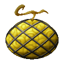

<!-- Generated by tools/build_pack_reference.py. Edit the pack sources and regenerate. -->

# Ami Ami no Mi

{ .entry-page-icon }

[Fruits](index.md) · [Missing Missing no Mi](../../reference/content/inomissing.md)

<!-- fruit inomissing:ami_ami_no_mi -->

| Stat | Value |
| --- | --- |
| Type | Paramecia |
| Tier | 1 |
| Fruit damage scaling | 1.00× at 10,000 Doriki → 2.25× at 50,000 Doriki |
| Abilities | 7 (7 active, 0 passive) |
| Fruit boxes | [Wooden Box](../fruit-boxes.md) |

See [damage calculations](../combat-stats.md#damage-from-doriki).

!!! note "Reading the stats"
    Listed base damage is for the named part of the move. Pack and Doriki multipliers are shown separately. Times assume 20 ticks per second.

<!-- move inomissing:mucho_neto_net -->

## Mucho Neto Net

{ .entry-move-icon loading=lazy } *Active*

Throws a sticky net that wraps the target, making it unable to move for 3 seconds.

| Stat | Value |
| --- | --- |
| Base damage | 3 HP |
| Cooldown | 8 s (160 ticks) |
| Pack multiplier when dealing damage | 2.4× |

<!-- move inomissing:neto_net_hoso_mo -->

## Neto Net Hoso Mo

{ .entry-move-icon loading=lazy } *Active*

Throws a sticky net that becomes a dome on the targeted location, all enemies inside are slowed and can't leave it for 5 seconds.

| Stat | Value |
| --- | --- |
| Cooldown | 16 s (320 ticks) |
| Pack multiplier when dealing damage | 2.4× |

<!-- move inomissing:mucho_cho_shi_mo -->

## Mucho Cho Shi Mo

{ .entry-move-icon loading=lazy } *Active*

The user eats an iron ingot and throws a barbed wire net that holds the target for 2 seconds and damages it every second.

| Stat | Value |
| --- | --- |
| Base damage | 4.5 HP |
| Cooldown | 10 s (200 ticks) |
| Pack multiplier when dealing damage | 2.4× |

<!-- move inomissing:mucho_tetsujo_mo -->

## Mucho Tetsujo Mo

{ .entry-move-icon loading=lazy } *Active*

The user eats an iron ingot and creates an iron cage around the enemy they are looking at, the cage holds the enemy and deals damage while it shrinks.

| Stat | Value |
| --- | --- |
| Close damage | 3 HP |
| Squeeze damage | 2.25 HP |
| Cooldown | 15 s (300 ticks) |
| Pack multiplier when dealing damage | 2.4× |

<!-- move inomissing:mucho_kaji_mo -->

## Mucho Kaji Mo

{ .entry-move-icon loading=lazy } *Active*

The user eats a fire charge and throws a burning net that holds the target for 2 seconds and sets it on fire.

| Stat | Value |
| --- | --- |
| Base damage | 6 HP |
| Cooldown | 10 s (200 ticks) |
| Pack multiplier when dealing damage | 2.4× |

<!-- move inomissing:millionet -->

## Millionet

{ .entry-move-icon loading=lazy } *Active*

The user drinks a water bottle and throws a net made of boiling water, which burns the target and holds it for 2 seconds.

| Stat | Value |
| --- | --- |
| Base damage | 9 HP |
| Cooldown | 10 s (200 ticks) |
| Pack multiplier when dealing damage | 2.4× |

<!-- move inomissing:no_shock_taimo -->

## No Shock Taimo

{ .entry-move-icon loading=lazy } *Active · Transformation*

The user's body becomes a net that absorbs the hits, melee attacks and projectiles deal 70% less damage. Does not work against blades, fire, explosions and Haki. Mucho-Mucho Zenshin Taimo. While the body is a net, the ability mode key makes the user fall on the enemy in sight and hold it inside their body for 3 seconds.

| Stat | Value |
| --- | --- |
| Base cooldown | 5 s (100 ticks) |
| Zenshin cooldown | 10 s (200 ticks) |
| Pack multiplier when dealing damage | 2.4× |

