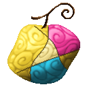

<!-- Generated by tools/build_pack_reference.py. Edit the pack sources and regenerate. -->

# Ato Ato no Mi

{ .entry-page-icon }

[Fruits](index.md) · [Missing Missing no Mi](../../reference/content/inomissing.md)

<!-- fruit inomissing:ato_ato_no_mi -->

| Stat | Value |
| --- | --- |
| Type | Paramecia |
| Tier | 1 |
| Fruit damage scaling | 1.00× at 10,000 Doriki → 2.25× at 50,000 Doriki |
| Abilities | 8 (8 active, 0 passive) |
| Fruit boxes | [Wooden Box](../fruit-boxes.md) |

See [damage calculations](../combat-stats.md#damage-from-doriki).

!!! note "Reading the stats"
    Listed base damage is for the named part of the move. Pack and Doriki multipliers are shown separately. Times assume 20 ticks per second.

<!-- move inomissing:broken_fu_art -->

## Broken-Fu Art

{ .entry-move-icon loading=lazy } *Active*

Throws a cloud that turns the enemy it touches into abstract art, slowing it and making its weapons and its fists useless.

| Stat | Value |
| --- | --- |
| Cooldown | 45 s (900 ticks) |
| Pack multiplier when dealing damage | 2.35× |

<!-- move inomissing:dying_art -->

## Dying Art

{ .entry-move-icon loading=lazy } *Active*

Flattens the enemy the user is looking at into a mural, where it can't move and slowly dies.

| Stat | Value |
| --- | --- |
| Cooldown | 20 s (400 ticks) |
| Conditional cooldown | 0.5 s (10 ticks) |
| Pack multiplier when dealing damage | 2.35× |

<!-- move inomissing:fukugen -->

## Fukugen

{ .entry-move-icon loading=lazy } *Active*

Restores everything the user turned into art. Everything is also restored if the user is knocked out. Water washes the art off a body.

| Stat | Value |
| --- | --- |
| Cooldown | 2 s (40 ticks) |
| Pack multiplier when dealing damage | 2.35× |

<!-- move inomissing:heavens_do_art -->

## Heaven's Do Art

{ .entry-move-icon loading=lazy } *Active · Transformation*

The user enters a world of their art, becoming giant and absorbing most of the damage they take. Using it again ends it.

| Stat | Value |
| --- | --- |
| Cooldown | 30 s (600 ticks) |
| Pack multiplier when dealing damage | 2.35× |

<!-- move inomissing:panorama_art -->

## Panorama Art

{ .entry-move-icon loading=lazy } *Active*

The user releases a wide cloud in front of them that turns all enemies it touches into abstract art, slowing them and making their weapons and fists useless.

| Stat | Value |
| --- | --- |
| Cooldown | 25 s (500 ticks) |
| Pack multiplier when dealing damage | 2.35× |

<!-- move inomissing:still_life_art -->

## Still Life Art

{ .entry-move-icon loading=lazy } *Active*

For a few seconds, all enemy projectiles that get close to the user are turned into small harmless pieces of art that fall to the ground. Using it again ends it.

| Stat | Value |
| --- | --- |
| Cooldown | 20 s (400 ticks) |
| Pack multiplier when dealing damage | 2.35× |

<!-- move inomissing:mosaic_art -->

## Mosaic Art

{ .entry-move-icon loading=lazy } *Active*

Turns the ground where the user is looking into abstract art for a while. All enemies standing on it are heavily slowed.

| Stat | Value |
| --- | --- |
| Cooldown | 25 s (500 ticks) |
| Pack multiplier when dealing damage | 2.35× |

<!-- move inomissing:readymade_art -->

## Readymade Art

{ .entry-move-icon loading=lazy } *Active*

Makes an art sculpture out of the block the user is looking at, which attracts all nearby hostile creatures for a while or until it is destroyed. Only one sculpture can be active.

| Stat | Value |
| --- | --- |
| Cooldown | 30 s (600 ticks) |
| Pack multiplier when dealing damage | 2.35× |

