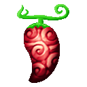
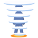
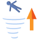

<!-- Generated by tools/build_pack_reference.py. Edit the pack sources and regenerate. -->

# Atsu Atsu no Mi

{ .entry-page-icon }

[Fruits](index.md) · [Missing Missing no Mi](../../reference/content/inomissing.md)

<!-- fruit inomissing:atsu_atsu_no_mi -->

| Stat | Value |
| --- | --- |
| Type | Paramecia |
| Tier | 2 |
| Fruit damage scaling | 1.00× at 10,000 Doriki → 2× at 50,000 Doriki |
| Abilities | 12 (12 active, 0 passive) |
| Fruit boxes | [Iron Box](../fruit-boxes.md) |

See [damage calculations](../combat-stats.md#damage-from-doriki).

!!! note "Reading the stats"
    Listed base damage is for the named part of the move. Pack and Doriki multipliers are shown separately. Times assume 20 ticks per second.

<!-- move inomissing:netsuryo_up -->

## Netsuryo Up

{ .entry-move-icon loading=lazy } *Active · Transformation*

The user raises their body heat to 3,000, 5,500 or 10,000 degrees. The hotter they are, the more their other abilities hurt and the further ice and snow melt around them, but the shorter it lasts. Enemies standing close catch fire and so do the ones who hit the user with their hands or a weapon. At 10,000 degrees allies burn too, and the stone under the user's feet turns to lava for a while.

| Stat | Value |
| --- | --- |
| Cooldown | 25 s (500 ticks) |
| Scorch damage | 2 HP |
| Layer top damage | 2 HP |
| Pack multiplier when dealing damage | 1.25× |

<!-- move inomissing:atsuyaki_tamago -->

## Atsuyaki Tamago

{ .entry-move-icon loading=lazy } *Active*

The user throws a ball of heat that burns what it hits and melts ice and snow where it lands.

| Stat | Value |
| --- | --- |
| Base damage | 8 HP |
| Cooldown | 5 s (100 ticks) |
| Pack multiplier when dealing damage | 1.1× |

<!-- move inomissing:atsu_atsu_no_gatling -->

## Atsu Atsu no Gatling

{ .entry-move-icon loading=lazy } *Active*

The user throws a barrage of slow balls of heat where they are looking. Use the ability again to stop it.

| Stat | Value |
| --- | --- |
| Base damage | 2.5 HP |
| Cooldown | 13 s (260 ticks) |
| Pack multiplier when dealing damage | 1.25× |

<!-- move inomissing:atsu_gesho -->

## Atsu Gesho

{ .entry-move-icon loading=lazy } *Active*

A whirlwind of scalding steam seizes the enemy the user is looking at, they can't move and are burned for as long as it turns. It lasts less on players and bosses. Use the ability again to let go.

| Stat | Value |
| --- | --- |
| Base damage | 2 HP |
| Cooldown | 16 s (320 ticks) |
| Pack multiplier when dealing damage | 1.25× |

<!-- move inomissing:atsuage -->

## Atsuage

{ .entry-move-icon loading=lazy } *Active*

A whirlwind of steam carries the enemy the user is looking at high in the air, then lets them fall and the fall hurts them. It goes half as high with players and bosses. Used with no enemy in sight, it takes the one held by Atsu Gesho.

| Stat | Value |
| --- | --- |
| Base damage | 6 HP |
| Cooldown | 15 s (300 ticks) |
| Pack multiplier when dealing damage | 1.25× |

<!-- move inomissing:hana_jet -->

## Atsutto Odoroku Hana Jet

{ .entry-move-icon loading=lazy } *Active*

A jet of steam throws the user through the air where they are looking. The fall that follows doesn't hurt, and Atsu Atsu Head hits harder during the flight.

| Stat | Value |
| --- | --- |
| Cooldown | 9 s (180 ticks) |
| Pack multiplier when dealing damage | 1.25× |

<!-- move inomissing:atsu_atsu_head -->

## Atsu Atsu Head

{ .entry-move-icon loading=lazy } *Active*

The user charges head first, the first enemy they meet is burned and thrown back. It hits harder during the flight of the Hana Jet.

| Stat | Value |
| --- | --- |
| Base damage | 12 HP |
| Jet damage | 18 HP |
| Cooldown | 8 s (160 ticks) |
| Pack multiplier when dealing damage | 1.25× |

<!-- move inomissing:steam_iron -->

## Steam Iron

{ .entry-move-icon loading=lazy } *Active*

The user leaps and comes down flat on the ground, enemies around the landing are burned and thrown back and ice and snow melt.

| Stat | Value |
| --- | --- |
| Base damage | 14 HP |
| Cooldown | 11 s (220 ticks) |
| Pack multiplier when dealing damage | 1.25× |

<!-- move inomissing:steam_iron_press -->

## Steam Iron: 10,000 Degree Press

{ .entry-move-icon loading=lazy } *Active*

Only at 10,000 degrees, the user leaps high above and comes down flat on a wide area, burning and throwing back every enemy in it.

| Stat | Value |
| --- | --- |
| Base damage | 15 HP |
| Cooldown | 35 s (700 ticks) |
| Pack multiplier when dealing damage | 1.25× |

<!-- move inomissing:net_tire -->

## Net Tire

{ .entry-move-icon loading=lazy } *Active*

The user rolls forward as a burning wheel, much faster, enemies in the way are burned and thrown aside and ice and snow melt. Jumping while rolling makes the wheel bound high once, and it hits the enemy it lands on. Use the ability again to stop.

| Stat | Value |
| --- | --- |
| Base damage | 8 HP |
| Cooldown | 13 s (260 ticks) |
| Pack multiplier when dealing damage | 1.25× |

<!-- move inomissing:slippery_slippery -->

## Slippery Slippery

{ .entry-move-icon loading=lazy } *Active*

Standing on ice or snow, the user melts its surface and slides on it, much faster, for as long as they stay on ice or snow. Use the ability again to stop.

| Stat | Value |
| --- | --- |
| Cooldown | 5 s (100 ticks) |
| Pack multiplier when dealing damage | 1.25× |

<!-- move inomissing:net_surfing -->

## Atsu Atsu no Net Surfing

{ .entry-move-icon loading=lazy } *Active*

Standing in or beside lava, the user raises it into a wave and rides it forward, enemies it reaches are burned and swept along.

| Stat | Value |
| --- | --- |
| Base damage | 16 HP |
| Cooldown | 20 s (400 ticks) |
| Pack multiplier when dealing damage | 1.25× |

