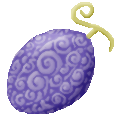

<!-- Generated by tools/build_pack_reference.py. Edit the pack sources and regenerate. -->

# Awa Awa no Mi

{ .entry-page-icon }

[Fruits](index.md) · [Mine Mine no Mi](../../reference/content/mineminenomi.md)

<!-- fruit mineminenomi:awa_awa_no_mi -->

| Stat | Value |
| --- | --- |
| Type | Paramecia |
| Tier | 1 |
| Fruit damage scaling | 1.00× at 10,000 Doriki → 2.25× at 50,000 Doriki |
| Abilities | 3 (3 active, 0 passive) |
| Fruit boxes | [Wooden Box](../fruit-boxes.md) |

See [damage calculations](../combat-stats.md#damage-from-doriki).

[Jump to awakening](#awakening)

!!! note "Reading the stats"
    Listed base damage is for the named part of the move. Pack and Doriki multipliers are shown separately. Times assume 20 ticks per second.

<!-- move mineminenomi:golden_hour -->

## Golden Hour

{ .entry-move-icon loading=lazy } *Active*

Spreads bubbles on enemies around, leaving them weakened and immobile

| Stat | Value |
| --- | --- |
| Min cooldown | 10 s (200 ticks) |
| Max cooldown | 60 s (1200 ticks) |
| Pack multiplier when dealing damage | 5.9× |

<!-- move mineminenomi:relax_hour -->

## Relax Hour

{ .entry-move-icon loading=lazy } *Active*

Fires a barrage of cleaning bubbles, leaving their targets weakened and immobile

| Stat | Value |
| --- | --- |
| Cooldown | 4 s (80 ticks) |
| Pack multiplier when dealing damage | 3.45× |

<!-- move mineminenomi:soap_defense -->

## Soap Defense

{ .entry-move-icon loading=lazy } *Active*

Protect yourself using a giant concentrated soap shield

| Stat | Value |
| --- | --- |
| Min cooldown | 2.5 s (50 ticks) |
| Max cooldown | 12.5 s (250 ticks) |
| Pack multiplier when dealing damage | 5.9× |

## Awakening

**Source** · Awaken Awaken no Mi

| Stat | Value |
| --- | --- |
| Doriki | 40,000 |
| Active time with the fruit | About 24 hours (1,728,000 ticks) |

<!-- move awakenawakennomi:world_wash -->

### World Wash { #awakening-world-wash }

{ .entry-move-icon loading=lazy } *Active*

Creates a big soap zone around the user that washes everyone inside, leaving them weak and unable to fight

| Stat | Value |
| --- | --- |
| Cooldown | 120 s (2400 ticks) |

<!-- move awakenawakennomi:bubble_cage -->

### Bubble Cage { #awakening-bubble-cage }

{ .entry-move-icon loading=lazy } *Active*

Fires a giant soap bubble that traps the first enemy hit so they can't move or attack. The bubble bursts at the end or when used again, dealing damage and washing away their buffs.

| Stat | Value |
| --- | --- |
| Pop damage | 120 HP |
| Cooldown | 45 s (900 ticks) |
| Miss cooldown | 15 s (300 ticks) |
| Abort cooldown | 2 s (40 ticks) |

<!-- move awakenawakennomi:squeaky_clean -->

### Squeaky Clean { #awakening-squeaky-clean }

{ .entry-move-icon loading=lazy } *Passive*

The user's hits deal a lot more damage to washed enemies. Each hit keeps the enemy washed for a few more seconds
