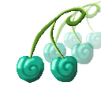

<!-- Generated by tools/build_pack_reference.py. Edit the pack sources and regenerate. -->

# Bai Bai no Mi

{ .entry-page-icon }

[Fruits](index.md) · [InoFruits](../../reference/content/inofruits.md)

<!-- fruit inofruits:bai_bai_no_mi -->

| Stat | Value |
| --- | --- |
| Type | Paramecia |
| Tier | 3 |
| Fruit damage scaling | 1.00× at 10,000 Doriki → 1.75× at 50,000 Doriki |
| Abilities | 3 (3 active, 0 passive) |
| Fruit boxes | [Golden Box](../fruit-boxes.md) |

See [damage calculations](../combat-stats.md#damage-from-doriki).

!!! note "Reading the stats"
    Listed base damage is for the named part of the move. Pack and Doriki multipliers are shown separately. Times assume 20 ticks per second.

<!-- move inofruits:bai_bunshin -->

## Bai Bunshin

{ .entry-move-icon loading=lazy } *Active*

Splits the user into three clones with the same gear that fight alongside them for 30 seconds.

| Stat | Value |
| --- | --- |
| Pack multiplier when dealing damage | 2.4× |

<!-- move inofruits:baizo -->

## Baizo

{ .entry-move-icon loading=lazy } *Active*

Every clone next to the user splits again up to a limit, the new ones lasting as long as the old ones had left.

| Stat | Value |
| --- | --- |
| Pack multiplier when dealing damage | 2.4× |

<!-- move inofruits:fukusei -->

## Fukusei

{ .entry-move-icon loading=lazy } *Active*

Makes a permanent copy of the item in the user's main hand.

| Stat | Value |
| --- | --- |
| Pack multiplier when dealing damage | 2.4× |

