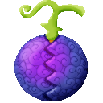

<!-- Generated by tools/build_pack_reference.py. Edit the pack sources and regenerate. -->

# Baku Baku no Mi

{ .entry-page-icon }

[Fruits](index.md) · [Mine Mine no Mi](../../reference/content/mineminenomi.md)

<!-- fruit mineminenomi:baku_baku_no_mi -->

| Stat | Value |
| --- | --- |
| Type | Paramecia |
| Tier | 1 |
| Fruit damage scaling | 1.00× at 10,000 Doriki → 2.25× at 50,000 Doriki |
| Abilities | 4 (4 active, 0 passive) |
| Fruit boxes | [Wooden Box](../fruit-boxes.md) |

See [damage calculations](../combat-stats.md#damage-from-doriki).

[Jump to awakening](#awakening)

!!! note "Reading the stats"
    Listed base damage is for the named part of the move. Pack and Doriki multipliers are shown separately. Times assume 20 ticks per second.

<!-- move mineminenomi:baku_munch -->

## Baku Munch

{ .entry-move-icon loading=lazy } *Active*

Allows the user to eat a big chunk of blocks in front of him, obtaining all of them as blocks in their inventory

| Stat | Value |
| --- | --- |
| Cooldown | 3 s (60 ticks) |
| Pack multiplier when dealing damage | 2.65× |

<!-- move mineminenomi:bero_cannon -->

## Bero Cannon

{ .entry-move-icon loading=lazy } *Active*

Transforms the user's tongue into a cannon and fires a random block from their inventory.

| Stat | Value |
| --- | --- |
| Cooldown | 2 s (40 ticks) |
| Pack multiplier when dealing damage | 1.8× |

<!-- move mineminenomi:baku_tsuiho -->

## Baku Tsuiho

{ .entry-move-icon loading=lazy } *Active*

Allows the user to charge multiple blocks from their inventory in their mouth and shoot them all at the same time.

| Stat | Value |
| --- | --- |
| Cooldown | 8 s (160 ticks) |
| Pack multiplier when dealing damage | 2.65× |

<!-- move mineminenomi:baku_factory -->

## Baku Factory

{ .entry-move-icon loading=lazy } *Active*

Allows the user to craft items and blocks without the need for a Crafting Table.

| Stat | Value |
| --- | --- |
| Pack multiplier when dealing damage | 2.65× |

## Awakening

**Source** · Awaken Awaken no Mi

| Stat | Value |
| --- | --- |
| Doriki | 40,000 |
| Active time with the fruit | About 24 hours (1,728,000 ticks) |

<!-- move awakenawakennomi:bakumetal_genesis -->

### Bakumetal Genesis { #awakening-bakumetal-genesis }

{ .entry-move-icon loading=lazy } *Active*

Fuses obsidian, diamond, gold and iron inside the user's body into a Bakumetal ingot

<!-- move awakenawakennomi:armor_munch -->

### Armor Munch { #awakening-armor-munch }

{ .entry-move-icon loading=lazy } *Active*

Lunges at an enemy and bites off their best armor piece. The user wears that armor for a minute and then gives it back.

| Stat | Value |
| --- | --- |
| Bite damage | 80 HP |
| Cooldown | 30 s (600 ticks) |
| Miss cooldown | 2 s (40 ticks) |

<!-- move awakenawakennomi:iron_stomach -->

### Iron Stomach { #awakening-iron-stomach }

{ .entry-move-icon loading=lazy } *Passive*

Every Bakumetal piece the user wears or holds makes them hit harder and take hits better. Wearing the full Bakumetal set with a Bakumetal weapon also cuts down knockback
