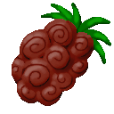
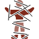
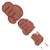

<!-- Generated by tools/build_pack_reference.py. Edit the pack sources and regenerate. -->

# Bara Bara No Mi

{ .entry-page-icon }

[Fruits](index.md) · [Mine Mine no Mi](../../reference/content/mineminenomi.md)

<!-- fruit mineminenomi:bara_bara_no_mi -->

| Stat | Value |
| --- | --- |
| Type | Paramecia |
| Tier | 2 |
| Fruit damage scaling | 1.00× at 10,000 Doriki → 2× at 50,000 Doriki |
| Abilities | 6 (5 active, 1 passive) |
| Fruit boxes | [Iron Box](../fruit-boxes.md) |

See [damage calculations](../combat-stats.md#damage-from-doriki).

[Jump to awakening](#awakening)

After awakening, this fruit’s original damaging moves deal **1.5× damage**. The awakening techniques below have their own values.

!!! note "Reading the stats"
    Listed base damage is for the named part of the move. Pack and Doriki multipliers are shown separately. Times assume 20 ticks per second.

<!-- move mineminenomi:bara_bara_ho -->

## Bara Bara Ho

{ .entry-move-icon loading=lazy } *Active*

Launches the user's fist toward the enemy, if the user holds a weapon in hand this will increase the fist's damage as well.

| Stat | Value |
| --- | --- |
| Cooldown | 4 s (80 ticks) |
| Pack multiplier when dealing damage | 2.7× |

<!-- move mineminenomi:bara_bara_festival -->

## Bara Bara Festival

{ .entry-move-icon loading=lazy } *Active*

Splits the user's body in several small parts that constantly hurt and slow down the target. Splits the user's body in several small parts that swarm around the user acting as a shield.

| Stat | Value |
| --- | --- |
| Cooldown | 15 s (300 ticks) |
| Base damage | 6 HP |
| Pack multiplier when dealing damage | 3.5× |

<!-- move mineminenomi:kuchu_kirimomi_dai_circus -->

## Kuchu Kirimomi Dai Circus

{ .entry-move-icon loading=lazy } *Active*

Fires both fists at an enemy and lifts them up, moving them around according to the user's movements.

| Stat | Value |
| --- | --- |
| Cooldown | 15 s (300 ticks) |
| Pack multiplier when dealing damage | 4.4× |

<!-- move mineminenomi:bara_bara_car -->

## Bara Bara Car

{ .entry-move-icon loading=lazy } *Active · Transformation*

Turns the user's body into a car.

| Stat | Value |
| --- | --- |
| Min cooldown | 5 s (100 ticks) |
| Max cooldown | 60 s (1200 ticks) |
| Pack multiplier when dealing damage | 4.4× |

<!-- move mineminenomi:bara_split -->

## Bara Split

{ .entry-move-icon loading=lazy } *Active*

Allows the user to split its upper part of the body from the lower.

| Stat | Value |
| --- | --- |
| Min cooldown | 5 s (100 ticks) |
| Max cooldown | 50 s (1000 ticks) |
| Pack multiplier when dealing damage | 4.4× |

<!-- move mineminenomi:slash_damage_immunity -->

## Slash Damage Immunity

{ .entry-move-icon loading=lazy } *Passive*

Makes the user immune to slash based attacks

| Stat | Value |
| --- | --- |
| Pack multiplier when dealing damage | 4.4× |

## Awakening

**Source** · Awaken Awaken no Mi

| Stat | Value |
| --- | --- |
| Doriki | 40,000 |
| Active time with the fruit | About 24 hours (1,728,000 ticks) |

<!-- move awakenawakennomi:dislocation_punch -->

### Dislocation Punch { #awakening-dislocation-punch }

{ .entry-move-icon loading=lazy } *Active*

Dislocates the target's arm so they can't use it Dislocates the target's leg so they can't use it.

| Stat | Value |
| --- | --- |
| Cooldown | 100 s (2000 ticks) |

<!-- move awakenawakennomi:bara_bara_parade -->

### Bara Bara Parade { #awakening-bara-bara-parade }

{ .entry-move-icon loading=lazy } *Active*

The user sends their hands flying at up to 8 enemies nearby, each fist goes after its own target. Every fist that lands dislocates an arm or a leg.

| Stat | Value |
| --- | --- |
| Base damage | 60 HP |
| Cooldown | 60 s (1200 ticks) |
| Miss cooldown | 2 s (40 ticks) |

<!-- move awakenawakennomi:severed_grip -->

### Severed Grip { #awakening-severed-grip }

{ .entry-move-icon loading=lazy } *Passive*

When a blade fails to cut the user, the arm that swung it gets dislocated.
