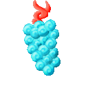

<!-- Generated by tools/build_pack_reference.py. Edit the pack sources and regenerate. -->

# Bari Bari no Mi

{ .entry-page-icon }

[Fruits](index.md) · [Mine Mine no Mi](../../reference/content/mineminenomi.md)

<!-- fruit mineminenomi:bari_bari_no_mi -->

| Stat | Value |
| --- | --- |
| Type | Paramecia |
| Tier | 1 |
| Fruit damage scaling | 1.00× at 10,000 Doriki → 2.25× at 50,000 Doriki |
| Abilities | 6 (6 active, 0 passive) |
| Fruit boxes | [Wooden Box](../fruit-boxes.md) |

See [damage calculations](../combat-stats.md#damage-from-doriki).

[Jump to awakening](#awakening)

After awakening, this fruit’s original damaging moves deal **1.5× damage**. The awakening techniques below have their own values.

!!! note "Reading the stats"
    Listed base damage is for the named part of the move. Pack and Doriki multipliers are shown separately. Times assume 20 ticks per second.

<!-- move mineminenomi:barrier -->

## Barrier

{ .entry-move-icon loading=lazy } *Active*

The user creates an impenetrable wall in front of themselves, which shields them from attacks.

| Stat | Value |
| --- | --- |
| Min cooldown | 5 s (100 ticks) |
| Max cooldown | 20 s (400 ticks) |
| Pack multiplier when dealing damage | 3.4× |

<!-- move mineminenomi:barrier_ball -->

## Barrier Ball

{ .entry-move-icon loading=lazy } *Active*

The user creates a spherical barrier where they're pointing.

| Stat | Value |
| --- | --- |
| Cooldown | 10 s (200 ticks) |
| Pack multiplier when dealing damage | 3.4× |

<!-- move mineminenomi:barrier_crash -->

## Barrier Crash

{ .entry-move-icon loading=lazy } *Active*

Launches a barrier toward the opponent, smashing it against them.

| Stat | Value |
| --- | --- |
| Cooldown | 8 s (160 ticks) |
| Pack multiplier when dealing damage | 3.4× |

<!-- move mineminenomi:bari_bari_no_pistol -->

## Bari Bari no Pistol

{ .entry-move-icon loading=lazy } *Active*

Shapes a barrier aroud the user's fist, which greatly increases the power of a punch.

| Stat | Value |
| --- | --- |
| Cooldown | 5 s (100 ticks) |
| Pack multiplier when dealing damage | 2.2× |

<!-- move mineminenomi:barrierbility_stairs -->

## Barrierbility Stairs

{ .entry-move-icon loading=lazy } *Active*

By shaping the Barrier, the user can create stairs.

| Stat | Value |
| --- | --- |
| Cooldown | 5 s (100 ticks) |
| Pack multiplier when dealing damage | 3.4× |

<!-- move mineminenomi:barrierbility_bat -->

## Barrierbility Bat

{ .entry-move-icon loading=lazy } *Active*

Shapes the barriers in the form of a bat that the user can hold.

| Stat | Value |
| --- | --- |
| Cooldown | 0.5 s (10 ticks) |
| Pack multiplier when dealing damage | 3.4× |

## Awakening

**Source** · Awaken Awaken no Mi

| Stat | Value |
| --- | --- |
| Doriki | 40,000 |
| Active time with the fruit | About 24 hours (1,728,000 ticks) |

<!-- move awakenawakennomi:gods_bulwark -->

### God's Bulwark { #awakening-gods-bulwark }

{ .entry-move-icon loading=lazy } *Active*

Fills the user's body with barrier energy, making them fully invulnerable for a short time

| Stat | Value |
| --- | --- |
| Min cooldown | 45 s (900 ticks) |
| Max cooldown | 180 s (3600 ticks) |

<!-- move awakenawakennomi:barrier_eruption -->

### Barrier Eruption { #awakening-barrier-eruption }

{ .entry-move-icon loading=lazy } *Active*

Slams barrier energy into the ground, raising huge barrier walls all around that launch nearby enemies.

| Stat | Value |
| --- | --- |
| Cooldown | 30 s (600 ticks) |
| Base damage | 60 HP |

<!-- move awakenawakennomi:grand_repulsion -->

### Grand Repulsion { #awakening-grand-repulsion }

{ .entry-move-icon loading=lazy } *Active*

Releases a shockwave of barriers that blasts away all nearby enemies.

| Stat | Value |
| --- | --- |
| Cooldown | 45 s (900 ticks) |
| Base damage | 80 HP |

