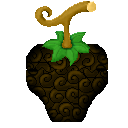
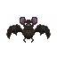
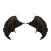

<!-- Generated by tools/build_pack_reference.py. Edit the pack sources and regenerate. -->

# Batto Batto no Mi

{ .entry-page-icon }

[Fruits](index.md) · [Blitz Utility](../../reference/content/blitzutility.md)

<!-- fruit blitzutility:batto_batto_no_mi -->

| Stat | Value |
| --- | --- |
| Type | Zoan |
| Tier | 2 |
| Fruit damage scaling | 1.00× at 10,000 Doriki → 2× at 50,000 Doriki |
| Abilities | 7 (5 active, 2 passive) |
| Fruit boxes | [Iron Box](../fruit-boxes.md) |

See [damage calculations](../combat-stats.md#damage-from-doriki).

!!! note "Reading the stats"
    Listed base damage is for the named part of the move. Pack and Doriki multipliers are shown separately. Times assume 20 ticks per second.

<!-- move blitzutility:batto_fly_point -->

## Batto Fly Point

{ .entry-move-icon loading=lazy } *Active · Transformation*

Transforms the user into a nimble bat that can fly freely.

<!-- move blitzutility:batto_assault_point -->

## Batto Assault Point

{ .entry-move-icon loading=lazy } *Active · Transformation*

Transforms the user into a half-bat hybrid with great wings and a slight increase in stats.

<!-- move blitzutility:batto_bite -->

## Batto Bite

{ .entry-move-icon loading=lazy } *Active*

The user grabs a target and sinks their fangs in, weakening them, making them bleed and leaving them drowsy.

| Stat | Value |
| --- | --- |
| Base damage | 25 HP |
| Cooldown | 25 s (500 ticks) |
| Bleed | 3 s (60 ticks) |

<!-- move blitzutility:sonic_boom -->

## Sonic Boom

{ .entry-move-icon loading=lazy } *Active*

The user charges up and unleashes a blast of sound that tears through everything in its path and leaves its victims dizzy. Silenced by the Nagi Nagi no Mi.

| Stat | Value |
| --- | --- |
| Cooldown | 20 s (400 ticks) |

<!-- move blitzutility:echo_location -->

## Echo Location

{ .entry-move-icon loading=lazy } *Active*

The user lets out a high pitched screech, revealing every player and creature nearby through walls for 3 seconds. Players glow red, creatures glow white.

| Stat | Value |
| --- | --- |
| Cooldown | 15 s (300 ticks) |

<!-- move blitzutility:batto_flight -->

## Batto Flight

*Passive*

<!-- move blitzutility:batto_night_vision -->

## Batto Night Vision

{ .entry-move-icon loading=lazy } *Passive*

The user gains passive night vision.
