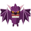
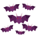

<!-- Generated by tools/build_pack_reference.py. Edit the pack sources and regenerate. -->

# Batto Batto no Mi, Model: Vampire

{ .entry-page-icon }

[Fruits](index.md) · [Missing Missing no Mi](../../reference/content/inomissing.md)

<!-- fruit inomissing:batto_batto_no_mi_model_vampire -->

| Stat | Value |
| --- | --- |
| Type | Mythical Zoan |
| Tier | 3 |
| Fruit damage scaling | 1.00× at 10,000 Doriki → 1.75× at 50,000 Doriki |
| Abilities | 11 (10 active, 1 passive) |
| Fruit boxes | [Golden Box](../fruit-boxes.md) |

See [damage calculations](../combat-stats.md#damage-from-doriki).

!!! note "Reading the stats"
    Listed base damage is for the named part of the move. Pack and Doriki multipliers are shown separately. Times assume 20 ticks per second.

<!-- move inomissing:vampire_assault_point -->

## Vampire Assault Point

{ .entry-move-icon loading=lazy } *Active · Transformation*

Transforms the user into a winged vampire with fangs and claws, which can fly and still use weapons.

| Stat | Value |
| --- | --- |
| Pack multiplier when dealing damage | 3.3× |

**Stats while transformed**

| Stat | Value |
| --- | --- |
| Movement speed | +15% of base |
| Maximum health | +40% |
| Punch damage | +9 HP |
| Armour | +6 |
| Step height | +0.5 blocks |
| Jump | +1.3 |
| Toughness | +3 |

<!-- move inomissing:vampire_fly_point -->

## Vampire Fly Point

{ .entry-move-icon loading=lazy } *Active · Transformation*

Transforms the user into a giant bat, fast in the air

| Stat | Value |
| --- | --- |
| Pack multiplier when dealing damage | 3.3× |

**Stats while transformed**

| Stat | Value |
| --- | --- |
| Movement speed | +30% of base |
| Maximum health | +30% |
| Punch damage | +7 HP |
| Armour | +4 |
| Step height | +1 blocks |
| Jump | +1 |
| Toughness | +2 |

<!-- move inomissing:vampire_flight -->

## Vampire Flight

*Passive*

| Stat | Value |
| --- | --- |
| Pack multiplier when dealing damage | 3.3× |

<!-- move inomissing:wing_slash -->

## Wing Slash

{ .entry-move-icon loading=lazy } *Active*

The user slashes all the enemies in front of them with their claws and the edge of their wings At night or in the dark, the cut makes them bleed

| Stat | Value |
| --- | --- |
| Base damage | 14 HP |
| Bleed | 5 s (100 ticks) |
| Cooldown | 7 s (140 ticks) |
| Pack multiplier when dealing damage | 2.15× |

<!-- move inomissing:draining_bite -->

## Draining Bite

{ .entry-move-icon loading=lazy } *Active*

The user bites the enemy in front of them and drains their youth, the enemy grows old, slower and weaker while the user is healed and becomes stronger and faster. Each bite makes the user stronger At night or in the dark, the bite deals more damage and heals more

| Stat | Value |
| --- | --- |
| Base damage | 10 HP |
| Night damage | 15 HP |
| Youth damage | 0.1 HP |
| Cooldown | 12 s (240 ticks) |
| Pack multiplier when dealing damage | 3.3× |

<!-- move inomissing:give_back -->

## Give Back

{ .entry-move-icon loading=lazy } *Active*

The user gives back the youth they drained, everyone they have bitten is young again and the user loses the strength they gained

| Stat | Value |
| --- | --- |
| Cooldown | 5 s (100 ticks) |
| Pack multiplier when dealing damage | 3.3× |

<!-- move inomissing:vampire_darkness -->

## Darkness

{ .entry-move-icon loading=lazy } *Active*

The user spreads an unnatural darkness around them in which enemies can barely see. It disappears after the user takes enough damage Inside their own darkness, the user's abilities are used as at night Use the ability again to lift the darkness

| Stat | Value |
| --- | --- |
| Cooldown | 45 s (900 ticks) |
| Pack multiplier when dealing damage | 3.3× |

<!-- move inomissing:dark_shot -->

## Dark Shot

{ .entry-move-icon loading=lazy } *Active*

The user spits a shot of dark matter where they are looking, which blinds the enemy it hits At night or in the dark, the shot splits in three

| Stat | Value |
| --- | --- |
| Base damage | 12 HP |
| Cooldown | 10 s (200 ticks) |
| Pack multiplier when dealing damage | 3.3× |

<!-- move inomissing:red_dash -->

## Red Dash

{ .entry-move-icon loading=lazy } *Active*

The user disappears in a red burst and reappears further where they are looking, slashing all the enemies on their way At night or in the dark, the dash goes further

| Stat | Value |
| --- | --- |
| Base damage | 9 HP |
| Cooldown | 8 s (160 ticks) |
| Pack multiplier when dealing damage | 3.3× |

<!-- move inomissing:bat_swarm -->

## Swarm of Bats

{ .entry-move-icon loading=lazy } *Active*

The user bursts into a swarm of bats, every attack goes through them for a short time, even those imbued with Haki At night or in the dark, it lasts twice as long

| Stat | Value |
| --- | --- |
| Cooldown | 25 s (500 ticks) |
| Pack multiplier when dealing damage | 3.3× |

<!-- move inomissing:echolocation -->

## Echolocation

{ .entry-move-icon loading=lazy } *Active*

The user lets out a cry that reveals all nearby enemies through walls for a few seconds At night or in the dark, the cry reaches further

| Stat | Value |
| --- | --- |
| Cooldown | 15 s (300 ticks) |
| Pack multiplier when dealing damage | 3.3× |

