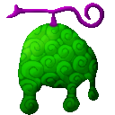

<!-- Generated by tools/build_pack_reference.py. Edit the pack sources and regenerate. -->

# Beta Beta no Mi

{ .entry-page-icon }

[Fruits](index.md) · [Mine Mine no Mi](../../reference/content/mineminenomi.md)

<!-- fruit mineminenomi:beta_beta_no_mi -->

| Stat | Value |
| --- | --- |
| Type | Paramecia |
| Tier | 2 |
| Fruit damage scaling | 1.00× at 10,000 Doriki → 2× at 50,000 Doriki |
| Abilities | 5 (4 active, 1 passive) |
| Fruit boxes | [Iron Box](../fruit-boxes.md) |

See [damage calculations](../combat-stats.md#damage-from-doriki).

[Jump to awakening](#awakening)

After awakening, this fruit’s original damaging moves deal **1.5× damage**. The awakening techniques below have their own values.

!!! note "Reading the stats"
    Listed base damage is for the named part of the move. Pack and Doriki multipliers are shown separately. Times assume 20 ticks per second.

<!-- move mineminenomi:beta_coating -->

## Beta Coating

{ .entry-move-icon loading=lazy } *Active*

Covers the user in a thick mucus coat, which makes them immune to almost all attacks, but extremely vulnerable to fire.

| Stat | Value |
| --- | --- |
| Min cooldown | 5 s (100 ticks) |
| Max cooldown | 20 s (400 ticks) |
| Pack multiplier when dealing damage | 1.7× |

<!-- move mineminenomi:beta_launcher -->

## Beta Launcher

{ .entry-move-icon loading=lazy } *Active*

Shoots sticky Mucus which cause explosions on contact when combined with fire (also holding Flint & Steel).

| Stat | Value |
| --- | --- |
| Cooldown | 9 s (180 ticks) |
| Pack multiplier when dealing damage | 2.65× |

<!-- move mineminenomi:hanamizu_shinken_shirahadori -->

## Hanamizu Shinken Shirahadori

{ .entry-move-icon loading=lazy } *Active*

Creates a protecting wall of mucus, protecting the user from incoming physical attacks and physical projectiles.

| Stat | Value |
| --- | --- |
| Cooldown | 5 s (100 ticks) |
| Pack multiplier when dealing damage | 2.65× |

<!-- move mineminenomi:beta_beta_chain -->

## Beta Beta Chain

{ .entry-move-icon loading=lazy } *Active*

The user shoots a mucus chain which will propel the user toward where it hits.

| Stat | Value |
| --- | --- |
| Cooldown | 6 s (120 ticks) |
| Pack multiplier when dealing damage | 1.8× |

<!-- move mineminenomi:beta_immunities -->

## Beta Immunities

*Passive*

| Stat | Value |
| --- | --- |
| Pack multiplier when dealing damage | 2.65× |

## Awakening

**Source** · Awaken Awaken no Mi

| Stat | Value |
| --- | --- |
| Doriki | 40,000 |
| Active time with the fruit | About 24 hours (1,728,000 ticks) |

<!-- move awakenawakennomi:beta_beta_ocean -->

### Beta Beta Ocean { #awakening-beta-beta-ocean }

{ .entry-move-icon loading=lazy } *Active*

Covers the ground around the user in sticky Mucus that slows enemies down The Mucus burns really easily.

| Stat | Value |
| --- | --- |
| Cooldown | 40 s (800 ticks) |

<!-- move awakenawakennomi:beta_beta_surge -->

### Beta Beta Surge { #awakening-beta-beta-surge }

{ .entry-move-icon loading=lazy } *Active*

Sends a wave of Mucus rolling forward that knocks enemies back and glues them in place. The wave leaves a trail of Mucus behind it.

| Stat | Value |
| --- | --- |
| Base damage | 120 HP |
| Cooldown | 45 s (900 ticks) |

<!-- move awakenawakennomi:slick_passage -->

### Slick Passage { #awakening-slick-passage }

{ .entry-move-icon loading=lazy } *Passive*

On Mucus the user slides around way faster and can't be knocked back.
