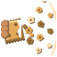

<!-- Generated by tools/build_pack_reference.py. Edit the pack sources and regenerate. -->

# Bisu Bisu no Mi

{ .entry-page-icon }

[Fruits](index.md) · [Missing Missing no Mi](../../reference/content/inomissing.md)

<!-- fruit inomissing:bisu_bisu_no_mi -->

| Stat | Value |
| --- | --- |
| Type | Paramecia |
| Tier | 2 |
| Fruit damage scaling | 1.00× at 10,000 Doriki → 2× at 50,000 Doriki |
| Abilities | 9 (9 active, 0 passive) |
| Fruit boxes | [Iron Box](../fruit-boxes.md) |

See [damage calculations](../combat-stats.md#damage-from-doriki).

!!! note "Reading the stats"
    Listed base damage is for the named part of the move. Pack and Doriki multipliers are shown separately. Times assume 20 ticks per second.

<!-- move inomissing:bisu_hei -->

## Biscuit Hei

{ .entry-move-icon loading=lazy } *Active*

The user makes biscuit soldiers that follow them and attack their enemies, and take the orders of the Command ability. A broken soldier comes back after a while as long as the ability is active, and each one that comes back makes the user a little hungry. In water or rain the biscuit gets soft. A soft soldier takes double damage and anyone can eat it.

| Stat | Value |
| --- | --- |
| Cooldown | 30 s (600 ticks) |
| Pack multiplier when dealing damage | 1.95× |

<!-- move inomissing:bisu_hard_biscuit -->

## Hard Biscuit

{ .entry-move-icon loading=lazy } *Active*

A pile of hardened biscuit shields falls on the enemy the user looks at. It hurts the enemy and pins them to the ground for a moment.

| Stat | Value |
| --- | --- |
| Base damage | 14 HP |
| Cooldown | 15 s (300 ticks) |
| Conditional cooldown | 0.5 s (10 ticks) |
| Pack multiplier when dealing damage | 1.95× |

<!-- move inomissing:bisu_wall -->

## Biscuit Wall

{ .entry-move-icon loading=lazy } *Active*

A wall of hard biscuit rises in front of the user and stops enemies and projectiles for a while. In water or rain it lasts half as long. Using the ability again brings the wall down.

| Stat | Value |
| --- | --- |
| Cooldown | 20 s (400 ticks) |
| Pack multiplier when dealing damage | 1.95× |

<!-- move inomissing:bisu_armour -->

## Biscuit Armor

{ .entry-move-icon loading=lazy } *Active*

The user wears a giant biscuit soldier that takes the damage for them. When the armor breaks the user comes out unharmed. Using it again adds a pair of arms with swords, up to 6 arms, and each pair makes the user hit harder. Using it with 6 arms leaves the armor. In water or rain the armor gets soft and breaks twice as fast.

| Stat | Value |
| --- | --- |
| Cooldown | 20 s (400 ticks) |
| Broken cooldown | 60 s (1200 ticks) |
| Pack multiplier when dealing damage | 1.95× |

**Stats while transformed**

| Stat | Value |
| --- | --- |
| Punch damage | +6 HP |
| Armor | +8 |
| Step height | +1 blocks |

<!-- move inomissing:bisu_pretzel -->

## Double Roll Pretzel

{ .entry-move-icon loading=lazy } *Active*

Inside the biscuit armor the user dashes forward with two spinning swords, hitting every enemy on the way and throwing them aside.

| Stat | Value |
| --- | --- |
| Base damage | 18 HP |
| Cooldown | 12 s (240 ticks) |
| Pack multiplier when dealing damage | 1.95× |

<!-- move inomissing:bisu_honey_pretzel -->

## Honey Pretzel

{ .entry-move-icon loading=lazy } *Active*

Honey Pretzel, the user leaps at the enemy and thrusts the sword they hold. The blow sends a shock wave that hits every enemy around. Crash Pretzel, the same thrust, stronger, and the point of the sword explodes when it strikes. It does not break blocks.

| Stat | Value |
| --- | --- |
| Honey damage | 16 HP |
| Crash damage | 22 HP |
| Honey cooldown | 12 s (240 ticks) |
| Crash cooldown | 20 s (400 ticks) |
| Pack multiplier when dealing damage | 1.95× |

<!-- move inomissing:bisu_crush_biscuit -->

## Crush Biscuit

{ .entry-move-icon loading=lazy } *Active*

The user crushes biscuits into fine crumbs and shapes a copy of the sword Pretzel in their hand, for 60 seconds at most. The sword crumbles if it leaves the hand of the user, in water or under the rain.

| Stat | Value |
| --- | --- |
| Cooldown | 12 s (240 ticks) |
| Pack multiplier when dealing damage | 1.95× |

<!-- move inomissing:bisu_crumb_burst -->

## Crumb Burst

{ .entry-move-icon loading=lazy } *Active*

The user crushes biscuits and throws the hardened crumbs in a fan in front of them, hitting every enemy close ahead.

| Stat | Value |
| --- | --- |
| Base damage | 12 HP |
| Cooldown | 12 s (240 ticks) |
| Pack multiplier when dealing damage | 1.95× |

<!-- move inomissing:bisu_biscuit_rations -->

## Biscuit Rations

{ .entry-move-icon loading=lazy } *Active*

The user makes 4 hard biscuits. They are too hard to eat until they are soaked, by using them on water.

| Stat | Value |
| --- | --- |
| Cooldown | 30 s (600 ticks) |
| Pack multiplier when dealing damage | 1.95× |

