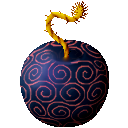
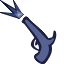

<!-- Generated by tools/build_pack_reference.py. Edit the pack sources and regenerate. -->

# Bomu Bomu no Mi

{ .entry-page-icon }

[Fruits](index.md) · [Mine Mine no Mi](../../reference/content/mineminenomi.md)

<!-- fruit mineminenomi:bomu_bomu_no_mi -->

| Stat | Value |
| --- | --- |
| Type | Paramecia |
| Tier | 2 |
| Fruit damage scaling | 1.00× at 10,000 Doriki → 2× at 50,000 Doriki |
| Abilities | 6 (5 active, 1 passive) |
| Fruit boxes | [Iron Box](../fruit-boxes.md) |

See [damage calculations](../combat-stats.md#damage-from-doriki).

[Jump to awakening](#awakening)

!!! note "Reading the stats"
    Listed base damage is for the named part of the move. Pack and Doriki multipliers are shown separately. Times assume 20 ticks per second.

<!-- move mineminenomi:nose_fancy_cannon -->

## Nose Fancy Cannon

{ .entry-move-icon loading=lazy } *Active*

Shoots dried mucus at the opponent, which explodes on impact

| Stat | Value |
| --- | --- |
| Cooldown | 4 s (80 ticks) |

<!-- move mineminenomi:kick_bomb -->

## Kick Bomb

{ .entry-move-icon loading=lazy } *Active*

The user kicks the ground, detonating their leg on impact

| Stat | Value |
| --- | --- |
| Cooldown | 20 s (400 ticks) |
| Explosion damage | 70 HP |

<!-- move mineminenomi:zenshin_kibaku -->

## Zenshin Kibaku

{ .entry-move-icon loading=lazy } *Active*

The user creates a massive explosion from their body

| Stat | Value |
| --- | --- |
| Min cooldown | 2 s (40 ticks) |
| Max cooldown | 7 s (140 ticks) |
| Pack multiplier when dealing damage | 0.75× |

<!-- move mineminenomi:explosive_punch -->

## Explosive Punch

{ .entry-move-icon loading=lazy } *Active*

The user punches and creates an explosion around their fist

| Stat | Value |
| --- | --- |
| Cooldown | 10 s (200 ticks) |
| Base damage | 20 HP |

<!-- move mineminenomi:breeze_breath_bomb -->

## Breeze Breath Bomb

{ .entry-move-icon loading=lazy } *Active*

Load a gun with explosive breath and shoot a chain explosion

| Stat | Value |
| --- | --- |
| Cooldown | 15 s (300 ticks) |

<!-- move mineminenomi:explosion_immunity -->

## Explosion Immunity

*Passive*

Makes the user immune to explosions

## Awakening

**Source** · Awaken Awaken no Mi

| Stat | Value |
| --- | --- |
| Doriki | 40,000 |
| Active time with the fruit | About 24 hours (1,728,000 ticks) |

<!-- move awakenawakennomi:airburst -->

### Airburst { #awakening-airburst }

{ .entry-move-icon loading=lazy } *Active*

Creates exploding bursts of air around the user for 30 seconds without breaking blocks.

| Stat | Value |
| --- | --- |
| Static damage | 30 HP |
| Cooldown | 30 s (600 ticks) |

<!-- move awakenawakennomi:blast_jump -->

### Blast Jump { #awakening-blast-jump }

{ .entry-move-icon loading=lazy } *Active*

Blows up the ground under the user's feet, launching them high into the air

| Stat | Value |
| --- | --- |
| Static damage | 40 HP |
| Conditional cooldown | 0.5 s (10 ticks) |

<!-- move awakenawakennomi:piercing_blast -->

### Piercing Blast { #awakening-piercing-blast }

{ .entry-move-icon loading=lazy } *Active*

The user fires a compressed air laser that pierces the target and explodes inside them.

| Stat | Value |
| --- | --- |
| Min cooldown | 10 s (200 ticks) |
| Max cooldown | 120 s (2400 ticks) |
| Min damage | 1 HP |
| Max damage | 300 HP |

