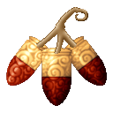
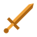
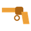
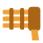

<!-- Generated by tools/build_pack_reference.py. Edit the pack sources and regenerate. -->

# Buki Buki no Mi

{ .entry-page-icon }

[Fruits](index.md) · [Missing Missing no Mi](../../reference/content/inomissing.md)

<!-- fruit inomissing:buki_buki_no_mi -->

| Stat | Value |
| --- | --- |
| Type | Paramecia |
| Tier | 2 |
| Fruit damage scaling | 1.00× at 10,000 Doriki → 2× at 50,000 Doriki |
| Abilities | 8 (8 active, 0 passive) |
| Fruit boxes | [Iron Box](../fruit-boxes.md) |

See [damage calculations](../combat-stats.md#damage-from-doriki).

!!! note "Reading the stats"
    Listed base damage is for the named part of the move. Pack and Doriki multipliers are shown separately. Times assume 20 ticks per second.

<!-- move inomissing:espada_girl -->

## Espada Girl

{ .entry-move-icon loading=lazy } *Active*

Turns the user's arms into weapons, sword blades by default. Their punches cut, and their hands count as a sword. The user picks another weapon before use.

| Stat | Value |
| --- | --- |
| Cooldown | 1 s (20 ticks) |
| Punch damage | 20 HP |
| Pack multiplier when dealing damage | 1.05× |

<!-- move inomissing:revolver_girl -->

## Revolver Girl

{ .entry-move-icon loading=lazy } *Active*

Turns the user's arm into a revolver that fires a burst of bullets where the user looks.

| Stat | Value |
| --- | --- |
| Base damage | 2.5 HP |
| Cooldown | 10 s (200 ticks) |
| Pack multiplier when dealing damage | 1.1× |

<!-- move inomissing:revolver_leg -->

## Revolver Leg

{ .entry-move-icon loading=lazy } *Active*

The user kicks with a leg turned into a gun. It fires as the kick lands and pushes back the enemies in front.

| Stat | Value |
| --- | --- |
| Base damage | 10 HP |
| Cooldown | 7 s (140 ticks) |
| Pack multiplier when dealing damage | 1.05× |

<!-- move inomissing:gatling_girl -->

## Gatling Girl

{ .entry-move-icon loading=lazy } *Active*

Turns the user's leg into a Gatling gun that fires a long burst of bullets where the user looks. The user is slowed while firing.

| Stat | Value |
| --- | --- |
| Base damage | 1.2 HP |
| Cooldown | 25 s (500 ticks) |
| Pack multiplier when dealing damage | 1.1× |

<!-- move inomissing:sickle_girl -->

## Sickle Girl

{ .entry-move-icon loading=lazy } *Active*

Throws a sickle on a chain from the user's arm. It cuts the first enemy it hits, and the chain pulls that enemy back.

| Stat | Value |
| --- | --- |
| Base damage | 5 HP |
| Cooldown | 9 s (180 ticks) |
| Pack multiplier when dealing damage | 1.1× |

<!-- move inomissing:fire_girl -->

## Fire Girl

{ .entry-move-icon loading=lazy } *Active*

Turns the user's upper body into a flamethrower that pours a cone of fire in front of them and sets the enemies on fire.

| Stat | Value |
| --- | --- |
| Base damage | 3 HP |
| Cooldown | 16 s (320 ticks) |
| Pack multiplier when dealing damage | 1.1× |

<!-- move inomissing:missile_girl -->

## Missile Girl

{ .entry-move-icon loading=lazy } *Active*

Turns the user into a missile that flies where they look and explodes on the first thing it hits. Use the ability again to explode at once. The blast does not hurt the user.

| Stat | Value |
| --- | --- |
| Base damage | 20 HP |
| Cooldown | 30 s (600 ticks) |
| Pack multiplier when dealing damage | 1.1× |

<!-- move inomissing:flying_disk_girl -->

## Flying Disk Girl

{ .entry-move-icon loading=lazy } *Active*

Turns the user into a spinning cutting disk that dashes forward, cutting and pushing away every enemy in its path.

| Stat | Value |
| --- | --- |
| Base damage | 7 HP |
| Cooldown | 12 s (240 ticks) |
| Pack multiplier when dealing damage | 1.1× |

