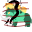

<!-- Generated by tools/build_pack_reference.py. Edit the pack sources and regenerate. -->

# Buta Buta no Mi, Model: Feng Xi

{ .entry-page-icon }

[Fruits](index.md) · [Akuma no Mi](../../reference/content/akuma.md)

<!-- fruit akuma:buta_buta_no_mi_model_feng_xi -->

| Stat | Value |
| --- | --- |
| Type | Mythical Zoan |
| Tier | 4 |
| Fruit damage scaling | 1.00× at 10,000 Doriki → 1.75× at 50,000 Doriki |
| Abilities | 6 (5 active, 1 passive) |
| Fruit boxes | [Noble Box](../fruit-boxes.md) |

See [damage calculations](../combat-stats.md#damage-from-doriki).

!!! note "Reading the stats"
    Listed base damage is for the named part of the move. Pack and Doriki multipliers are shown separately. Times assume 20 ticks per second.

<!-- move akuma:feng_xi_heavy_point -->

## Feng Xi Heavy Point

{ .entry-move-icon loading=lazy } *Active · Transformation*

Transforms the user into the nightmarish Feng Xi

| Stat | Value |
| --- | --- |
| Pack multiplier when dealing damage | 2× |

<!-- move akuma:wild_roar -->

## Wild Roar

{ .entry-move-icon loading=lazy } *Active*

The user lets out a massive roar that keeps damaging, pushing back and dizzying everything around them.

| Stat | Value |
| --- | --- |
| Cooldown | 40 s (800 ticks) |
| Base damage | 5 HP |
| Pack multiplier when dealing damage | 2× |

<!-- move akuma:hard_head -->

## Hard Head

{ .entry-move-icon loading=lazy } *Active*

The user charges up and rams their skull into a target, leaving them dizzy.

| Stat | Value |
| --- | --- |
| Cooldown | 15 s (300 ticks) |
| Base damage | 45 HP |
| Pack multiplier when dealing damage | 2× |

<!-- move akuma:tusk_raid -->

## Tusk Raid

{ .entry-move-icon loading=lazy } *Active*

The user rolls up into the air, draws their blade tusks and slams down on their target, making them bleed.

| Stat | Value |
| --- | --- |
| Cooldown | 15 s (300 ticks) |
| Base damage | 50 HP |
| Pack multiplier when dealing damage | 2× |

<!-- move akuma:tusk_blades -->

## Tusk Blades

{ .entry-move-icon loading=lazy } *Active*

Turns the user's tusks into blades, allowing them to use swordsman abilities and strike harder.

| Stat | Value |
| --- | --- |
| Base damage | 20 HP |
| Pack multiplier when dealing damage | 2× |

<!-- move akuma:feng_xi_immunities -->

## Feng Xi Immunities

*Passive*

| Stat | Value |
| --- | --- |
| Pack multiplier when dealing damage | 2× |

