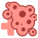

<!-- Generated by tools/build_pack_reference.py. Edit the pack sources and regenerate. -->

# Chiyu Chiyu no Mi

{ .entry-page-icon }

[Fruits](index.md) · [Mine Mine no Mi](../../reference/content/mineminenomi.md)

<!-- fruit mineminenomi:chiyu_chiyu_no_mi -->

| Stat | Value |
| --- | --- |
| Type | Paramecia |
| Tier | 1 |
| Fruit damage scaling | 1.00× at 10,000 Doriki → 2.25× at 50,000 Doriki |
| Abilities | 4 (3 active, 1 passive) |
| Fruit boxes | [Wooden Box](../fruit-boxes.md) |

See [damage calculations](../combat-stats.md#damage-from-doriki).

[Jump to awakening](#awakening)

!!! note "Reading the stats"
    Listed base damage is for the named part of the move. Pack and Doriki multipliers are shown separately. Times assume 20 ticks per second.

<!-- move mineminenomi:healing_touch -->

## Healing Touch

{ .entry-move-icon loading=lazy } *Active*

Touch the target to heal them

| Stat | Value |
| --- | --- |
| Cooldown | 10 s (200 ticks) |
| Pack multiplier when dealing damage | 2.8× |

<!-- move mineminenomi:chiyupopo -->

## Chiyupopo

{ .entry-move-icon loading=lazy } *Active*

Releases dandelions made of tears that temporarily increase the healing rate of those around the user. This can only be applied once per person.

| Stat | Value |
| --- | --- |
| Cooldown | 840 s (16800 ticks) |
| Pack multiplier when dealing damage | 2.8× |

<!-- move mineminenomi:kenpopo -->

## Kenpopo

{ .entry-move-icon loading=lazy } *Active*

Takes an ally's life force, transforming it into a Dandelion. Dandelions can be eaten for healing

| Stat | Value |
| --- | --- |
| Cooldown | 50 s (1000 ticks) |
| Pack multiplier when dealing damage | 2.8× |

<!-- move mineminenomi:tears -->

## Tears

{ .entry-move-icon loading=lazy } *Passive*

Each time the user is hurt their Watering Can has a 10% chance of being filled with a tear, which can be drank to heal themselves.

| Stat | Value |
| --- | --- |
| Pack multiplier when dealing damage | 2.8× |

## Awakening

**Source** · Awaken Awaken no Mi

| Stat | Value |
| --- | --- |
| Doriki | 40,000 |
| Active time with the fruit | About 24 hours (1,728,000 ticks) |

<!-- move awakenawakennomi:word_of_recovery -->

### Word of Recovery { #awakening-word-of-recovery }

{ .entry-move-icon loading=lazy } *Active*

The user heals a target with a single touch, restoring a huge amount of health.

| Stat | Value |
| --- | --- |
| Cooldown | 150 s (3000 ticks) |

<!-- move awakenawakennomi:cellular_overgrowth -->

### Cellular Overgrowth { #awakening-cellular-overgrowth }

{ .entry-move-icon loading=lazy } *Active*

Punches the target so their cells grow out of control, dealing damage based on their max health The target can't be healed by anything for a while.

| Stat | Value |
| --- | --- |
| Min damage | 40 HP |
| Cooldown | 30 s (600 ticks) |

<!-- move awakenawakennomi:overflow -->

### Overflow { #awakening-overflow }

{ .entry-move-icon loading=lazy } *Passive*

Healing that goes past full health on the user or nearby allies turns into absorption hearts Stacks up to 10 extra hearts.
