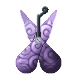

<!-- Generated by tools/build_pack_reference.py. Edit the pack sources and regenerate. -->

# Choki Choki no Mi

{ .entry-page-icon }

[Fruits](index.md) · [Missing Missing no Mi](../../reference/content/inomissing.md)

<!-- fruit inomissing:choki_choki_no_mi -->

| Stat | Value |
| --- | --- |
| Type | Paramecia |
| Tier | 1 |
| Fruit damage scaling | 1.00× at 10,000 Doriki → 2.25× at 50,000 Doriki |
| Abilities | 8 (7 active, 1 passive) |
| Fruit boxes | [Wooden Box](../fruit-boxes.md) |

See [damage calculations](../combat-stats.md#damage-from-doriki).

!!! note "Reading the stats"
    Listed base damage is for the named part of the move. Pack and Doriki multipliers are shown separately. Times assume 20 ticks per second.

<!-- move inomissing:hasami -->

## Hasami

{ .entry-move-icon loading=lazy } *Active*

Turns the user's hands into giant scissors. Punches cut the enemy, blocks are cut like paper, and the hands count as a sword.

| Stat | Value |
| --- | --- |
| Cooldown | 1 s (20 ticks) |
| Punch damage | 15 HP |
| Pack multiplier when dealing damage | 1.4× |

<!-- move inomissing:o_kanabashi -->

## O Kanabashi

{ .entry-move-icon loading=lazy } *Active*

While the scissors are active, the user dashes forward and cuts all enemies and blocks near them.

| Stat | Value |
| --- | --- |
| Base damage | 8 HP |
| Cooldown | 8 s (160 ticks) |
| Pack multiplier when dealing damage | 1.75× |

<!-- move inomissing:keep_out -->

## Keep Out

{ .entry-move-icon loading=lazy } *Active*

While the scissors are active, the user cuts up to 4 pieces of the ground and throws them one by one where they are looking. Harder blocks deal more damage.

| Stat | Value |
| --- | --- |
| Min damage | 3 HP |
| Max damage | 8 HP |
| Cooldown | 12 s (240 ticks) |
| Pack multiplier when dealing damage | 1.75× |

<!-- move inomissing:kirikabe -->

## Kirikabe

{ .entry-move-icon loading=lazy } *Active*

While the scissors are active, the user cuts the ground under them and raises it as a wall 9 blocks wide and 6 blocks tall. It goes back down after 10 seconds.

| Stat | Value |
| --- | --- |
| Cooldown | 15 s (300 ticks) |
| Pack multiplier when dealing damage | 1.75× |

<!-- move inomissing:kamikiri -->

## Kamikiri

{ .entry-move-icon loading=lazy } *Passive*

While the scissors are active, right clicking a block with an empty hand cuts it instantly. An iron door or trapdoor is picked open instead.

| Stat | Value |
| --- | --- |
| Pack multiplier when dealing damage | 1.75× |

<!-- move inomissing:dai_setsudan -->

## Dai Setsudan

{ .entry-move-icon loading=lazy } *Active*

While the scissors are active, the user closes both blades on the enemy in front of them and deals heavy damage.

| Stat | Value |
| --- | --- |
| Base damage | 18 HP |
| Cooldown | 10 s (200 ticks) |
| Pack multiplier when dealing damage | 1.75× |

<!-- move inomissing:kirisaki -->

## Kirisaki

{ .entry-move-icon loading=lazy } *Active*

While the scissors are active, the user cuts open the protections of the enemy in front of them. It loses a big part of its armor for a few seconds.

| Stat | Value |
| --- | --- |
| Base damage | 7 HP |
| Cooldown | 12 s (240 ticks) |
| Pack multiplier when dealing damage | 1.75× |

<!-- move inomissing:kami_hashi -->

## Kami Hashi

{ .entry-move-icon loading=lazy } *Active*

While the scissors are active, the user cuts a strip of the ground and unrolls it like paper toward where they are looking. It makes a bridge or a ramp that goes back down after 10 seconds.

| Stat | Value |
| --- | --- |
| Cooldown | 15 s (300 ticks) |
| Pack multiplier when dealing damage | 1.75× |

