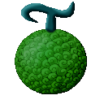

<!-- Generated by tools/build_pack_reference.py. Edit the pack sources and regenerate. -->

# Deka Deka no Mi

{ .entry-page-icon }

[Fruits](index.md) · [Mine Mine no Mi](../../reference/content/mineminenomi.md)

<!-- fruit mineminenomi:deka_deka_no_mi -->

| Stat | Value |
| --- | --- |
| Type | Paramecia |
| Tier | 1 |
| Fruit damage scaling | 1.00× at 10,000 Doriki → 2.25× at 50,000 Doriki |
| Abilities | 2 (1 active, 1 passive) |
| Fruit boxes | [Wooden Box](../fruit-boxes.md) |

See [damage calculations](../combat-stats.md#damage-from-doriki).

[Jump to awakening](#awakening)

After awakening, this fruit’s original damaging moves deal **1.5× damage**. The awakening techniques below have their own values.

!!! note "Reading the stats"
    Listed base damage is for the named part of the move. Pack and Doriki multipliers are shown separately. Times assume 20 ticks per second.

<!-- move mineminenomi:deka_deka -->

## Deka Deka

{ .entry-move-icon loading=lazy } *Active · Transformation*

Allows the user to increase their size to that of a giant.

| Stat | Value |
| --- | --- |
| Pack multiplier when dealing damage | 6× |

<!-- move mineminenomi:deka_trample -->

## Deka Trample

{ .entry-move-icon loading=lazy } *Passive*

Running speed increases with acceleration trampling any nearby entity.

| Stat | Value |
| --- | --- |
| Base damage | 8 HP |
| Pack multiplier when dealing damage | 6× |

## Awakening

**Source** · Awaken Awaken no Mi

| Stat | Value |
| --- | --- |
| Doriki | 40,000 |
| Active time with the fruit | About 24 hours (1,728,000 ticks) |

<!-- move awakenawakennomi:titan -->

### Titan { #awakening-titan }

{ .entry-move-icon loading=lazy } *Active · Transformation*

Allows the user to grow to the size of a Titan.

| Stat | Value |
| --- | --- |
| Cooldown | 0.5 s (10 ticks) |

**Stats while transformed**

| Stat | Value |
| --- | --- |
| Movement speed | +125% of base |
| Jump | +10 |
| Armor | +20 |
| Punch damage | +25 HP |
| Step height | +3 blocks |
| Toughness | +6 |

<!-- move awakenawakennomi:titan_trample -->

### Titan Trample { #awakening-titan-trample }

{ .entry-move-icon loading=lazy } *Passive*

Speeds up the user while running, trampling any nearby enemy.

| Stat | Value |
| --- | --- |
| Base damage | 7.2 HP |

<!-- move awakenawakennomi:titan_smash -->

### Titan Smash { #awakening-titan-smash }

{ .entry-move-icon loading=lazy } *Active*

Allows the user to smash the ground as a Titan

| Stat | Value |
| --- | --- |
| Cooldown | 60 s (1200 ticks) |

