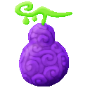
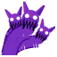

<!-- Generated by tools/build_pack_reference.py. Edit the pack sources and regenerate. -->

# Doku Doku no Mi

{ .entry-page-icon }

[Fruits](index.md) · [Mine Mine no Mi](../../reference/content/mineminenomi.md)

<!-- fruit mineminenomi:doku_doku_no_mi -->

| Stat | Value |
| --- | --- |
| Type | Paramecia |
| Tier | 3 |
| Fruit damage scaling | 1.00× at 10,000 Doriki → 1.75× at 50,000 Doriki |
| Abilities | 7 (6 active, 1 passive) |
| Fruit boxes | [Golden Box](../fruit-boxes.md) |

See [damage calculations](../combat-stats.md#damage-from-doriki).

[Jump to awakening](#awakening)

After awakening, this fruit’s original damaging moves deal **1.5× damage**. The awakening techniques below have their own values.

!!! note "Reading the stats"
    Listed base damage is for the named part of the move. Pack and Doriki multipliers are shown separately. Times assume 20 ticks per second.

<!-- move mineminenomi:hydra -->

## Hydra

{ .entry-move-icon loading=lazy } *Active*

Launches a dragon made out of liquid poison at the opponent

| Stat | Value |
| --- | --- |
| Cooldown | 5 s (100 ticks) |
| Pack multiplier when dealing damage | 1.25× |

<!-- move mineminenomi:chloro_ball -->

## Chloro Ball

{ .entry-move-icon loading=lazy } *Active*

The user spits a bubble made of poison toward the enemy, which also leaves poison on the ground.

| Stat | Value |
| --- | --- |
| Cooldown | 9 s (180 ticks) |
| Pack multiplier when dealing damage | 1.25× |

<!-- move mineminenomi:doku_fugu -->

## Doku Fugu

{ .entry-move-icon loading=lazy } *Active*

The user covers themselves in poison creating a thin protective layer to damage. Cannot be used while %s is active.

| Stat | Value |
| --- | --- |
| Cooldown | 30 s (600 ticks) |
| Pack multiplier when dealing damage | 1.25× |

<!-- move mineminenomi:venom_road -->

## Venom Road

{ .entry-move-icon loading=lazy } *Active*

Fires a Hydra at the target location that stays there for a few seconds during which time the user can use them to move along their path.

| Stat | Value |
| --- | --- |
| Cooldown | 4 s (80 ticks) |
| Pack multiplier when dealing damage | 1.25× |

<!-- move mineminenomi:doku_gumo -->

## Doku Gumo

{ .entry-move-icon loading=lazy } *Active*

Creates a dense cloud of poisonous smoke, which moves along with the user and poisons and blinds everyone inside.

| Stat | Value |
| --- | --- |
| Cooldown | 30 s (600 ticks) |
| Pack multiplier when dealing damage | 1.25× |

<!-- move mineminenomi:venom_demon -->

## Venom Demon

{ .entry-move-icon loading=lazy } *Active · Transformation*

The user coats themselves in layers of strong corrosive venom, becoming a Venom Demon and leaving a highly poisonous trail. Also enhances all Posion abilities.

| Stat | Value |
| --- | --- |
| Cooldown | 100 s (2000 ticks) |
| Pack multiplier when dealing damage | 1.25× |

<!-- move mineminenomi:poison_immunities -->

## Poison Immunities

*Passive*

| Stat | Value |
| --- | --- |
| Pack multiplier when dealing damage | 1.25× |

## Awakening

**Source** · Awaken Awaken no Mi

| Stat | Value |
| --- | --- |
| Doriki | 40,000 |
| Active time with the fruit | About 24 hours (1,728,000 ticks) |

<!-- move awakenawakennomi:venom_world -->

### Venom World { #awakening-venom-world }

{ .entry-move-icon loading=lazy } *Active*

Floods the ground around the user with venom that poisons enemies who walk on it For a minute, enemies standing in the venom are dosed again every second.

| Stat | Value |
| --- | --- |
| Cooldown | 50 s (1000 ticks) |

<!-- move awakenawakennomi:compound_hydra -->

### Compound Hydra { #awakening-compound-hydra }

{ .entry-move-icon loading=lazy } *Active*

Fires a bunch of venom hydras one after another from different spots, poisoning every enemy they hit.

| Stat | Value |
| --- | --- |
| Cooldown | 45 s (900 ticks) |
| Base damage | 30 HP |
| Demon damage | 40 HP |

<!-- move awakenawakennomi:virulence -->

### Virulence { #awakening-virulence }

{ .entry-move-icon loading=lazy } *Passive*

Every new dose of poison on an enemy that is already poisoned raises the poison by one level. It can go up to the max poison level.
