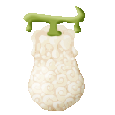
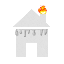

<!-- Generated by tools/build_pack_reference.py. Edit the pack sources and regenerate. -->

# Doru Doru no Mi

{ .entry-page-icon }

[Fruits](index.md) · [Mine Mine no Mi](../../reference/content/mineminenomi.md)

<!-- fruit mineminenomi:doru_doru_no_mi -->

| Stat | Value |
| --- | --- |
| Type | Paramecia |
| Tier | 2 |
| Fruit damage scaling | 1.00× at 10,000 Doriki → 2× at 50,000 Doriki |
| Abilities | 9 (9 active, 0 passive) |
| Fruit boxes | [Iron Box](../fruit-boxes.md) |

See [damage calculations](../combat-stats.md#damage-from-doriki).

[Jump to awakening](#awakening)

!!! note "Reading the stats"
    Listed base damage is for the named part of the move. Pack and Doriki multipliers are shown separately. Times assume 20 ticks per second.

<!-- move mineminenomi:candle_wall -->

## Candle Wall

{ .entry-move-icon loading=lazy } *Active*

Creates a wax wall in front of the user

| Stat | Value |
| --- | --- |
| Cooldown | 6 s (120 ticks) |
| Pack multiplier when dealing damage | 4.5× |

<!-- move mineminenomi:candle_house -->

## Candle House

{ .entry-move-icon loading=lazy } *Active*

Creates a big house-like structure made of wax, to protect the user

| Stat | Value |
| --- | --- |
| Cooldown | 50 s (1000 ticks) |
| Pack multiplier when dealing damage | 4.5× |

<!-- move mineminenomi:doru_doru_arts_mori -->

## Doru Doru Arts: Mori

{ .entry-move-icon loading=lazy } *Active*

The user fires a harpoon made of wax at the opponent.

| Stat | Value |
| --- | --- |
| Cooldown | 4 s (80 ticks) |
| Pack multiplier when dealing damage | 2.75× |

<!-- move mineminenomi:doru_doru_arts_ken -->

## Doru Doru Arts: Ken

{ .entry-move-icon loading=lazy } *Active*

The user uses hardened wax to create a sword

| Stat | Value |
| --- | --- |
| Pack multiplier when dealing damage | 4.5× |

<!-- move mineminenomi:candle_lock -->

## Candle Lock

{ .entry-move-icon loading=lazy } *Active*

Traps the opponent's feet in hardened wax, which makes them unable to move

| Stat | Value |
| --- | --- |
| Cooldown | 12 s (240 ticks) |
| Pack multiplier when dealing damage | 4.5× |

<!-- move mineminenomi:doru_doru_arts_pickaxe -->

## Doru Doru Arts: Pickaxe

{ .entry-move-icon loading=lazy } *Active*

The user uses hardened wax to create a pickaxe

| Stat | Value |
| --- | --- |
| Cooldown | 0.5 s (10 ticks) |
| Pack multiplier when dealing damage | 4.5× |

<!-- move mineminenomi:doru_doru_ball -->

## Doru Doru Ball

{ .entry-move-icon loading=lazy } *Active*

Puts the user into a hardened wax ball for max defense

| Stat | Value |
| --- | --- |
| Min cooldown | 1.5 s (30 ticks) |
| Max cooldown | 11.5 s (230 ticks) |
| Pack multiplier when dealing damage | 4.5× |

<!-- move mineminenomi:doru_doru_no_yakata -->

## Doru Doru no Yakata

{ .entry-move-icon loading=lazy } *Active*

The user creates a few wax copies of themselves (Use the Color Palette for color on the clones)

| Stat | Value |
| --- | --- |
| Cooldown | 40 s (800 ticks) |
| Pack multiplier when dealing damage | 4.5× |

<!-- move mineminenomi:candle_champion -->

## Candle Champion

{ .entry-move-icon loading=lazy } *Active · Transformation*

The user covers themselves in a thick wax coating, creating a battle suit protecting the user and increasing their offensive capabilities. While active transforms Doru Doru Arts: Mori into Champ Fight

| Stat | Value |
| --- | --- |
| Min cooldown | 2 s (40 ticks) |
| Max cooldown | 62 s (1240 ticks) |
| Pack multiplier when dealing damage | 4.5× |

## Awakening

**Source** · Awaken Awaken no Mi

| Stat | Value |
| --- | --- |
| Doriki | 40,000 |
| Active time with the fruit | About 24 hours (1,728,000 ticks) |

<!-- move awakenawakennomi:candle_world -->

### Candle World { #awakening-candle-world }

{ .entry-move-icon loading=lazy } *Active*

Turns the area into hot wax that slows and burns enemies, then hardens and traps them

| Stat | Value |
| --- | --- |
| Cooldown | 120 s (2400 ticks) |
| Burn damage | 6 HP |

<!-- move awakenawakennomi:wax_master -->

### Wax Master { #awakening-wax-master }

{ .entry-move-icon loading=lazy } *Passive*

The user is not slowed or trapped by soft wax blocks. Standing on any wax makes the user faster.

<!-- move awakenawakennomi:wick -->

### Wick { #awakening-wick }

{ .entry-move-icon loading=lazy } *Active*

Sets the wax around every enemy nearby alight. The more wax surrounds them, the harder the flames hit.

| Stat | Value |
| --- | --- |
| Cooldown | 30 s (600 ticks) |
| Aborted cooldown | 3 s (60 ticks) |
| Base damage | 30 HP |
| Max damage | 90 HP |

