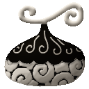

<!-- Generated by tools/build_pack_reference.py. Edit the pack sources and regenerate. -->

# Fude Fude no Mi

{ .entry-page-icon }

[Fruits](index.md) · [Missing Missing no Mi](../../reference/content/inomissing.md)

<!-- fruit inomissing:fude_fude_no_mi -->

| Stat | Value |
| --- | --- |
| Type | Paramecia |
| Tier | 2 |
| Fruit damage scaling | 1.00× at 10,000 Doriki → 2× at 50,000 Doriki |
| Abilities | 10 (9 active, 1 passive) |
| Fruit boxes | [Iron Box](../fruit-boxes.md) |

See [damage calculations](../combat-stats.md#damage-from-doriki).

!!! note "Reading the stats"
    Listed base damage is for the named part of the move. Pack and Doriki multipliers are shown separately. Times assume 20 ticks per second.

<!-- move inomissing:ink -->

## Ink

{ .entry-move-icon loading=lazy } *Passive*

The user's body makes ink, and what they draw with it becomes real. Every drawing is first traced flat on the ground, then comes to life after a short moment. A living drawing holds a part of the user's ink until it dissolves. Drawings dissolve in water

| Stat | Value |
| --- | --- |
| Pack multiplier when dealing damage | 2.2× |

<!-- move inomissing:nuke_suzume -->

## Nuke Suzume

{ .entry-move-icon loading=lazy } *Active*

The user draws a great crane of ink on the ground in front of them. After a short moment it comes to life with the user on its back and flies where they look, for 60 seconds at most. Using the ability again dissolves the crane. It also dissolves in water

| Stat | Value |
| --- | --- |
| Cooldown | 25 s (500 ticks) |
| Pack multiplier when dealing damage | 2.2× |

<!-- move inomissing:nobori_ryu -->

## Nobori Ryu

{ .entry-move-icon loading=lazy } *Active*

The user draws a long dragon of ink on the ground in front of them. After a short moment it comes to life with the user on its back, for 60 seconds at most. It can't fly, but it climbs any wall it is ridden against. Using the ability again dissolves the dragon. It also dissolves in water

| Stat | Value |
| --- | --- |
| Cooldown | 25 s (500 ticks) |
| Pack multiplier when dealing damage | 2.2× |

<!-- move inomissing:kazenbo -->

## Kazenbo

{ .entry-move-icon loading=lazy } *Active*

The user draws a huge ghost of ink wreathed in flames on the ground in front of them. After a short moment it comes to life, for 40 seconds at most, it floats to the user's enemies through walls, damages every second the ones it touches and sets them on fire. Using the ability again dissolves the ghost. It also dissolves in water

| Stat | Value |
| --- | --- |
| Cooldown | 45 s (900 ticks) |
| Pack multiplier when dealing damage | 2.2× |

<!-- move inomissing:ink_double -->

## Ink Double

{ .entry-move-icon loading=lazy } *Active*

The user draws a copy of themselves in ink on the ground in front of them. After a short moment it comes to life and stands there under their name, for 30 seconds at most, the monsters that see it attack it instead of the user. When it is destroyed it bursts into ink and blinds everyone near it. Using the ability again dissolves the copy. It also dissolves in water

| Stat | Value |
| --- | --- |
| Cooldown | 20 s (400 ticks) |
| Pack multiplier when dealing damage | 2.2× |

<!-- move inomissing:sumigumo -->

## Sumigumo

{ .entry-move-icon loading=lazy } *Active*

The user draws a cloud of ink on the ground where they are looking. After a short moment it rises and spreads above that place for 15 seconds, the enemies under it are blinded and monsters lose track of their targets. Using the ability again is Ukiyo Yudachi Ezu, for 3 seconds the cloud rains arrows of ink on every enemy under it, then it dissolves

| Stat | Value |
| --- | --- |
| Cooldown | 25 s (500 ticks) |
| Conditional cooldown | 0.5 s (10 ticks) |
| Pack multiplier when dealing damage | 2.2× |

<!-- move inomissing:flat_hiding -->

## Flat Hiding

{ .entry-move-icon loading=lazy } *Active · Transformation*

The user flattens against the wall beside them and becomes a drawing on it, for 30 seconds at most. Monsters lose track of them and their name can't be seen. Moving, attacking, being hit or using another ability ends it

| Stat | Value |
| --- | --- |
| Cooldown | 15 s (300 ticks) |
| Pack multiplier when dealing damage | 2.2× |

<!-- move inomissing:ink_weapon -->

## Ink Weapon

*Active*

The user draws a weapon of ink in their hand, for 60 seconds at most. The weapon dissolves if it leaves the user's hands, or in water The sabre is the quick weapon. The spear is slower and reaches further.

| Stat | Value |
| --- | --- |
| Cooldown | 10 s (200 ticks) |
| Pack multiplier when dealing damage | 2.2× |

<!-- move inomissing:ink_food -->

## Ink Food

{ .entry-move-icon loading=lazy } *Active*

The user draws 3 dango of ink. They feed whoever eats them but taste bad, and dissolve after 3 minutes.

| Stat | Value |
| --- | --- |
| Cooldown | 30 s (600 ticks) |
| Pack multiplier when dealing damage | 2.2× |

<!-- move inomissing:ink_snakes -->

## Ink Snakes

{ .entry-move-icon loading=lazy } *Active*

The user draws 2 snakes of ink on the ground under the enemy they are looking at. After a short moment the snakes come to life and coil around the nearest enemy, it can't move and is squeezed 4 times. The snakes let go in water

| Stat | Value |
| --- | --- |
| Cooldown | 16 s (320 ticks) |
| Conditional cooldown | 0.5 s (10 ticks) |
| Pack multiplier when dealing damage | 2.2× |

