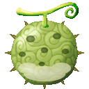
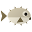
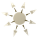
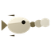
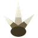

<!-- Generated by tools/build_pack_reference.py. Edit the pack sources and regenerate. -->

# Fugu Fugu no Mi, Model: Pufferfish

{ .entry-page-icon }

[Fruits](index.md) · [InoFruits](../../reference/content/inofruits.md)

<!-- fruit inofruits:fugu_fugu_no_mi_model_pufferfish -->

| Stat | Value |
| --- | --- |
| Type | Zoan |
| Tier | 1 |
| Fruit damage scaling | 1.00× at 10,000 Doriki → 2.25× at 50,000 Doriki |
| Abilities | 7 (5 active, 2 passive) |
| Fruit boxes | [Wooden Box](../fruit-boxes.md) |

See [damage calculations](../combat-stats.md#damage-from-doriki).

!!! note "Reading the stats"
    Listed base damage is for the named part of the move. Pack and Doriki multipliers are shown separately. Times assume 20 ticks per second.

<!-- move inofruits:fugu_fugu_guard_point -->

## Fugu Fugu Guard Point

{ .entry-move-icon loading=lazy } *Active · Transformation*

Transforms the user into a pufferfish, which focuses on defense, good underwater but too round for most doors.

| Stat | Value |
| --- | --- |
| Pack multiplier when dealing damage | 3× |

**Stats while transformed**

| Stat | Value |
| --- | --- |
| Movement speed | -30% of base |
| Step height | +0.3 blocks |
| Armour | +3 |
| Toughness | +1 |
| Punch damage | +2 HP |

<!-- move inofruits:fugu_fugu_heavy_point -->

## Fugu Fugu Heavy Point

{ .entry-move-icon loading=lazy } *Active · Transformation*

Covers the user's chest, arms and legs in spiky pufferfish skin

| Stat | Value |
| --- | --- |
| Pack multiplier when dealing damage | 3× |

**Stats while transformed**

| Stat | Value |
| --- | --- |
| Movement speed | -35% of base |
| Armour | +6 |
| Toughness | +2 |
| Punch damage | +4 HP |

<!-- move inofruits:bocho -->

## Bocho

{ .entry-move-icon loading=lazy } *Active*

The user puffs up into a spiky ball, pushing everything nearby away. The hybrid's belly is bigger, pushing things away from further

| Stat | Value |
| --- | --- |
| Burst damage | 6 HP |
| Amplified burst damage | 9 HP |
| Contact damage | 2 HP |
| Amplified contact damage | 3 HP |
| Cooldown | 15 s (300 ticks) |
| Pack multiplier when dealing damage | 3× |

<!-- move inofruits:togeuchi -->

## Togeuchi

{ .entry-move-icon loading=lazy } *Active*

The user shoots a ring of spines out of their body in every direction. The hybrid's belly throws more spines, and they hit harder

| Stat | Value |
| --- | --- |
| Cooldown | 8 s (160 ticks) |
| Pack multiplier when dealing damage | 3× |

<!-- move inofruits:hosui -->

## Hosui

{ .entry-move-icon loading=lazy } *Active*

The user blows out a jet of air that throws them backwards.

| Stat | Value |
| --- | --- |
| Cooldown | 7 s (140 ticks) |
| Pack multiplier when dealing damage | 3× |

<!-- move inofruits:toge -->

## Toge

{ .entry-move-icon loading=lazy } *Passive*

Enemies hitting the user in melee while in a form take some of the damage back.

| Stat | Value |
| --- | --- |
| Pack multiplier when dealing damage | 3× |

<!-- move inofruits:doku -->

## Doku

{ .entry-move-icon loading=lazy } *Passive*

While in a form, anyone the user hits and anyone hitting the user gets poisoned.

| Stat | Value |
| --- | --- |
| Pack multiplier when dealing damage | 3× |

