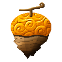
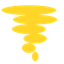

<!-- Generated by tools/build_pack_reference.py. Edit the pack sources and regenerate. -->

# Fuwa Fuwa no Mi

{ .entry-page-icon }

[Fruits](index.md) · [Missing Missing no Mi](../../reference/content/inomissing.md)

<!-- fruit inomissing:fuwa_fuwa_no_mi -->

| Stat | Value |
| --- | --- |
| Type | Paramecia |
| Tier | 3 |
| Fruit damage scaling | 1.00× at 10,000 Doriki → 1.75× at 50,000 Doriki |
| Abilities | 9 (8 active, 1 passive) |
| Fruit boxes | [Golden Box](../fruit-boxes.md) |

See [damage calculations](../combat-stats.md#damage-from-doriki).

!!! note "Reading the stats"
    Listed base damage is for the named part of the move. Pack and Doriki multipliers are shown separately. Times assume 20 ticks per second.

<!-- move inomissing:fuyu -->

## Fuyu

{ .entry-move-icon loading=lazy } *Passive*

The user makes themselves weightless allowing them to fly, the speed is higher while not in combat

| Stat | Value |
| --- | --- |
| Pack multiplier when dealing damage | 1.45× |

<!-- move inomissing:item_kaiten -->

## Item Kaiten

{ .entry-move-icon loading=lazy } *Active*

The user takes up to 6 blocks from the ground that will float and spin around them. Each block stops one projectile, taking a melee hit drops all of them. Use it again to shoot one of the blocks where the user is looking at. The block stays where it lands. If used while crouching, drops all the blocks. The cooldown starts once no block is left.

| Stat | Value |
| --- | --- |
| Cooldown | 5 s (100 ticks) |
| Base damage | 8 HP |
| Conditional cooldown | 0.5 s (10 ticks) |
| Pack multiplier when dealing damage | 1.2× |

<!-- move inomissing:shishi_odoshi -->

## Shishi Odoshi

{ .entry-move-icon loading=lazy } *Active*

The user shapes the ground into lion heads that charge forward. Can be used while flying close to the ground Shishi Odoshi makes 3 lion heads, each one bites the first enemy it hits and sends it flying Colossal Shishi Odoshi takes a long time to call up one giant lion head out of the ground, the user can barely move meanwhile. It goes through everything in its way and crush every enemy it runs over

| Stat | Value |
| --- | --- |
| Base damage | 18 HP |
| Cooldown | 10 s (200 ticks) |
| Giant damage | 50 HP |
| Giant cooldown | 45 s (900 ticks) |
| Pack multiplier when dealing damage | 1.45× |

<!-- move inomissing:chimaki -->

## Shishi Odoshi: Chimaki

{ .entry-move-icon loading=lazy } *Active*

The ground where the user is looking at buries up to 4 enemies into a spiral of earth, they can't move, attack or use abilities. On snow the enemies are also frozen. Use the ability again to drop a boulder on each buried enemy

| Stat | Value |
| --- | --- |
| Seize damage | 10 HP |
| Boulder damage | 30 HP |
| Cooldown | 20 s (400 ticks) |
| Pack multiplier when dealing damage | 1.45× |

<!-- move inomissing:zanpa -->

## Zanpa

{ .entry-move-icon loading=lazy } *Active*

Can only be used near water or during rain. Traps the enemy the user is looking at inside a floating sphere of water, where it drowns. Devil Fruit users lose their powers inside and drown 2 times faster.

| Stat | Value |
| --- | --- |
| Base damage | 6 HP |
| Cooldown | 25 s (500 ticks) |
| Pack multiplier when dealing damage | 1.45× |

<!-- move inomissing:shishi_funjin -->

## Shishi Funjin

{ .entry-move-icon loading=lazy } *Active*

The user shoots 5 rock shards from their palms in a fan shape. Can be used while flying close to the ground

| Stat | Value |
| --- | --- |
| Base damage | 9 HP |
| Cooldown | 8 s (160 ticks) |
| Pack multiplier when dealing damage | 1.45× |

<!-- move inomissing:ryuki -->

## Ryuki

{ .entry-move-icon loading=lazy } *Active*

The user puts their palm on the ground making it erupt, damaging and pushing back all nearby enemies while the user is launched into the air.

| Stat | Value |
| --- | --- |
| Base damage | 18 HP |
| Cooldown | 12 s (240 ticks) |
| Pack multiplier when dealing damage | 1.45× |

<!-- move inomissing:tatsumaki -->

## Tatsumaki

{ .entry-move-icon loading=lazy } *Active*

The user spins and rises into the air, taking all nearby enemies with them which are hit 5 times and then dropped. The floating blocks around the user increases the damage

| Stat | Value |
| --- | --- |
| Base damage | 5 HP |
| Cooldown | 14 s (280 ticks) |
| Pack multiplier when dealing damage | 1.45× |

<!-- move inomissing:fusen -->

## Fusen

{ .entry-move-icon loading=lazy } *Active*

The boat the user is sitting in becomes weightless and flies where they are looking, together with its passengers. The boat falls if the user leaves it or loses their powers.

| Stat | Value |
| --- | --- |
| Cooldown | 2 s (40 ticks) |
| Pack multiplier when dealing damage | 1.45× |

