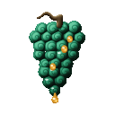
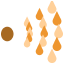
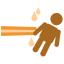

<!-- Generated by tools/build_pack_reference.py. Edit the pack sources and regenerate. -->

# Gabu Gabu no Mi

{ .entry-page-icon }

[Fruits](index.md) · [Missing Missing no Mi](../../reference/content/inomissing.md)

<!-- fruit inomissing:gabu_gabu_no_mi -->

| Stat | Value |
| --- | --- |
| Type | Paramecia |
| Tier | 1 |
| Fruit damage scaling | 1.00× at 10,000 Doriki → 2.25× at 50,000 Doriki |
| Abilities | 6 (5 active, 1 passive) |
| Fruit boxes | [Wooden Box](../fruit-boxes.md) |

See [damage calculations](../combat-stats.md#damage-from-doriki).

!!! note "Reading the stats"
    Listed base damage is for the named part of the move. Pack and Doriki multipliers are shown separately. Times assume 20 ticks per second.

<!-- move inomissing:gabu_suiken -->

## Suiken

{ .entry-move-icon loading=lazy } *Passive*

The user fists are soaked in liquor, a bare hand blow make the enemy a little drunk Drunk enemies walk crooked, very drunk they miss some blows and shots and when too drunk they fall asleep until hit. A hangover follow

<!-- move inomissing:gabu_shugo_roppu -->

## Shugo Roppu

{ .entry-move-icon loading=lazy } *Active*

After a great gulp the user breathes a stream of burning liquor in front of them that burns every enemy it swallows

| Stat | Value |
| --- | --- |
| Cooldown | 15 s (300 ticks) |

<!-- move inomissing:gabu_sake_shibuki -->

## Sake Shibuki

{ .entry-move-icon loading=lazy } *Active*

The user spits liquor over the enemies in front of them, they get drunk

| Stat | Value |
| --- | --- |
| Cooldown | 8 s (160 ticks) |
| Conditional cooldown | 0.5 s (10 ticks) |

<!-- move inomissing:gabu_shuki -->

## Shuki

{ .entry-move-icon loading=lazy } *Active*

The user breathes a cloud of liquor fumes where they look. Enemies in it get more drunk the longer they stay

| Stat | Value |
| --- | --- |
| Cooldown | 20 s (400 ticks) |

<!-- move inomissing:gabu_sakedeppo -->

## Sakedeppo

{ .entry-move-icon loading=lazy } *Active*

The user shoots a jet of liquor at the enemy they look at, it push them back and make them very drunk

| Stat | Value |
| --- | --- |
| Base damage | 6 HP |
| Cooldown | 12 s (240 ticks) |
| Conditional cooldown | 0.5 s (10 ticks) |

<!-- move inomissing:gabu_tokkuri -->

## Tokkuri

{ .entry-move-icon loading=lazy } *Active*

The user fills the empty glass bottles of their inventory with liquor. A bottle is thrown to make enemies drunk, or drunk while crouching to heal

| Stat | Value |
| --- | --- |
| Cooldown | 30 s (600 ticks) |
| Conditional cooldown | 0.5 s (10 ticks) |

