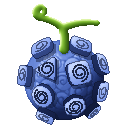
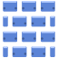
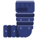
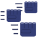

<!-- Generated by tools/build_pack_reference.py. Edit the pack sources and regenerate. -->

# Gasha Gasha no Mi

{ .entry-page-icon }

[Fruits](index.md) · [Missing Missing no Mi](../../reference/content/inomissing.md)

<!-- fruit inomissing:gasha_gasha_no_mi -->

| Stat | Value |
| --- | --- |
| Type | Paramecia |
| Tier | 3 |
| Fruit damage scaling | 1.00× at 10,000 Doriki → 1.75× at 50,000 Doriki |
| Abilities | 11 (10 active, 1 passive) |
| Fruit boxes | [Golden Box](../fruit-boxes.md) |

See [damage calculations](../combat-stats.md#damage-from-doriki).

!!! note "Reading the stats"
    Listed base damage is for the named part of the move. Pack and Doriki multipliers are shown separately. Times assume 20 ticks per second.

<!-- move inomissing:desmontar -->

## Desmontar

{ .entry-move-icon loading=lazy } *Active*

Breaks the crafted block or the dropped item the user is looking at into half the ingredients of its recipe, rounded down. A damaged item gives fewer ingredients. A thing that can be made in more than one way does not come apart.

| Stat | Value |
| --- | --- |
| Cooldown | 2 s (40 ticks) |

<!-- move inomissing:taller -->

## Taller

{ .entry-move-icon loading=lazy } *Active*

Opens a crafting table anywhere. If used while crouching, repairs the item in the user's hand with its material from the inventory, with no anvil or experience needed.

| Stat | Value |
| --- | --- |
| Cooldown | 1 s (20 ticks) |

<!-- move inomissing:muralla -->

## Muralla

{ .entry-move-icon loading=lazy } *Active*

The user creates a big wall where they are looking, made from the ground blocks, which sends the enemies near it flying. The wall stops enemies and projectiles and disappears after 10 seconds. Using the ability again brings the wall down.

| Stat | Value |
| --- | --- |
| Cooldown | 12 s (240 ticks) |

<!-- move inomissing:canon_armado -->

## Cañón Armado

{ .entry-move-icon loading=lazy } *Active*

Transforms the user's arm into a cannon. While active, holding right click with an empty hand shoots the first ammo found in the inventory (TNT, gunpowder, bullets, cannon balls or arrows). Use the ability again to remove the cannon. Making the cannon takes metal blocks near the user, or 2 iron ingots from the inventory.

| Stat | Value |
| --- | --- |
| Tnt damage | 20 HP |
| Powder damage | 12 HP |
| Cooldown | 2 s (40 ticks) |

<!-- move inomissing:torreta -->

## Torreta

{ .entry-move-icon loading=lazy } *Active*

Creates a turret where the user is looking and loads it with up to 32 bullets from the inventory. The turret shoots the closest enemy every second, for 1 minute or until it has no more bullets or is destroyed. The unused bullets are given back to the user. Only one turret can be active. Building the turret takes metal blocks near the user, or 4 iron ingots and 2 gunpowder from the inventory.

| Stat | Value |
| --- | --- |
| Cooldown | 30 s (600 ticks) |
| Conditional cooldown | 0.5 s (10 ticks) |

<!-- move inomissing:soldado -->

## Soldado

{ .entry-move-icon loading=lazy } *Active*

Creates a soldier made of scrap in front of the user, which follows them and attacks their enemies for 90 seconds. A broken soldier comes back after 10 seconds as long as the ability is active. Only one soldier can be active. Building the soldier takes metal blocks near the user, or 6 iron ingots and 2 copper ingots from the inventory, also each time it comes back.

| Stat | Value |
| --- | --- |
| Cooldown | 60 s (1200 ticks) |

<!-- move inomissing:union_armado -->

## Unión Armado

{ .entry-move-icon loading=lazy } *Active*

The user creates a giant mech around them, increasing the damage and the range of their punches and their armor, but making them slower. The size can be changed before using it. The colossus looks like the ground it was made on, lasts less and has a longer cooldown. Building the mech takes metal blocks near the user, or 8 iron ingots and 2 copper ingots from the inventory.

| Stat | Value |
| --- | --- |
| Least cooldown | 0.01 s (0.2 ticks) |

**Stats while transformed**

| Stat | Value |
| --- | --- |
| Step height | +1 blocks |

<!-- move inomissing:ultimate_faust -->

## Ultimate Faust

{ .entry-move-icon loading=lazy } *Active*

While in the colossus form, the user pulls back their fist and then smashes it where they are looking, damaging all enemies around the impact and sending them flying. Deals more damage while Busoshoku Haki is active.

| Stat | Value |
| --- | --- |
| Base damage | 80 HP |
| Cooldown | 40 s (800 ticks) |

<!-- move inomissing:blindado -->

## Blindado

{ .entry-move-icon loading=lazy } *Active · Transformation*

The user's arms get bigger with scrap and Busoshoku Haki, increasing their punch damage, armor and speed. Growing the arms takes metal blocks near the user, or 3 iron ingots from the inventory.

| Stat | Value |
| --- | --- |
| Cooldown | 60 s (1200 ticks) |

**Stats while transformed**

| Stat | Value |
| --- | --- |
| Punch damage | +12 HP |
| Armor | +8 |

<!-- move inomissing:det_sterkeste_strike -->

## Det Sterkeste Strike

{ .entry-move-icon loading=lazy } *Active*

The user launches 8 fast punches in 2 seconds hitting all enemies in front of them, the last punch sends them flying.

| Stat | Value |
| --- | --- |
| Base damage | 10 HP |
| Cooldown | 20 s (400 ticks) |

<!-- move inomissing:gasha_parts -->

## Scrap Parts

{ .entry-move-icon loading=lazy } *Passive*

Shows the iron ingots, copper ingots and gunpowder the user carries, in green when there are enough metal blocks around them to build for free. Soldado costs 6 iron and 2 copper, Torreta 4 iron and 2 gunpowder, Cañón Armado 2 iron, Blindado 3 iron, and Unión Armado (the mech or the colossus) 8 iron and 2 copper. Muralla is free.
