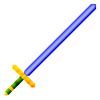
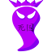
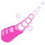

<!-- Generated by tools/build_pack_reference.py. Edit the pack sources and regenerate. -->

# Gasu Gasu no Mi

{ .entry-page-icon }

[Fruits](index.md) · [Mine Mine no Mi](../../reference/content/mineminenomi.md)

<!-- fruit mineminenomi:gasu_gasu_no_mi -->

| Stat | Value |
| --- | --- |
| Type | Logia |
| Tier | 3 |
| Fruit damage scaling | 1.00× at 10,000 Doriki → 1.75× at 50,000 Doriki |
| Abilities | 10 (6 active, 4 passive) |
| Fruit boxes | [Golden Box](../fruit-boxes.md) |

See [damage calculations](../combat-stats.md#damage-from-doriki).

[Jump to awakening](#awakening)

After awakening, this fruit’s original damaging moves deal **1.5× damage**. The awakening techniques below have their own values.

!!! note "Reading the stats"
    Listed base damage is for the named part of the move. Pack and Doriki multipliers are shown separately. Times assume 20 ticks per second.

<!-- move mineminenomi:gas_robe -->

## Gas Robe

{ .entry-move-icon loading=lazy } *Active*

Launches a cloud of poisonous gas at the opponent

| Stat | Value |
| --- | --- |
| Cooldown | 10 s (200 ticks) |
| Pack multiplier when dealing damage | 4.15× |

<!-- move mineminenomi:gastanet -->

## Gastanet

{ .entry-move-icon loading=lazy } *Active*

The user creates an explosion by detonating gas with their hands poisoning every enemy around the user. If %s is active the nearby entities will instead get affected by whatever effect the user has at the moment. Allies will receive benefic effects while enemies will receive negative effects.

| Stat | Value |
| --- | --- |
| Cooldown | 8 s (160 ticks) |
| Pack multiplier when dealing damage | 4.15× |

<!-- move mineminenomi:gastille -->

## Gastille

{ .entry-move-icon loading=lazy } *Active*

Shoots a beam of lit gas from the users mouth, that explodes on impact If %s is active a bigger and more destructive laser will be shot.

| Stat | Value |
| --- | --- |
| Cooldown | 15 s (300 ticks) |
| Pack multiplier when dealing damage | 4.15× |

<!-- move mineminenomi:blue_sword -->

## Blue Sword

{ .entry-move-icon loading=lazy } *Passive*

Fills a %s hilt with flamable gas, then sets it on fire to create a sword

| Stat | Value |
| --- | --- |
| Pack multiplier when dealing damage | 4.15× |

<!-- move mineminenomi:karakuni -->

## Karakuni

{ .entry-move-icon loading=lazy } *Active*

Removes the oxygen around the user, suffocating and weakening everyone in the vicinity

| Stat | Value |
| --- | --- |
| Cooldown | 30 s (600 ticks) |
| Pack multiplier when dealing damage | 4.15× |

<!-- move mineminenomi:shinokuni -->

## Shinokuni

{ .entry-move-icon loading=lazy } *Active · Transformation*

Transforms into a gas giant releasing an area of effect gas near the user based on whatever %s the user holds when transforming. If %s is active the nearby entities will instead get affected by whatever effect the user has at the moment. Allies will receive benefic effects while enemies will receive negative effects.

| Stat | Value |
| --- | --- |
| Min cooldown | 5 s (100 ticks) |
| Max cooldown | 15 s (300 ticks) |
| Pack multiplier when dealing damage | 4.15× |

<!-- move mineminenomi:koro -->

## Koro

{ .entry-move-icon loading=lazy } *Active*

Removes all poison from self and nearby allies. If used while %s is active, it'll remove all harmful effects for self and nearby allies.

| Stat | Value |
| --- | --- |
| Cooldown | 20 s (400 ticks) |
| Pack multiplier when dealing damage | 4.15× |

<!-- move mineminenomi:gasu_special_fly -->

## Gasu Special Fly

*Passive*

Allows the user to fly

| Stat | Value |
| --- | --- |
| Pack multiplier when dealing damage | 4.15× |

<!-- move mineminenomi:gasu_immunities -->

## Gasu Immunities

*Passive*

| Stat | Value |
| --- | --- |
| Pack multiplier when dealing damage | 4.15× |

<!-- move mineminenomi:logia_invulnerability_gasu -->

## Logia Invulnerability Gasu

{ .entry-move-icon loading=lazy } *Passive*

| Stat | Value |
| --- | --- |
| Pack multiplier when dealing damage | 4.15× |

## Awakening

**Source** · Awaken Awaken no Mi

| Stat | Value |
| --- | --- |
| Doriki | 40,000 |
| Active time with the fruit | About 24 hours (1,728,000 ticks) |

<!-- move awakenawakennomi:taiki -->

### Taiki { #awakening-taiki }

{ .entry-move-icon loading=lazy } *Active*

The user takes control of the air around them, everyone inside breathes what they choose Allies get stronger from it while enemies choke on it. The zone gets bigger while Shinokuni is active

| Stat | Value |
| --- | --- |
| Zone cooldown | 60 s (1200 ticks) |
| Choke damage | 12 HP |
| Cooldown | 60 s (1200 ticks) |

<!-- move awakenawakennomi:asshuku -->

### Asshuku { #awakening-asshuku }

{ .entry-move-icon loading=lazy } *Active*

Pulls all the gas in the air into a single point and crushes whoever was breathing it. Uses up the gas cloud, a bigger cloud hits harder but leaves nothing behind Hits even harder while Shinokuni is active.

| Stat | Value |
| --- | --- |
| Cooldown | 30 s (600 ticks) |
| Floor damage | 45 HP |
| Max damage | 135 HP |

<!-- move awakenawakennomi:chuwa -->

### Chuwa { #awakening-chuwa }

{ .entry-move-icon loading=lazy } *Passive*

Poison, fumes and smoke near the user fade away before they can affect allies Only works on things that are breathed in, not wounds or curses. While Shinokuni is active the gas is sent to the nearest enemy instead
