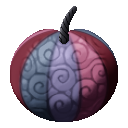
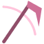

<!-- Generated by tools/build_pack_reference.py. Edit the pack sources and regenerate. -->

# Gocha Gocha no Mi

{ .entry-page-icon }

[Fruits](index.md) · [Missing Missing no Mi](../../reference/content/inomissing.md)

<!-- fruit inomissing:gocha_gocha_no_mi -->

| Stat | Value |
| --- | --- |
| Type | Paramecia |
| Tier | 1 |
| Fruit damage scaling | 1.00× at 10,000 Doriki → 2.25× at 50,000 Doriki |
| Abilities | 2 (2 active, 0 passive) |
| Fruit boxes | [Wooden Box](../fruit-boxes.md) |

See [damage calculations](../combat-stats.md#damage-from-doriki).

!!! note "Reading the stats"
    Listed base damage is for the named part of the move. Pack and Doriki multipliers are shown separately. Times assume 20 ticks per second.

<!-- move inomissing:gocha_gattai -->

## Gattai

{ .entry-move-icon loading=lazy } *Active*

The user merges with their own creatures nearby and stays open for a moment. A player who right clicks the user merges too. Up to 4 members, each one makes the giant bigger and stronger and adds their health to it A merged player sees from the giant and uses their own abilities from it, they get down to leave. Using it again ends the merge and everyone comes out with the same share of health as the giant When the giant falls nobody dies, everyone comes out with one heart

| Stat | Value |
| --- | --- |
| Cooldown | 30 s (600 ticks) |
| Fallen cooldown | 120 s (2400 ticks) |
| Conditional cooldown | 2 s (40 ticks) |
| Pack multiplier when dealing damage | 2.1× |

**Stats while transformed**

| Stat | Value |
| --- | --- |
| Step height | +1 blocks |

<!-- move inomissing:gocha_great_weapon -->

## Great Weapon

{ .entry-move-icon loading=lazy } *Active*

The giant sweeps everything in front with the weapons of all its members as one huge weapon. Each weapon held by a member and the blow of each merged creature adds to the damage. Only the merged giant can use it

| Stat | Value |
| --- | --- |
| Cooldown | 8 s (160 ticks) |
| Base damage | 10 HP |
| Pack multiplier when dealing damage | 2.1× |

