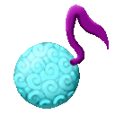

<!-- Generated by tools/build_pack_reference.py. Edit the pack sources and regenerate. -->

# Goe Goe no Mi

{ .entry-page-icon }

[Fruits](index.md) · [Mine Mine no Mi](../../reference/content/mineminenomi.md)

<!-- fruit mineminenomi:goe_goe_no_mi -->

| Stat | Value |
| --- | --- |
| Type | Paramecia |
| Tier | 1 |
| Fruit damage scaling | 1.00× at 10,000 Doriki → 2.25× at 50,000 Doriki |
| Abilities | 2 (2 active, 0 passive) |
| Fruit boxes | [Wooden Box](../fruit-boxes.md) |

See [damage calculations](../combat-stats.md#damage-from-doriki).

[Jump to awakening](#awakening)

!!! note "Reading the stats"
    Listed base damage is for the named part of the move. Pack and Doriki multipliers are shown separately. Times assume 20 ticks per second.

<!-- move mineminenomi:todoroki -->

## Todoroki

{ .entry-move-icon loading=lazy } *Active*

The user shouts and creates a powerful sound blast.

| Stat | Value |
| --- | --- |
| Base damage | 15 HP |
| Cooldown | 8 s (160 ticks) |

<!-- move mineminenomi:dragons_roar -->

## Dragon's Roar

{ .entry-move-icon loading=lazy } *Active*

The user shouts and creates a series of powerful sound shockwaves.

| Stat | Value |
| --- | --- |
| Cooldown | 8 s (160 ticks) |
| Pack multiplier when dealing damage | 0.75× |

## Awakening

**Source** · Awaken Awaken no Mi

| Stat | Value |
| --- | --- |
| Doriki | 40,000 |
| Active time with the fruit | About 24 hours (1,728,000 ticks) |

<!-- move awakenawakennomi:high_frequency_wall -->

### High-Frequency Wall { #awakening-high-frequency-wall }

{ .entry-move-icon loading=lazy } *Active*

Creates a sound wall that destroys enemy projectiles and Deafens enemies who pass through it

| Stat | Value |
| --- | --- |
| Min cooldown | 15 s (300 ticks) |
| Max cooldown | 125 s (2500 ticks) |

<!-- move awakenawakennomi:resonating_world -->

### Resonating World { #awakening-resonating-world }

{ .entry-move-icon loading=lazy } *Active*

Turns the area into a resonance chamber that damages moving enemies, sprinting or swimming makes it worse. Landing from high up sends a shockwave, attacks inside echo back at the attacker and everyone is Deafened.

| Stat | Value |
| --- | --- |
| Move damage | 6 HP |
| Sprint damage | 12 HP |
| Swim damage | 5 HP |
| Echo damage | 10 HP |
| Cooldown | 120 s (2400 ticks) |

<!-- move awakenawakennomi:broken_focus -->

### Broken Focus { #awakening-broken-focus }

{ .entry-move-icon loading=lazy } *Passive*

Every sound the user makes breaks their enemies' focus, so an ability being charged is cut off and locked for a while. Todoroki, Dragon's Roar, Resonating World and High-Frequency Wall all count.
