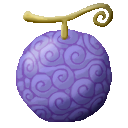

<!-- Generated by tools/build_pack_reference.py. Edit the pack sources and regenerate. -->

# Gomu Gomu no Mi

{ .entry-page-icon }

[Fruits](index.md) · [Mine Mine no Mi](../../reference/content/mineminenomi.md)

<!-- fruit mineminenomi:gomu_gomu_no_mi -->

| Stat | Value |
| --- | --- |
| Type | Paramecia |
| Tier | 2 |
| Fruit damage scaling | 1.00× at 10,000 Doriki → 2× at 50,000 Doriki |
| Abilities | 11 (7 active, 4 passive) |
| Fruit boxes | [Iron Box](../fruit-boxes.md) |

See [damage calculations](../combat-stats.md#damage-from-doriki).

[Jump to awakening](#awakening)

!!! note "Reading the stats"
    Listed base damage is for the named part of the move. Pack and Doriki multipliers are shown separately. Times assume 20 ticks per second.

<!-- move mineminenomi:gomu_gomu_no_pistol -->

## Gomu Gomu no Pistol

{ .entry-move-icon loading=lazy } *Active*

The user stretches their arm to punch the opponent.

| Stat | Value |
| --- | --- |
| No gear cooldown | 1.5 s (30 ticks) |
| Second gear cooldown | 1 s (20 ticks) |
| Third gear cooldown | 6 s (120 ticks) |
| Fourth gear cooldown | 4 s (80 ticks) |
| No gear proj damage | 6 HP |
| Second gear proj damage | 10 HP |
| Third gear proj damage | 15 HP |
| Fourth gear proj damage | 20 HP |
| Pack multiplier when dealing damage | 1.65× |
| Hit at 50,000 Doriki, no gear | 19.8 HP |
| Hit at 50,000 Doriki, Gear Second | 33 HP |

<!-- move mineminenomi:gomu_gomu_no_gatling -->

## Gomu Gomu no Gatling

{ .entry-move-icon loading=lazy } *Active*

Rapidly punches enemies in front of the user.

| Stat | Value |
| --- | --- |
| No gear cooldown | 7 s (140 ticks) |
| Second gear cooldown | 5 s (100 ticks) |
| Third gear cooldown | 12.5 s (250 ticks) |
| Fourth gear cooldown | 10 s (200 ticks) |
| Cooldown | 7 s (140 ticks) |
| Pack multiplier when dealing damage | 1.65× |

<!-- move mineminenomi:gomu_gomu_no_bazooka -->

## Gomu Gomu no Bazooka

{ .entry-move-icon loading=lazy } *Active*

Hits the enemy with both hands to launch them away.

| Stat | Value |
| --- | --- |
| No gear cooldown | 10 s (200 ticks) |
| Second gear cooldown | 7 s (140 ticks) |
| Third gear cooldown | 15 s (300 ticks) |
| Fourth gear cooldown | 12 s (240 ticks) |
| Cooldown | 10 s (200 ticks) |
| Pack multiplier when dealing damage | 1.65× |

<!-- move mineminenomi:gomu_gomu_no_rocket -->

## Gomu Gomu no Rocket

{ .entry-move-icon loading=lazy } *Active*

Stretches towards a block, then launches the user on an arch depending on where they fist landed.

| Stat | Value |
| --- | --- |
| Cooldown | 3 s (60 ticks) |
| Pack multiplier when dealing damage | 1.3× |

<!-- move mineminenomi:gear_second -->

## Gear Second

{ .entry-move-icon loading=lazy } *Active*

By speding up their blood flow, the user gains strength, speed and mobility.

| Stat | Value |
| --- | --- |
| Min cooldown | 1 s (20 ticks) |
| Max cooldown | 33.3333 s (666.667 ticks) |
| Pack multiplier when dealing damage | 1.65× |

<!-- move mineminenomi:gear_third -->

## Gear Third

{ .entry-move-icon loading=lazy } *Active*

By blowing air and inflating their body, the user's attacks get bigger and gain incredible strength.

| Stat | Value |
| --- | --- |
| Min cooldown | 3 s (60 ticks) |
| Max cooldown | 20 s (400 ticks) |
| Pack multiplier when dealing damage | 1.65× |

<!-- move mineminenomi:gear_fourth -->

## Gear Fourth

{ .entry-move-icon loading=lazy } *Active · Transformation*

The user inflates their muscle structure to tremendously increase the power of their attacks and also allows flight.

| Stat | Value |
| --- | --- |
| Min cooldown | 5 s (100 ticks) |
| Max cooldown | 33.3333 s (666.667 ticks) |
| Pack multiplier when dealing damage | 1.65× |

<!-- move mineminenomi:gear_fourth_flight -->

## Gear Fourth Flight

*Passive*

| Stat | Value |
| --- | --- |
| Pack multiplier when dealing damage | 1.65× |

<!-- move mineminenomi:bouncy -->

## Bouncy

{ .entry-move-icon loading=lazy } *Passive*

Makes the user bounce upon landing

| Stat | Value |
| --- | --- |
| Pack multiplier when dealing damage | 1.65× |

<!-- move mineminenomi:bullet_reflect -->

## Bullet Reflect

*Passive*

Reflects bullets

| Stat | Value |
| --- | --- |
| Pack multiplier when dealing damage | 1.65× |

<!-- move mineminenomi:gomu_immunity -->

## Gomu Immunity

*Passive*

| Stat | Value |
| --- | --- |
| Pack multiplier when dealing damage | 1.65× |

## Awakening

**Source** · Awaken Awaken no Mi

| Stat | Value |
| --- | --- |
| Doriki | 40,000 |
| Active time with the fruit | About 24 hours (1,728,000 ticks) |

Gear Fifth gives Pistol, Gatling, Bazooka and Rocket the Dawn forms below.

<!-- move awakenawakennomi:gear_fifth -->

### Gear Fifth { #awakening-gear-fifth }

{ .entry-move-icon loading=lazy } *Active · Transformation*

The user's heart plays the Drums of Liberation and their body moves freely like a cartoon. Hits only squash the user and do less damage, blades still cut normally, and the user can run in the air. Takes the place of the other Gears.

| Stat | Value |
| --- | --- |
| Min cooldown | 10 s (200 ticks) |
| Max cooldown | 60 s (1200 ticks) |
| Maximum duration | 180 s |
| Damage taken from eligible hits | 50% |
| Air running per takeoff | 3 s |

**Stats while transformed**

| Stat | Value |
| --- | --- |
| Punch damage | +20 HP |
| Armour | +12 |
| Armour toughness | +8 |
| Toughness | +3 |
| Movement speed | +100% of base |
| Jump | +6 |
| Step height | +1 blocks |
| Gravity | -0.04 |

<!-- move awakenawakennomi:gomu_gomu_no_sekai -->

### Gomu Gomu no Sekai { #awakening-gomu-gomu-no-sekai }

{ .entry-move-icon loading=lazy } *Active*

Turns the surroundings to rubber for a while. Falls bounce instead of landing and the user and their allies take no damage from it, the ground also throws enemy projectiles back at whoever fired them. Can only be used in Gear Fifth.

| Stat | Value |
| --- | --- |
| Min cooldown | 20 s (400 ticks) |
| Max cooldown | 60 s (1200 ticks) |

<!-- move awakenawakennomi:gomu_gomu_no_mogura_pistol -->

### Gomu Gomu no Mogura Pistol { #awakening-gomu-gomu-no-mogura-pistol }

{ .entry-move-icon loading=lazy } *Active*

The user punches into the ground, the arm stretches under it and comes out next to the enemy they look at, hitting them from the side. Needs the ground under the user but not a line of sight so walls do not stop it. Can only be used in Gear Fifth.

| Stat | Value |
| --- | --- |
| Cooldown | 12 s (240 ticks) |

<!-- move awakenawakennomi:gomu_gomu_no_gigant -->

### Gomu Gomu no Gigant { #awakening-gomu-gomu-no-gigant }

{ .entry-move-icon loading=lazy } *Active · Transformation*

The user's whole body grows giant, giving them a longer reach and stronger hits and nothing can knock them back. Can only be used in Gear Fifth, and ends with it.

| Stat | Value |
| --- | --- |
| Min cooldown | 10 s (200 ticks) |
| Max cooldown | 30 s (600 ticks) |
| Maximum duration | 30 s |

**Stats while transformed**

| Stat | Value |
| --- | --- |
| Punch damage | +10 HP |
| Armour | +8 |
| Toughness | +2 |
| Entity reach | +6 blocks |
| Block reach | +6 blocks |
| Step height | +1.5 blocks |
| Knockback resistance | +1 |

<!-- move awakenawakennomi:gomu_gomu_no_kaminari -->

### Gomu Gomu no Kaminari { #awakening-gomu-gomu-no-kaminari }

{ .entry-move-icon loading=lazy } *Active*

The user catches a lightning bolt in their hand and throws it where they look. Can only be used in Gear Fifth.

| Stat | Value |
| --- | --- |
| Cooldown | 12 s (240 ticks) |

<!-- move awakenawakennomi:gomu_gomu_no_bajrang_gun -->

### Gomu Gomu no Bajrang Gun { #awakening-gomu-gomu-no-bajrang-gun }

{ .entry-move-icon loading=lazy } *Active*

The user raises a fist that grows huge, then brings it down where they look and blows away everything it hits. Can only be used in Gear Fifth.

| Stat | Value |
| --- | --- |
| Cooldown | 40 s (800 ticks) |

<!-- move awakenawakennomi:gomu_gomu_no_dawn_whip -->

### Gomu Gomu no Dawn Whip { #awakening-gomu-gomu-no-dawn-whip }

{ .entry-move-icon loading=lazy } *Active*

The user twists their body like a spring and then spins into a kick all around them, hitting every enemy in reach. Can only be used in Gear Fifth.

| Stat | Value |
| --- | --- |
| Cooldown | 15 s (300 ticks) |
| Projectile hit | 60 HP |
| Sweep reach | 9 blocks |
| Sweep duration | 0.4 s (8 ticks) |
| Projectile hit at 50,000 Doriki with pack multiplier | 120 HP |

<!-- move awakenawakennomi:gomu_gomu_no_dawn_pistol -->

### Dawn Pistol { #awakening-gomu-gomu-no-dawn-pistol }

{ .entry-move-icon loading=lazy } *Active*

Fire a giant stretched punch. The area effect has no separate damage hit.

| Stat | Value |
| --- | --- |
| Projectile hit | 25 HP |
| Cooldown | 6 s (120 ticks) |
| Pack multiplier when dealing damage | 1.65× |
| Projectile hit at 50,000 Doriki with pack multiplier | 82.5 HP |

<!-- move awakenawakennomi:gomu_gomu_no_dawn_gatling -->

### Dawn Gatling { #awakening-gomu-gomu-no-dawn-gatling }

{ .entry-move-icon loading=lazy } *Active*

Fire 12 punches at intervals of 3 ticks. Damage is listed per projectile.

| Stat | Value |
| --- | --- |
| Projectile hit | 8.75 HP |
| Cooldown | 20 s (400 ticks) |
| Projectiles per cast | 12 |
| Interval | 0.15 s (3 ticks) |
| Pack multiplier when dealing damage | 1.65× |
| Projectile hit at 50,000 Doriki with pack multiplier | 28.875 HP |

<!-- move awakenawakennomi:gomu_gomu_no_dawn_cymbal -->

### Dawn Cymbal { #awakening-gomu-gomu-no-dawn-cymbal }

{ .entry-move-icon loading=lazy } *Active*

Charge a giant two-handed strike that flattens targets it catches.

| Stat | Value |
| --- | --- |
| Projectile hit | 80 HP |
| Cooldown | 16 s (320 ticks) |
| Charge | 1 s (20 ticks) |
| Flatten | 3 s (60 ticks) |
| Pack multiplier when dealing damage | 1.65× |
| Projectile hit at 50,000 Doriki with pack multiplier | 264 HP |

<!-- move awakenawakennomi:gomu_gomu_no_dawn_rocket -->

### Dawn Rocket { #awakening-gomu-gomu-no-dawn-rocket }

{ .entry-move-icon loading=lazy } *Active*

Launch yourself toward a point within 100 blocks. The launch itself deals no direct damage.

| Stat | Value |
| --- | --- |
| Cooldown | 14 s (280 ticks) |
| Maximum reach | 100 blocks |

