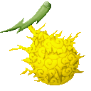
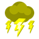

<!-- Generated by tools/build_pack_reference.py. Edit the pack sources and regenerate. -->

# Goro Goro no Mi

{ .entry-page-icon }

[Fruits](index.md) · [Mine Mine no Mi](../../reference/content/mineminenomi.md)

<!-- fruit mineminenomi:goro_goro_no_mi -->

| Stat | Value |
| --- | --- |
| Type | Logia |
| Tier | 3 |
| Fruit damage scaling | 1.00× at 10,000 Doriki → 1.75× at 50,000 Doriki |
| Abilities | 11 (7 active, 4 passive) |
| Fruit boxes | [Golden Box](../fruit-boxes.md) |

See [damage calculations](../combat-stats.md#damage-from-doriki).

[Jump to awakening](#awakening)

!!! note "Reading the stats"
    Listed base damage is for the named part of the move. Pack and Doriki multipliers are shown separately. Times assume 20 ticks per second.

<!-- move mineminenomi:spark_step -->

## Spark Step

{ .entry-move-icon loading=lazy } *Active*

Teleport the user to their desired location

| Stat | Value |
| --- | --- |
| Cooldown | 5 s (100 ticks) |
| Pack multiplier when dealing damage | 2.2× |

<!-- move mineminenomi:el_thor -->

## El Thor

{ .entry-move-icon loading=lazy } *Active*

Focuses a large cluster of electricity above the target, then sends a powerful lightning bolt crashing down from the sky

| Stat | Value |
| --- | --- |
| Cooldown | 18 s (360 ticks) |
| Pack multiplier when dealing damage | 2.2× |

<!-- move mineminenomi:vari -->

## Vari

{ .entry-move-icon loading=lazy } *Active*

A basic move where the user discharges variable amounts of electricity

| Stat | Value |
| --- | --- |
| Pack multiplier when dealing damage | 2.2× |

<!-- move mineminenomi:kari -->

## Kari

{ .entry-move-icon loading=lazy } *Active*

The user heats the air around them with lightning until it explodes with a thunder clap. Can be used to avoid and neutralize projectiles.

| Stat | Value |
| --- | --- |
| Min cooldown | 3 s (60 ticks) |
| Max cooldown | 12 s (240 ticks) |
| Explosion damage | 10 HP |
| Pack multiplier when dealing damage | 2.2× |

<!-- move mineminenomi:sango -->

## Sango

{ .entry-move-icon loading=lazy } *Active*

Launches powerful charges of electricity from the hands.

| Stat | Value |
| --- | --- |
| Cooldown | 12 s (240 ticks) |
| Pack multiplier when dealing damage | 2.2× |

<!-- move mineminenomi:volt_amaru -->

## Volt Amaru

{ .entry-move-icon loading=lazy } *Active*

Transforms the user into a powerful, lightning giant massively boosting physical attributes and lightning attacks

| Stat | Value |
| --- | --- |
| Cooldown | 50 s (1000 ticks) |
| Pack multiplier when dealing damage | 2.2× |

<!-- move mineminenomi:volt_amaru_flight -->

## Volt Amaru Flight

*Passive*

| Stat | Value |
| --- | --- |
| Pack multiplier when dealing damage | 2.2× |

<!-- move mineminenomi:raigo -->

## Raigo

{ .entry-move-icon loading=lazy } *Active*

Shapes a vast quantity of thunderclouds into one giant, dark sphere charged with electricity Causes the nearby thunderclouds to shower everything below them with dozens of massive lightning bolts Can only be used during a thunderstorm.

Requires a thunderstorm at your location. A successful cast reinforces local thunder for 60 seconds.

| Stat | Value |
| --- | --- |
| Raigo base cooldown | 85 s (1700 ticks) |
| Raigo thunderstorm cooldown | 35 s (700 ticks) |
| Mamaragan cooldown | 70 s (1400 ticks) |
| Pack multiplier when dealing damage | 2.2× |

<!-- move mineminenomi:logia_invulnerability_goro -->

## Logia Invulnerability Goro

{ .entry-move-icon loading=lazy } *Passive*

| Stat | Value |
| --- | --- |
| Base damage | 5 HP |
| Pack multiplier when dealing damage | 2.2× |

<!-- move mineminenomi:heat_logia_immunities -->

## Heat Logia Immunities

*Passive*

| Stat | Value |
| --- | --- |
| Pack multiplier when dealing damage | 2.2× |

<!-- move mineminenomi:goro_block_bypassing -->

## Goro Block Bypassing

*Passive*

| Stat | Value |
| --- | --- |
| Pack multiplier when dealing damage | 2.2× |

## Awakening

**Source** · Awaken Awaken no Mi

| Stat | Value |
| --- | --- |
| Doriki | 40,000 |
| Active time with the fruit | About 24 hours (1,728,000 ticks) |

<!-- move awakenawakennomi:kami_no_kuni -->

### Godland { #awakening-kami-no-kuni }

{ .entry-move-icon loading=lazy } *Active*

Calls a real thunderstorm that lasts as long as the zone stays up. Lightning inside strikes whoever carries the most metal, hitting harder the better they conduct Diamond and leather don't conduct at all.

| Stat | Value |
| --- | --- |
| Zone cooldown | 90 s (1800 ticks) |
| Min strike damage | 20 HP |
| Max strike damage | 65 HP |
| Display min damage | 20 HP |
| Display max damage | 65 HP |
| Cooldown | 90 s (1800 ticks) |

<!-- move awakenawakennomi:stormstep -->

### Stormstep { #awakening-stormstep }

{ .entry-move-icon loading=lazy } *Active*

Fires a lightning bolt that jumps from enemy to enemy toward whoever conducts best The metal a target carries sets how far the bolt jumps and how hard it hits, losing power with each jump.

| Stat | Value |
| --- | --- |
| Cooldown | 25 s (500 ticks) |
| Whiff cooldown | 3 s (60 ticks) |
| Base damage | 90 HP |

<!-- move awakenawakennomi:storm_sovereign -->

### Storm Sovereign { #awakening-storm-sovereign }

{ .entry-move-icon loading=lazy } *Passive*

During a thunderstorm the user hits harder, moves faster and heals quickly Hits from conductive weapons are dampened by the user's body, by up to half their damage.

The local thunder check affects the form’s tier and its response to damage.
