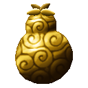
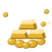
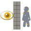
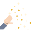
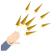
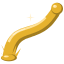
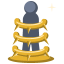
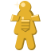
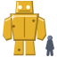

<!-- Generated by tools/build_pack_reference.py. Edit the pack sources and regenerate. -->

# Goru Goru no Mi

{ .entry-page-icon }

[Fruits](index.md) · [Missing Missing no Mi](../../reference/content/inomissing.md)

<!-- fruit inomissing:goru_goru_no_mi -->

| Stat | Value |
| --- | --- |
| Type | Paramecia |
| Tier | 3 |
| Fruit damage scaling | 1.00× at 10,000 Doriki → 1.75× at 50,000 Doriki |
| Abilities | 12 (10 active, 2 passive) |
| Fruit boxes | [Golden Box](../fruit-boxes.md) |

See [damage calculations](../combat-stats.md#damage-from-doriki).

!!! note "Reading the stats"
    Listed base damage is for the named part of the move. Pack and Doriki multipliers are shown separately. Times assume 20 ticks per second.

<!-- move inomissing:gold_hoard -->

## Gold Hoard

{ .entry-move-icon loading=lazy } *Passive*

Shows the gold the user can use, a gold nugget counts for 1, an ingot for 9 and a block for 81, and pulls the nearby gold items to them. The gold is shown in green when there are enough gold blocks around them to use the abilities for free.

| Stat | Value |
| --- | --- |
| Pack multiplier when dealing damage | 2.05× |

<!-- move inomissing:golden_senses -->

## Golden Senses

{ .entry-move-icon loading=lazy } *Passive*

The user sees everyone covered in gold dust through walls.

| Stat | Value |
| --- | --- |
| Pack multiplier when dealing damage | 2.05× |

<!-- move inomissing:gold_dust -->

## Gold Dust

{ .entry-move-icon loading=lazy } *Active*

The user showers everyone around them with gold dust, marking them for 2 minutes. Water washes the gold dust off.

| Stat | Value |
| --- | --- |
| Cooldown | 20 s (400 ticks) |
| Pack multiplier when dealing damage | 2.05× |

<!-- move inomissing:golden_statue -->

## Golden Statue

{ .entry-move-icon loading=lazy } *Active*

The user turns the enemy covered in gold dust they are looking at into a golden statue, they can't move or attack. The statue lasts less on players and bosses, and breaks if it takes enough damage or touches water. Use the ability again to release the enemy

| Stat | Value |
| --- | --- |
| Cooldown | 30 s (600 ticks) |
| Pack multiplier when dealing damage | 2.05× |

<!-- move inomissing:gon_bomba -->

## Gon Bomba

{ .entry-move-icon loading=lazy } *Active*

The user covers their arm with a golden gauntlet and punches the enemy in front, the gold then explodes damaging all nearby enemies. The user uppercuts the enemies in front of them with a golden gauntlet, launching them in the air, the gust it creates pushes back the enemies further away. As Golden Tesoro the golem punches with Gon Inferno instead, a bigger exploding punch that needs no gold.

| Stat | Value |
| --- | --- |
| B damage | 22 HP |
| B cooldown | 10 s (200 ticks) |
| T damage | 16 HP |
| T cooldown | 12 s (240 ticks) |
| I damage | 26 HP |
| I cooldown | 20 s (400 ticks) |
| Cooldown | 10 s (200 ticks) |
| Pack multiplier when dealing damage | 2.05× |

<!-- move inomissing:gon_lancia -->

## Gon Lancia

{ .entry-move-icon loading=lazy } *Active*

The user fires 9 golden spikes from their fingertips where they are looking, the gold of each spike is left where it lands.

| Stat | Value |
| --- | --- |
| Base damage | 3 HP |
| Cooldown | 10 s (200 ticks) |
| Pack multiplier when dealing damage | 2.05× |

<!-- move inomissing:gon_lira_di_dio -->

## Gon L'ira di Dio

{ .entry-move-icon loading=lazy } *Active*

The user throws a wave of gold in front of them, damaging and pushing back all the enemies it falls on. The gold stays where the wave lands. The user throws a huge golden tendril straight where they are looking, damaging and pushing away all the enemies on its way.

| Stat | Value |
| --- | --- |
| Base damage | 26 HP |
| Cooldown | 14 s (280 ticks) |
| Splash damage | 14 HP |
| Splash cooldown | 16 s (320 ticks) |
| Pack multiplier when dealing damage | 2.05× |

<!-- move inomissing:gon_incantesimo -->

## Gon Incantesimo

{ .entry-move-icon loading=lazy } *Active*

A golden tendril covered in spikes comes out of the ground and wraps around the enemy the user is looking at, they are stuck in place and damaged every second but can still attack. Use the ability again to release the enemy

| Stat | Value |
| --- | --- |
| Seize damage | 12 HP |
| Bite damage | 2 HP |
| Cooldown | 16 s (320 ticks) |
| Pack multiplier when dealing damage | 2.05× |

<!-- move inomissing:gon_frenesia -->

## Gon Frenesia

{ .entry-move-icon loading=lazy } *Active*

The user forms a long golden blade on their arm and slashes all the enemies in front of them, pushing them back.

| Stat | Value |
| --- | --- |
| Base damage | 18 HP |
| Cooldown | 8 s (160 ticks) |
| Pack multiplier when dealing damage | 2.05× |

<!-- move inomissing:golden_armour -->

## Golden Armour

{ .entry-move-icon loading=lazy } *Active · Transformation*

The user covers their whole body with gold, becoming much tougher and harder to push, but heavier and slower.

| Stat | Value |
| --- | --- |
| Cooldown | 20 s (400 ticks) |
| Pack multiplier when dealing damage | 2.05× |

**Stats while transformed**

| Stat | Value |
| --- | --- |
| Armour | +14 |
| Armour toughness | +6 |
| Punch damage | +4 HP |

<!-- move inomissing:golden_tesoro -->

## Golden Tesoro

{ .entry-move-icon loading=lazy } *Active*

The user creates a giant golden body around them, the hits damages the gold instead of the user and it repairs itself while standing among gold blocks. The golem breaks when there is no gold left. The size can be changed before using it, a bigger golem is slower and golems can't jump.

| Stat | Value |
| --- | --- |
| Cooldown | 60 s (1200 ticks) |
| Pack multiplier when dealing damage | 2.05× |

**Stats while transformed**

| Stat | Value |
| --- | --- |
| Punch damage | +20 HP |
| Step height | +1.5 blocks |

<!-- move inomissing:gon_fuoco_di_dio -->

## Gon Fuoco di Dio

{ .entry-move-icon loading=lazy } *Active*

Only as Golden Tesoro. The golem fires a beam from its eyes where the user is looking, damaging all the enemies on its way and exploding at the end. A bigger golem hits harder.

| Stat | Value |
| --- | --- |
| Base damage | 20 HP |
| Cooldown | 20 s (400 ticks) |
| Pack multiplier when dealing damage | 2.05× |

