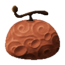
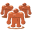
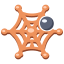
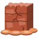
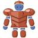
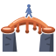

<!-- Generated by tools/build_pack_reference.py. Edit the pack sources and regenerate. -->

# Gunyo Gunyo no Mi

{ .entry-page-icon }

[Fruits](index.md) · [Missing Missing no Mi](../../reference/content/inomissing.md)

<!-- fruit inomissing:gunyo_gunyo_no_mi -->

| Stat | Value |
| --- | --- |
| Type | Paramecia |
| Tier | 2 |
| Fruit damage scaling | 1.00× at 10,000 Doriki → 2× at 50,000 Doriki |
| Abilities | 8 (8 active, 0 passive) |
| Fruit boxes | [Iron Box](../fruit-boxes.md) |

See [damage calculations](../combat-stats.md#damage-from-doriki).

!!! note "Reading the stats"
    Listed base damage is for the named part of the move. Pack and Doriki multipliers are shown separately. Times assume 20 ticks per second.

<!-- move inomissing:gunyo_golems -->

## Golems

{ .entry-move-icon loading=lazy } *Active*

Golems, the user makes three clay golems that follow them and attack their enemies, slow and heavy, their blows throw far. A broken golem melts and forms again later, later still if the blow had Haki or it stood in water or rain. Used again they melt away. Giant Golem, the golems merge into one giant golem twice their size, slow and very strong. With none out it rises at once from the clay. Switching back splits it into three. A broken giant melts and the three form again later.

| Stat | Value |
| --- | --- |
| Cooldown | 30 s (600 ticks) |
| Pack multiplier when dealing damage | 3× |

<!-- move inomissing:gunyo_nyudo -->

## Nyudo Gunyo

{ .entry-move-icon loading=lazy } *Active*

A wave of soft clay covers the ground where the user aims. Nobody takes fall damage on it and the feet of enemies sink in, they are very slow and can't jump. Used again the clay goes away.

| Stat | Value |
| --- | --- |
| Cooldown | 20 s (400 ticks) |
| Conditional cooldown | 0.5 s (10 ticks) |
| Pack multiplier when dealing damage | 3× |

<!-- move inomissing:gunyo_no_su -->

## Gunyo no Su

{ .entry-move-icon loading=lazy } *Active*

A web of clay stands before the user where they aim, the longer they charge it the bigger it is. Pressed again it stands. It stops every projectile and holds the enemies that touch it, until the user uses it again or goes too far from it.

| Stat | Value |
| --- | --- |
| Cooldown | 20 s (400 ticks) |
| Conditional cooldown | 0.5 s (10 ticks) |
| Pack multiplier when dealing damage | 3× |

<!-- move inomissing:gunyo_clay_weapon -->

## Clay Weapon

{ .entry-move-icon loading=lazy } *Active*

The user hardens clay into a spiked morning star in their hand. Used again it is put away. The morning star crumbles if it leaves the user's hands.

| Stat | Value |
| --- | --- |
| Cooldown | 2 s (40 ticks) |
| Pack multiplier when dealing damage | 3× |

<!-- move inomissing:gunyo_clay_wall -->

## Clay Wall

{ .entry-move-icon loading=lazy } *Active*

A wall of clay rises where the user aims, soft then hard. It stops enemies and projectiles. Using the ability again brings the wall down.

| Stat | Value |
| --- | --- |
| Cooldown | 15 s (300 ticks) |
| Pack multiplier when dealing damage | 3× |

<!-- move inomissing:gunyo_bury -->

## Bury

{ .entry-move-icon loading=lazy } *Active*

Soft clay climbs the enemy the user looks at and holds its whole body. It can't move and can't hit.

| Stat | Value |
| --- | --- |
| Cooldown | 12 s (240 ticks) |
| Conditional cooldown | 0.5 s (10 ticks) |
| Pack multiplier when dealing damage | 3× |

<!-- move inomissing:gunyo_clay_armour -->

## Clay Armor

{ .entry-move-icon loading=lazy } *Active · Transformation*

The user hardens clay into a heavy armor all over their body until they take it off.

| Stat | Value |
| --- | --- |
| Cooldown | 40 s (800 ticks) |
| Pack multiplier when dealing damage | 3× |

**Stats while transformed**

| Stat | Value |
| --- | --- |
| Armor | +12 |
| Armor toughness | +4 |
| Punch damage | +4 HP |

<!-- move inomissing:gunyo_clay_bridge -->

## Clay Bridge

{ .entry-move-icon loading=lazy } *Active*

The user lays a path of hard clay from their feet the way they look, flat or as stairs going up or down. It only fills the empty space. Using the ability again brings the path down.

| Stat | Value |
| --- | --- |
| Cooldown | 25 s (500 ticks) |
| Pack multiplier when dealing damage | 3× |

