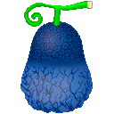

<!-- Generated by tools/build_pack_reference.py. Edit the pack sources and regenerate. -->

# Gura Gura no Mi

{ .entry-page-icon }

[Fruits](index.md) · [Mine Mine no Mi](../../reference/content/mineminenomi.md)

<!-- fruit mineminenomi:gura_gura_no_mi -->

| Stat | Value |
| --- | --- |
| Type | Paramecia |
| Tier | 3 |
| Fruit damage scaling | 1.00× at 10,000 Doriki → 1.75× at 50,000 Doriki |
| Abilities | 6 (5 active, 1 passive) |
| Fruit boxes | [Golden Box](../fruit-boxes.md) |

See [damage calculations](../combat-stats.md#damage-from-doriki).

[Jump to awakening](#awakening)

After awakening, this fruit’s original damaging moves deal **1.5× damage**. The awakening techniques below have their own values.

!!! note "Reading the stats"
    Listed base damage is for the named part of the move. Pack and Doriki multipliers are shown separately. Times assume 20 ticks per second.

<!-- move mineminenomi:gekishin -->

## Gekishin

{ .entry-move-icon loading=lazy } *Active*

The user 'cracks' the air, launching a single concentrated shockwave forward which send blocks flying and deals damage to all enemies in its path The user 'cracks' the air on their sides, launching two smaller shockwaves which send blocks flying and deals damage to all enemies in their path

| Stat | Value |
| --- | --- |
| Gekishin cooldown | 12 s (240 ticks) |
| Kaishin cooldown | 24 s (480 ticks) |
| Cooldown | 12 s (240 ticks) |
| Pack multiplier when dealing damage | 1.6× |

<!-- move mineminenomi:shingen_no_ichigeki -->

## Shingen no Ichigeki

{ .entry-move-icon loading=lazy } *Active*

The user focuses vibrations around their fist in an spherical bubble, releasing when hitting an enemy. The user slams their fist on the ground pushing all nearby enemies.

| Stat | Value |
| --- | --- |
| Cooldown | 10 s (200 ticks) |
| Punch damage | 40 HP |
| Aoe damage | 10 HP |
| Base damage | 40 HP |
| Pack multiplier when dealing damage | 1.6× |

<!-- move mineminenomi:tenchi_meido -->

## Tenchi Meido

{ .entry-move-icon loading=lazy } *Active*

The user grabs the air and pulls it downwards, after which all of the opponents are tossed into the air.

| Stat | Value |
| --- | --- |
| Cooldown | 20 s (400 ticks) |
| Pack multiplier when dealing damage | 1.6× |

<!-- move mineminenomi:shima_yurashi -->

## Shima Yurashi

{ .entry-move-icon loading=lazy } *Active*

The user grabs the air around them and pulls it downwards after which the nearby land and entities are sent flying.

| Stat | Value |
| --- | --- |
| Cooldown | 60 s (1200 ticks) |
| Min damage | 66 HP |
| Max damage | 80 HP |
| Pack multiplier when dealing damage | 1.6× |

<!-- move mineminenomi:gura_immunities -->

## Gura Immunities

*Passive*

| Stat | Value |
| --- | --- |
| Pack multiplier when dealing damage | 1.6× |

<!-- move mineminenomi:kabutowari -->

## Kabutowari

{ .entry-move-icon loading=lazy } *Active*

The user grabs their opponent's head and concentrates their vibrations around it, resulting in crushing damage

| Stat | Value |
| --- | --- |
| Cooldown | 10 s (200 ticks) |
| Base damage | 60 HP |
| Pack multiplier when dealing damage | 1.6× |

## Awakening

**Source** · Awaken Awaken no Mi

| Stat | Value |
| --- | --- |
| Doriki | 40,000 |
| Active time with the fruit | About 24 hours (1,728,000 ticks) |

<!-- move awakenawakennomi:tenchi_hokai -->

### Tenchi Hokai { #awakening-tenchi-hokai }

{ .entry-move-icon loading=lazy } *Active*

Tears the ground apart over a huge area, throwing it into the air and knocking out enemies.

| Stat | Value |
| --- | --- |
| Cooldown | 150 s (3000 ticks) |
| Max damage | 200 HP |
| Min damage | 160 HP |

<!-- move awakenawakennomi:funshin -->

### Funshin { #awakening-funshin }

{ .entry-move-icon loading=lazy } *Active*

The user releases a quake under their feet, launching themselves in the direction they look. Landing sends a second quake through the enemies around the user.

| Stat | Value |
| --- | --- |
| Cooldown | 25 s (500 ticks) |
| Static damage | 60 HP |
| Landing damage | 40 HP |
| Conditional cooldown | 1 s (20 ticks) |

<!-- move awakenawakennomi:aftershock -->

### Aftershock { #awakening-aftershock }

{ .entry-move-icon loading=lazy } *Passive*

The user's quakes keep going after the hit, every enemy hit by a Gura ability gets shaken again a moment later. The aftershock passes through Logia bodies and leaves the target dizzy.
