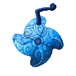

<!-- Generated by tools/build_pack_reference.py. Edit the pack sources and regenerate. -->

# Guru Guru no Mi

{ .entry-page-icon }

[Fruits](index.md) · [Missing Missing no Mi](../../reference/content/inomissing.md)

<!-- fruit inomissing:guru_guru_no_mi -->

| Stat | Value |
| --- | --- |
| Type | Paramecia |
| Tier | 1 |
| Fruit damage scaling | 1.00× at 10,000 Doriki → 2.25× at 50,000 Doriki |
| Abilities | 7 (5 active, 2 passive) |
| Fruit boxes | [Wooden Box](../fruit-boxes.md) |

See [damage calculations](../combat-stats.md#damage-from-doriki).

!!! note "Reading the stats"
    Listed base damage is for the named part of the move. Pack and Doriki multipliers are shown separately. Times assume 20 ticks per second.

<!-- move inomissing:puropera -->

## Puropera

{ .entry-move-icon loading=lazy } *Active*

Transforms the top of the user's head into a propeller allowing them to fly while it spins, their legs spins too. An ally can ride on their back. Taking a melee hit stops it

| Stat | Value |
| --- | --- |
| Cooldown | 2 s (40 ticks) |
| Pack multiplier when dealing damage | 2.75× |

<!-- move inomissing:toppu_matasaburo -->

## Toppu: Matasaburo

{ .entry-move-icon loading=lazy } *Active*

The user spins with their arms spinning around them like a rotor, creating a strong wind in front of them, enemies are blown away and clouds of gas and smoke are removed

| Stat | Value |
| --- | --- |
| Base damage | 6 HP |
| Cooldown | 10 s (200 ticks) |
| Pack multiplier when dealing damage | 2.75× |

<!-- move inomissing:guru_guru_toshaho -->

## Guru Guru Toshaho

{ .entry-move-icon loading=lazy } *Active*

Grabs the creature in front of the user, spins it around them at the end of their arms and throws it where the user is looking at. An ally using Missile Girl is launched much faster.

| Stat | Value |
| --- | --- |
| Cooldown | 13 s (260 ticks) |
| Pack multiplier when dealing damage | 2.75× |

<!-- move inomissing:suketo -->

## Suketo

{ .entry-move-icon loading=lazy } *Active*

The user's legs spins like wheels allowing them to roll on the ground like on skates, pushing away everyone in their path

| Stat | Value |
| --- | --- |
| Base damage | 7 HP |
| Cooldown | 10 s (200 ticks) |
| Pack multiplier when dealing damage | 2.75× |

<!-- move inomissing:senpu -->

## Senpu

{ .entry-move-icon loading=lazy } *Active*

The user's arms becomes rotors that spins around them, hitting all nearby enemies multiple times.

| Stat | Value |
| --- | --- |
| Base damage | 8 HP |
| Cooldown | 12 s (240 ticks) |
| Pack multiplier when dealing damage | 2.75× |

<!-- move inomissing:hiko -->

## Hiko

{ .entry-move-icon loading=lazy } *Passive*

While the propeller is spinning the user can fly, until they have no more stamina.

| Stat | Value |
| --- | --- |
| Pack multiplier when dealing damage | 2.75× |

<!-- move inomissing:kaiten_ningen -->

## Kaiten Ningen

{ .entry-move-icon loading=lazy } *Passive*

Taking a melee hit while a part of the user is spinning stops all rotations, if the user was flying they will fall

| Stat | Value |
| --- | --- |
| Pack multiplier when dealing damage | 2.75× |

