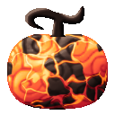
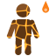

<!-- Generated by tools/build_pack_reference.py. Edit the pack sources and regenerate. -->

# Gutsu Gutsu no Mi

{ .entry-page-icon }

[Fruits](index.md) · [Missing Missing no Mi](../../reference/content/inomissing.md)

<!-- fruit inomissing:gutsu_gutsu_no_mi -->

| Stat | Value |
| --- | --- |
| Type | Paramecia |
| Tier | 2 |
| Fruit damage scaling | 1.00× at 10,000 Doriki → 2× at 50,000 Doriki |
| Abilities | 10 (9 active, 1 passive) |
| Fruit boxes | [Iron Box](../fruit-boxes.md) |

See [damage calculations](../combat-stats.md#damage-from-doriki).

!!! note "Reading the stats"
    Listed base damage is for the named part of the move. Pack and Doriki multipliers are shown separately. Times assume 20 ticks per second.

<!-- move inomissing:furnace -->

## Furnace

{ .entry-move-icon loading=lazy } *Passive*

The user's body is a furnace. The metal they eat is stored inside them, up to 64 ingots, and every ability of the fruit spends it. The best metal eaten decides what their metal is made of. The user is immune to fire and lava.

<!-- move inomissing:smelt -->

## Smelt

{ .entry-move-icon loading=lazy } *Active*

The user eats up to 8 pieces of metal from their inventory, the one in their hand first. It can be ore, raw metal, ingots, nuggets or blocks of iron, gold, copper or black metal. It fills their furnace.

| Stat | Value |
| --- | --- |
| Cooldown | 1 s (20 ticks) |

<!-- move inomissing:belly_oven -->

## Belly Oven

{ .entry-move-icon loading=lazy } *Active*

The user opens the oven in their belly. Anything a furnace can smelt cooks in it with no fuel and it never runs out of heat. It keeps cooking when closed. What is inside stays with the user, but it drops when they die like the inventory does.

| Stat | Value |
| --- | --- |
| Cooldown | 1 s (20 ticks) |

<!-- move inomissing:forge -->

## Forge

{ .entry-move-icon loading=lazy } *Active*

The user pulls a glowing weapon out of their body. Forged weapons are made of the best metal in the furnace. They set what they strike on fire, and melt after 90 seconds or when dropped. Arm the Crew hands out the weapon chosen here. The weapon is a blade. The weapon is a heavy maul. The weapon is a spear. The weapon is a gun that fires molten metal.

| Stat | Value |
| --- | --- |
| Cooldown | 10 s (200 ticks) |

<!-- move inomissing:arm_the_crew -->

## Arm the Crew

{ .entry-move-icon loading=lazy } *Active*

The user forges a weapon for each ally around them who has no forged weapon yet, as long as the furnace has metal for it. It is the weapon chosen in Forge, but a creature that can't shoot gets a blade instead of a gun. These weapons melt as the user's own do.

| Stat | Value |
| --- | --- |
| Cooldown | 30 s (600 ticks) |

<!-- move inomissing:molten_shot -->

## Molten Shot

{ .entry-move-icon loading=lazy } *Active*

The user spits a ball of molten metal. It damages what it hits and sets it on fire. The user spits a big, slow sphere of molten metal. It bursts where it lands, and every enemy around takes damage and catches fire.

| Stat | Value |
| --- | --- |
| Base damage | 14 HP |
| Cooldown | 3.5 s (70 ticks) |
| Sphere damage | 26 HP |
| Sphere cooldown | 12 s (240 ticks) |

<!-- move inomissing:molten_stream -->

## Molten Stream

{ .entry-move-icon loading=lazy } *Active*

The user pours a wide stream of molten metal where they are looking. Enemies in it are burned and set on fire. It spends metal for as long as it flows. Use the ability again to stop it. While Overfed, the stream is a torrent, half again as wide and as strong.

| Stat | Value |
| --- | --- |
| Base damage | 3 HP |
| Cooldown | 12 s (240 ticks) |

<!-- move inomissing:metal_casing -->

## Metal Casing

{ .entry-move-icon loading=lazy } *Active*

The user pours molten metal over the enemy they are looking at. It burns them and sets around them, and they can't move or attack. The casing lasts less on players and bosses, and breaks if it takes enough damage. The metal armour of the enemy the user is looking at heats up. Each piece of iron, chain, gold or netherite burns them every second, and the steam blinds them for a moment.

| Stat | Value |
| --- | --- |
| Base damage | 8 HP |
| Cooldown | 25 s (500 ticks) |
| Heat damage | 1 HP |
| Heat cooldown | 15 s (300 ticks) |

<!-- move inomissing:metal_coat -->

## Metal Coat

{ .entry-move-icon loading=lazy } *Active · Transformation*

The user covers their whole body with the metal of their furnace. They become much tougher and harder to push, but heavier and slower.

| Stat | Value |
| --- | --- |
| Cooldown | 20 s (400 ticks) |

**Stats while transformed**

| Stat | Value |
| --- | --- |
| Armour | +12 |
| Armour toughness | +4 |
| Punch damage | +3 HP |

<!-- move inomissing:overfed -->

## Overfed

{ .entry-move-icon loading=lazy } *Active · Transformation*

With at least 32 ingots in the furnace, the user's body swells. They are bigger, much stronger and harder to push. They are so hot that enemies close to them are burned, ice and snow melt and what can burn catches fire. The fuller the furnace, the hotter and the further. The furnace burns its metal for as long as the form lasts, and the form ends when it is empty. Molten Stream becomes a torrent.

| Stat | Value |
| --- | --- |
| Heat damage | 2 HP |
| Cooldown | 40 s (800 ticks) |

**Stats while transformed**

| Stat | Value |
| --- | --- |
| Maximum health | +50% |
| Armour | +6 |
| Punch damage | +6 HP |

