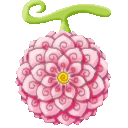

<!-- Generated by tools/build_pack_reference.py. Edit the pack sources and regenerate. -->

# Hana Hana No Mi

{ .entry-page-icon }

[Fruits](index.md) · [Mine Mine no Mi](../../reference/content/mineminenomi.md)

<!-- fruit mineminenomi:hana_hana_no_mi -->

| Stat | Value |
| --- | --- |
| Type | Paramecia |
| Tier | 2 |
| Fruit damage scaling | 1.00× at 10,000 Doriki → 2× at 50,000 Doriki |
| Abilities | 8 (8 active, 0 passive) |
| Fruit boxes | [Iron Box](../fruit-boxes.md) |

See [damage calculations](../combat-stats.md#damage-from-doriki).

[Jump to awakening](#awakening)

After awakening, this fruit’s original damaging moves deal **1.5× damage**. The awakening techniques below have their own values.

!!! note "Reading the stats"
    Listed base damage is for the named part of the move. Pack and Doriki multipliers are shown separately. Times assume 20 ticks per second.

<!-- move mineminenomi:dos_fleur_clutch -->

## Dos Fleur: Clutch

{ .entry-move-icon loading=lazy } *Active*

Sprouts two hands to cover the opponent, and then bends them backward with bone-breaking results. While %s is active it will sprout on every enemy in a %s blocks radius and increase its damage by %s.

| Stat | Value |
| --- | --- |
| Cooldown | 6 s (120 ticks) |
| Normal damage | 10 HP |
| Base damage | 10 HP |
| Pack multiplier when dealing damage | 2.7× |

<!-- move mineminenomi:seis_fleur_slap -->

## Seis Fleur: Slap

{ .entry-move-icon loading=lazy } *Active*

Slaps the enemy pushing them few blocks back and dealing some damage. While %s is active it will sprout on every enemy in a %s blocks radius and increase its damage by %s.

| Stat | Value |
| --- | --- |
| Cooldown | 5 s (100 ticks) |
| Normal damage | 6 HP |
| Base damage | 6 HP |
| Pack multiplier when dealing damage | 2.7× |

<!-- move mineminenomi:seis_fleur_twist -->

## Seis Fleur: Twist

{ .entry-move-icon loading=lazy } *Active*

The six arms sprout from around a target's body and then twists it around. While %s is active it will sprout on every enemy in a %s blocks radius and increase its damage by %s.

| Stat | Value |
| --- | --- |
| Cooldown | 5 s (100 ticks) |
| Normal damage | 6 HP |
| Base damage | 6 HP |
| Pack multiplier when dealing damage | 2.7× |

<!-- move mineminenomi:veinte_fleur_calendula -->

## Veinte Fleur: Calendula

{ .entry-move-icon loading=lazy } *Active*

Using newly sprouted arms in the form of a shield the user can partially block attacks.

| Stat | Value |
| --- | --- |
| Min cooldown | 3 s (60 ticks) |
| Max cooldown | 10 s (200 ticks) |
| Pack multiplier when dealing damage | 4.35× |

<!-- move mineminenomi:cien_fleur_wing -->

## Cien Fleur: Wing

{ .entry-move-icon loading=lazy } *Active*

Sprouts two big wings made out of limbs on the user's back and allows them to gently float down taking no fall damage.

| Stat | Value |
| --- | --- |
| Min cooldown | 2 s (40 ticks) |
| Max cooldown | 10 s (200 ticks) |
| Pack multiplier when dealing damage | 4.35× |

<!-- move mineminenomi:cien_fleur_stomp -->

## Cien Fleur: Stomp

{ .entry-move-icon loading=lazy } *Active*

Stomps the ground in front of the user using giant feet.

| Stat | Value |
| --- | --- |
| Cooldown | 10 s (200 ticks) |
| Pack multiplier when dealing damage | 4.35× |

<!-- move mineminenomi:campo_de_flores -->

## Campo de Flores

{ .entry-move-icon loading=lazy } *Active*

Sprouts multiple hands in front of the user stunning and sending all enemies in a radius flying

| Stat | Value |
| --- | --- |
| Cooldown | 10 s (200 ticks) |
| Base damage | 10 HP |
| Pack multiplier when dealing damage | 4.35× |

<!-- move mineminenomi:mil_fleur -->

## Mil Fleur

{ .entry-move-icon loading=lazy } *Active*

While active all the other abilities of this fruit will transform, either allowing for area of effects or bigger and better versions of themselves.

| Stat | Value |
| --- | --- |
| Min cooldown | 5 s (100 ticks) |
| Max cooldown | 20 s (400 ticks) |
| Pack multiplier when dealing damage | 4.35× |

## Awakening

**Source** · Awaken Awaken no Mi

| Stat | Value |
| --- | --- |
| Doriki | 40,000 |
| Active time with the fruit | About 24 hours (1,728,000 ticks) |

<!-- move awakenawakennomi:diosa_fleur -->

### Diosa Fleur { #awakening-diosa-fleur }

{ .entry-move-icon loading=lazy } *Active*

Summons a giant clone of the user that fights alongside them and gets stronger over time.

| Stat | Value |
| --- | --- |
| Min cooldown | 50 s (1000 ticks) |
| Max cooldown | 150 s (3000 ticks) |
| Clone duration | 60 s |
| Clone damage | 20 HP |

<!-- move awakenawakennomi:bloom_crusher -->

### Bloom Crusher { #awakening-bloom-crusher }

{ .entry-move-icon loading=lazy } *Active*

Giant arms burst out of the ground under the targeted enemy, grab them and crush them into the ground. The Diosa Fleur clone joins the crush, and while Mil Fleur is active every enemy around the target is crushed too.

| Stat | Value |
| --- | --- |
| Base damage | 100 HP |
| Cooldown | 40 s (800 ticks) |
| Miss cooldown | 2 s (40 ticks) |

<!-- move awakenawakennomi:clutch_lock -->

### Clutch Lock { #awakening-clutch-lock }

{ .entry-move-icon loading=lazy } *Passive*

The user's sprouted hands grip way harder, every Clutch, Slap and Twist deals more damage and pins the enemy in place for a while.

| Stat | Value |
| --- | --- |
| Bonus damage | 25 HP |

