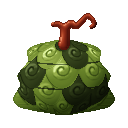
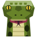
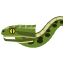
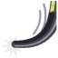
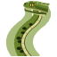
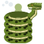
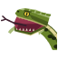
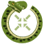

<!-- Generated by tools/build_pack_reference.py. Edit the pack sources and regenerate. -->

# Hebi Hebi no Mi, Model: Anaconda

{ .entry-page-icon }

[Fruits](index.md) · [Missing Missing no Mi](../../reference/content/inomissing.md)

<!-- fruit inomissing:hebi_hebi_no_mi_model_anaconda -->

| Stat | Value |
| --- | --- |
| Type | Zoan |
| Tier | 2 |
| Fruit damage scaling | 1.00× at 10,000 Doriki → 2× at 50,000 Doriki |
| Abilities | 7 (7 active, 0 passive) |
| Fruit boxes | [Iron Box](../fruit-boxes.md) |

See [damage calculations](../combat-stats.md#damage-from-doriki).

!!! note "Reading the stats"
    Listed base damage is for the named part of the move. Pack and Doriki multipliers are shown separately. Times assume 20 ticks per second.

<!-- move inomissing:anaconda_heavy_point -->

## Anaconda Heavy Point

{ .entry-move-icon loading=lazy } *Active · Transformation*

Transforms the user into a half-snake, their upper body on a long and heavy anaconda tail that gives their blows reach.

| Stat | Value |
| --- | --- |
| Pack multiplier when dealing damage | 1.15× |

**Stats while transformed**

| Stat | Value |
| --- | --- |
| Movement speed | +5% of base |
| Maximum health | +30% |
| Punch damage | +8 HP |
| Armour | +10 |
| Toughness | +3 |

<!-- move inomissing:anaconda_walk_point -->

## Anaconda Walk Point

{ .entry-move-icon loading=lazy } *Active · Transformation*

Transforms the user into a huge anaconda, fourteen blocks long and very heavy.

| Stat | Value |
| --- | --- |
| Pack multiplier when dealing damage | 1.15× |

**Stats while transformed**

| Stat | Value |
| --- | --- |
| Movement speed | +25% of base |
| Maximum health | +40% |
| Punch damage | +9 HP |
| Armour | +11 |
| Toughness | +3 |
| Step height | +1 blocks |

<!-- move inomissing:heavy_slam -->

## Heavy Slam

{ .entry-move-icon loading=lazy } *Active*

The user hardens their tail with Armament Haki, wraps it round the enemy in front of them, lifts it and slams it head first into the ground. Needs Armament Haki hardening unlocked

| Stat | Value |
| --- | --- |
| Base damage | 24 HP |
| Cooldown | 14 s (280 ticks) |
| Conditional cooldown | 0.5 s (10 ticks) |
| Pack multiplier when dealing damage | 1.15× |

<!-- move inomissing:snake_dance -->

## Snake Dance

{ .entry-move-icon loading=lazy } *Active*

The user reads the blows with Observation Haki and sways their body like a dance, so every blow and projectile misses them for a while. Explosions still hit. Needs Observation Haki unlocked

| Stat | Value |
| --- | --- |
| Cooldown | 18 s (360 ticks) |
| Pack multiplier when dealing damage | 1.15× |

<!-- move inomissing:shimetsuke -->

## Shimetsuke

{ .entry-move-icon loading=lazy } *Active*

The user winds their long body round the enemy in front of them and slowly chokes it. Every time it moves or strikes the coils tighten and it runs out of breath. Only a strong blow on the user makes them let go. Use the ability again to let it go

| Stat | Value |
| --- | --- |
| Max damage | 20 HP |
| Cooldown | 24 s (480 ticks) |
| Pack multiplier when dealing damage | 1.15× |

<!-- move inomissing:kamiyose -->

## Kamiyose

{ .entry-move-icon loading=lazy } *Active*

The user uses their jaws With Kamiyose the user bites the enemy in front of them and pulls it against their body. A hold put on it right after lasts longer With Marunomi the anaconda swallows a small creature whole, heals and digests it slowly, then its loot comes out. Not players, bosses, tamed or named creatures

| Stat | Value |
| --- | --- |
| Base damage | 9 HP |
| Bite cooldown | 8 s (160 ticks) |
| Swallow cooldown | 30 s (600 ticks) |
| Cooldown | 8 s (160 ticks) |
| Conditional cooldown | 0.5 s (10 ticks) |
| Pack multiplier when dealing damage | 1.15× |

<!-- move inomissing:daija_shime -->

## Daija Shime

{ .entry-move-icon loading=lazy } *Active*

The user coils their body into a huge ring around them, then tightens it more and more. The enemies inside cant get out and get crushed together in the middle

| Stat | Value |
| --- | --- |
| Cooldown | 40 s (800 ticks) |
| Pack multiplier when dealing damage | 1.15× |

