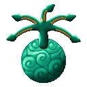
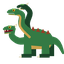
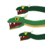
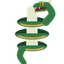
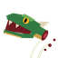
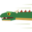
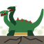
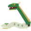
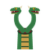

<!-- Generated by tools/build_pack_reference.py. Edit the pack sources and regenerate. -->

# Hebi Hebi no Mi, Model: Hydra

{ .entry-page-icon }

[Fruits](index.md) · [InoFruits](../../reference/content/inofruits.md)

<!-- fruit inofruits:hebi_hebi_no_mi_model_hydra -->

| Stat | Value |
| --- | --- |
| Type | Mythical Zoan |
| Tier | 3 |
| Fruit damage scaling | 1.00× at 10,000 Doriki → 1.75× at 50,000 Doriki |
| Abilities | 16 (14 active, 2 passive) |
| Fruit boxes | [Golden Box](../fruit-boxes.md) |

See [damage calculations](../combat-stats.md#damage-from-doriki).

!!! note "Reading the stats"
    Listed base damage is for the named part of the move. Pack and Doriki multipliers are shown separately. Times assume 20 ticks per second.

<!-- move inofruits:hydra_heavy_point -->

## Hydra Heavy Point

{ .entry-move-icon loading=lazy } *Active · Transformation*

Transforms the user into a hydra hybrid, which focuses on speed and reach.

| Stat | Value |
| --- | --- |
| Pack multiplier when dealing damage | 2.7× |

**Stats while transformed**

| Stat | Value |
| --- | --- |
| Movement speed | +30% of base |
| Maximum health | +20% |
| Punch damage | +7 HP |
| Armour | +8 |
| Toughness | +3 |
| Jump | +1 |
| Step height | +0.5 blocks |

<!-- move inofruits:hydra_guard_point -->

## Hydra Guard Point

{ .entry-move-icon loading=lazy } *Active · Transformation*

Transforms the user into a hydra, which focuses on defense and holding its ground.

| Stat | Value |
| --- | --- |
| Pack multiplier when dealing damage | 2.7× |

**Stats while transformed**

| Stat | Value |
| --- | --- |
| Movement speed | -15% of base |
| Maximum health | +60% |
| Punch damage | +8 HP |
| Armour | +18 |
| Toughness | +8 |
| Step height | +1 blocks |

<!-- move inofruits:king_cobra_strike -->

## King Cobra Strike

{ .entry-move-icon loading=lazy } *Active*

Every head bites at once, each one a different enemy in front of the user. The heads that have no enemy left bite again for less damage.

| Stat | Value |
| --- | --- |
| Cooldown | 8 s (160 ticks) |
| Conditional cooldown | 0.5 s (10 ticks) |
| Pack multiplier when dealing damage | 2.7× |

<!-- move inofruits:python_coil -->

## Python Coil

{ .entry-move-icon loading=lazy } *Active*

The necks grab the target and crush it. The target and the user cannot move, the hold lasts longer with more heads

| Stat | Value |
| --- | --- |
| Crush damage | 2.5 HP |
| Cooldown | 15 s (300 ticks) |
| Pack multiplier when dealing damage | 2.7× |

<!-- move inofruits:severed_head -->

## Severed Head

{ .entry-move-icon loading=lazy } *Active*

The user tears off one of their own heads and throws it, it bites what it hits and pins it. Costs a head and a bit of health, then 2 heads grow back.

| Stat | Value |
| --- | --- |
| Cooldown | 12 s (240 ticks) |
| Conditional cooldown | 0.5 s (10 ticks) |
| Pack multiplier when dealing damage | 2.7× |

<!-- move inofruits:diamondback_guard -->

## Diamondback Guard

{ .entry-move-icon loading=lazy } *Active*

The necks cross in front of the user and block part of the damage coming from the front, half with 3 heads and up to four fifths with 9 heads. The user is slowed and can still lose a head.

| Stat | Value |
| --- | --- |
| Cooldown | 14 s (280 ticks) |
| Pack multiplier when dealing damage | 2.7× |

<!-- move inofruits:hydras_blood -->

## Hydra's Blood

{ .entry-move-icon loading=lazy } *Active*

The heads spit the blood of the hydra on the enemies in front of the user. It deals little damage but stops them from healing, it lasts longer with more heads

| Stat | Value |
| --- | --- |
| Base damage | 3 HP |
| Cooldown | 12 s (240 ticks) |
| Pack multiplier when dealing damage | 2.7× |

<!-- move inofruits:taipan_geyser -->

## Taipan Geyser

{ .entry-move-icon loading=lazy } *Active*

Spits a jet of blood that hits everything in a line and leaves a pool where it lands, enemies standing in the pool are slowed and cannot heal.

| Stat | Value |
| --- | --- |
| Base damage | 6 HP |
| Cooldown | 8 s (160 ticks) |
| Pack multiplier when dealing damage | 2.7× |

<!-- move inofruits:boomslang_blitz -->

## Boomslang Blitz

{ .entry-move-icon loading=lazy } *Active*

The user lunges forward with the heads first, hitting everyone in the way and knocking them back

| Stat | Value |
| --- | --- |
| Base damage | 10 HP |
| Cooldown | 10 s (200 ticks) |
| Pack multiplier when dealing damage | 2.7× |

<!-- move inofruits:anaconda_press -->

## Anaconda Press

{ .entry-move-icon loading=lazy } *Active*

The hydra jumps where the user is looking and lands with its whole weight, crushing everyone under it. The damage is higher in the middle.

| Stat | Value |
| --- | --- |
| Centre damage | 18 HP |
| Edge damage | 9 HP |
| Cooldown | 20 s (400 ticks) |
| Conditional cooldown | 0.5 s (10 ticks) |
| Pack multiplier when dealing damage | 2.7× |

<!-- move inofruits:molt -->

## Molt

{ .entry-move-icon loading=lazy } *Active*

The user sheds their skin, removing every harmful effect and breaking free from grabs and pins, but not from Seastone or handcuffs. The empty skin attracts mobs for 6 seconds.

| Stat | Value |
| --- | --- |
| Cooldown | 30 s (600 ticks) |
| Pack multiplier when dealing damage | 2.7× |

<!-- move inofruits:kingsnakes_feast -->

## Kingsnake's Feast

{ .entry-move-icon loading=lazy } *Active*

The middle head bites the target and eats part of it, healing the user and making the next head grow back twice as fast

| Stat | Value |
| --- | --- |
| Base damage | 8 HP |
| Cooldown | 18 s (360 ticks) |
| Conditional cooldown | 0.5 s (10 ticks) |
| Pack multiplier when dealing damage | 2.7× |

<!-- move inofruits:frenzy -->

## Frenzy

{ .entry-move-icon loading=lazy } *Active*

For 10 seconds every head bites the nearby enemies on its own all around the user. An enemy can only be bitten by 3 heads at a time so more heads means more enemies bitten.

| Stat | Value |
| --- | --- |
| Cooldown | 25 s (500 ticks) |
| Pack multiplier when dealing damage | 2.7× |

<!-- move inofruits:nine_heads -->

## Nine Heads

{ .entry-move-icon loading=lazy } *Active*

Every neck grows at once even the burned ones, giving the user 9 heads for 20 seconds. After that the hydra is left with 1 head and no head grows back for 20 seconds

| Stat | Value |
| --- | --- |
| Cooldown | 120 s (2400 ticks) |
| Conditional cooldown | 0.5 s (10 ticks) |
| Pack multiplier when dealing damage | 2.7× |

<!-- move inofruits:lernaean_heads -->

## Lernaean Heads

{ .entry-move-icon loading=lazy } *Passive*

The hydra has 3 heads and can have up to 9. While transformed, a hit that deals a tenth of the user's health or more cuts off a head which absorbs part of the hit, then 2 heads grow back after a few seconds. A head cut off by fire or while the user is burning does not grow back for 30 seconds

| Stat | Value |
| --- | --- |
| Pack multiplier when dealing damage | 2.7× |

<!-- move inofruits:hydra_poison_immunity -->

## Poison Immunity

{ .entry-move-icon loading=lazy } *Passive*

The user is immune to poison, to the poison of the Doku Doku no Mi and to the blood of another hydra.

| Stat | Value |
| --- | --- |
| Pack multiplier when dealing damage | 2.7× |

