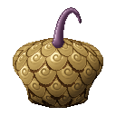
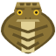
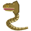
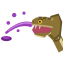
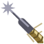
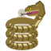
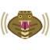

<!-- Generated by tools/build_pack_reference.py. Edit the pack sources and regenerate. -->

# Hebi Hebi no Mi, Model: King Cobra

{ .entry-page-icon }

[Fruits](index.md) · [Missing Missing no Mi](../../reference/content/inomissing.md)

<!-- fruit inomissing:hebi_hebi_no_mi_model_king_cobra -->

| Stat | Value |
| --- | --- |
| Type | Zoan |
| Tier | 2 |
| Fruit damage scaling | 1.00× at 10,000 Doriki → 2× at 50,000 Doriki |
| Abilities | 7 (7 active, 0 passive) |
| Fruit boxes | [Iron Box](../fruit-boxes.md) |

See [damage calculations](../combat-stats.md#damage-from-doriki).

!!! note "Reading the stats"
    Listed base damage is for the named part of the move. Pack and Doriki multipliers are shown separately. Times assume 20 ticks per second.

<!-- move inomissing:king_cobra_heavy_point -->

## King Cobra Heavy Point

{ .entry-move-icon loading=lazy } *Active · Transformation*

Transforms the user into a half-snake, their upper body on a long king cobra tail that gives their blows reach.

| Stat | Value |
| --- | --- |
| Pack multiplier when dealing damage | 1.2× |

**Stats while transformed**

| Stat | Value |
| --- | --- |
| Movement speed | +10% of base |
| Maximum health | +20% |
| Punch damage | +7 HP |
| Armour | +8 |
| Toughness | +2 |

<!-- move inomissing:king_cobra_walk_point -->

## King Cobra Walk Point

{ .entry-move-icon loading=lazy } *Active · Transformation*

Transforms the user into a huge king cobra, ten blocks long, its hood raised.

| Stat | Value |
| --- | --- |
| Pack multiplier when dealing damage | 1.2× |

**Stats while transformed**

| Stat | Value |
| --- | --- |
| Movement speed | +35% of base |
| Maximum health | +25% |
| Punch damage | +8 HP |
| Armour | +9 |
| Toughness | +2 |
| Step height | +1 blocks |

<!-- move inomissing:modoku -->

## Modoku

{ .entry-move-icon loading=lazy } *Active*

The user spits a corrosive purple venom where they look. The enemy it hits is poisoned and its armor corroded. If it misses, it leaves a cloud of poison smoke

| Stat | Value |
| --- | --- |
| Base damage | 10 HP |
| Cooldown | 10 s (200 ticks) |
| Pack multiplier when dealing damage | 1.2× |

<!-- move inomissing:heavy_stick -->

## Heavy Stick

{ .entry-move-icon loading=lazy } *Active*

The user hardens their tail with Armament Haki and thrusts it straight where they look, far ahead, into the first enemy in its way. Needs Armament Haki hardening unlocked

| Stat | Value |
| --- | --- |
| Base damage | 22 HP |
| Cooldown | 12 s (240 ticks) |
| Pack multiplier when dealing damage | 1.2× |

<!-- move inomissing:makitsuki -->

## Makitsuki

{ .entry-move-icon loading=lazy } *Active*

The user winds their long body round the enemy in front of them and squeezes it. It can't move, jump or strike and takes damage. A blow on the user lets it go. Use the ability again to let it go

| Stat | Value |
| --- | --- |
| Base damage | 2 HP |
| Cooldown | 16 s (320 ticks) |
| Pack multiplier when dealing damage | 1.2× |

<!-- move inomissing:ikaku -->

## Ikaku

{ .entry-move-icon loading=lazy } *Active*

The user spreads their hood and hisses. Nearby enemies are frightened. Small creatures run away and the others are weakened and slowed. Modoku's poison lasts twice as long on a frightened enemy

| Stat | Value |
| --- | --- |
| Cooldown | 20 s (400 ticks) |
| Pack multiplier when dealing damage | 1.2× |

<!-- move inomissing:hebigami_tsuki_salamander -->

## Hebigami-Tsuki: Salamander

{ .entry-move-icon loading=lazy } *Active*

Two cobras of flames rise out of the ground beside the user and bite the nearby enemies in turn from both sides, setting them on fire

| Stat | Value |
| --- | --- |
| Base damage | 5 HP |
| Cooldown | 35 s (700 ticks) |
| Pack multiplier when dealing damage | 1.2× |

