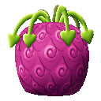
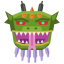
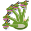
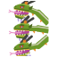
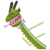
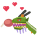
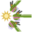
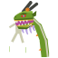
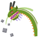

<!-- Generated by tools/build_pack_reference.py. Edit the pack sources and regenerate. -->

# Hebi Hebi no Mi, Model: Yamata no Orochi

{ .entry-page-icon }

[Fruits](index.md) · [Missing Missing no Mi](../../reference/content/inomissing.md)

<!-- fruit inomissing:hebi_hebi_no_mi_model_yamata_no_orochi -->

| Stat | Value |
| --- | --- |
| Type | Mythical Zoan |
| Tier | 3 |
| Fruit damage scaling | 1.00× at 10,000 Doriki → 1.75× at 50,000 Doriki |
| Abilities | 10 (9 active, 1 passive) |
| Fruit boxes | [Golden Box](../fruit-boxes.md) |

See [damage calculations](../combat-stats.md#damage-from-doriki).

!!! note "Reading the stats"
    Listed base damage is for the named part of the move. Pack and Doriki multipliers are shown separately. Times assume 20 ticks per second.

<!-- move inomissing:orochi_heavy_point -->

## Orochi Heavy Point

{ .entry-move-icon loading=lazy } *Active · Transformation*

Transforms the user into a serpent hybrid, with 7 serpent heads on long necks growing from their back around their own head.

| Stat | Value |
| --- | --- |
| Pack multiplier when dealing damage | 1.55× |

**Stats while transformed**

| Stat | Value |
| --- | --- |
| Punch damage | +10 HP |
| Armor | +14 |
| Toughness | +4 |

<!-- move inomissing:orochi_guard_point -->

## Orochi Guard Point

{ .entry-move-icon loading=lazy } *Active · Transformation*

Transforms the user into the Yamata no Orochi, a huge serpent with 8 heads on long necks. It is slow but very tough and reaches far.

| Stat | Value |
| --- | --- |
| Pack multiplier when dealing damage | 1.55× |

**Stats while transformed**

| Stat | Value |
| --- | --- |
| Movement speed | -20% of base |
| Punch damage | +12 HP |
| Armor | +18 |
| Toughness | +6 |
| Step height | +1.5 blocks |

<!-- move inomissing:eight_lives -->

## Eight Lives

{ .entry-move-icon loading=lazy } *Passive*

The user has 8 heads. A blow that would kill them cuts off a head instead and leaves them with a quarter of their health, even in human form. With only 1 head left the user dies normally A lost head grows back after 4 minutes. The user's abilities are stronger with more heads

| Stat | Value |
| --- | --- |
| Pack multiplier when dealing damage | 1.55× |

<!-- move inomissing:multi_bite -->

## Multi Bite

{ .entry-move-icon loading=lazy } *Active*

Each of the user's heads bites one of the enemies in front of them. With fewer heads, fewer enemies are bitten

| Stat | Value |
| --- | --- |
| Base damage | 12 HP |
| Guard damage | 14 HP |
| Cooldown | 8 s (160 ticks) |
| Pack multiplier when dealing damage | 1.55× |

<!-- move inomissing:long_neck -->

## Long Neck

{ .entry-move-icon loading=lazy } *Active*

One of the user's heads shoots far ahead and bites the enemy they are looking at. With fewer heads, it reaches less far

| Stat | Value |
| --- | --- |
| Base damage | 20 HP |
| Cooldown | 10 s (200 ticks) |
| Pack multiplier when dealing damage | 1.55× |

<!-- move inomissing:devour -->

## Devour

{ .entry-move-icon loading=lazy } *Active*

One of the user's heads bites a piece out of the enemy in front of them and swallows it, healing the user by half of the damage dealt

| Stat | Value |
| --- | --- |
| Base damage | 18 HP |
| Cooldown | 12 s (240 ticks) |
| Conditional cooldown | 0.5 s (10 ticks) |
| Pack multiplier when dealing damage | 1.55× |

<!-- move inomissing:eightfold_strike -->

## Eightfold Strike

{ .entry-move-icon loading=lazy } *Active*

All of the user's heads strike the enemy in front of them one after the other, the last hit sends it back. One hit for each head the user has left

| Stat | Value |
| --- | --- |
| Base damage | 5 HP |
| Cooldown | 20 s (400 ticks) |
| Conditional cooldown | 0.5 s (10 ticks) |
| Pack multiplier when dealing damage | 1.55× |

<!-- move inomissing:coiled_guard -->

## Coiled Guard

{ .entry-move-icon loading=lazy } *Active*

The user's necks close around them like a shield, reducing the damage they take. The more heads, the stronger the shield. While it holds the user is slowed and can't attack. Use the ability again to open it

| Stat | Value |
| --- | --- |
| Cooldown | 15 s (300 ticks) |
| Pack multiplier when dealing damage | 1.55× |

<!-- move inomissing:jaw_grab -->

## Jaw Grab

{ .entry-move-icon loading=lazy } *Active*

While in the full Orochi form, the main head grabs the enemy the user is looking at and lifts it in its jaws, it can't move and takes damage. Use the ability again to drop it

| Stat | Value |
| --- | --- |
| Base damage | 4 HP |
| Cooldown | 16 s (320 ticks) |
| Pack multiplier when dealing damage | 1.55× |

<!-- move inomissing:thrash -->

## Thrash

{ .entry-move-icon loading=lazy } *Active*

While in the full Orochi form, the user sweeps their necks in front of them, hitting all enemies there, sending them flying and breaking weak blocks. With fewer heads, the sweep reaches less far

| Stat | Value |
| --- | --- |
| Base damage | 24 HP |
| Cooldown | 16 s (320 ticks) |
| Pack multiplier when dealing damage | 1.55× |

