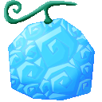

<!-- Generated by tools/build_pack_reference.py. Edit the pack sources and regenerate. -->

# Hie Hie no Mi

{ .entry-page-icon }

[Fruits](index.md) · [Mine Mine no Mi](../../reference/content/mineminenomi.md)

<!-- fruit mineminenomi:hie_hie_no_mi -->

| Stat | Value |
| --- | --- |
| Type | Logia |
| Tier | 3 |
| Fruit damage scaling | 1.00× at 10,000 Doriki → 1.75× at 50,000 Doriki |
| Abilities | 11 (7 active, 4 passive) |
| Fruit boxes | [Golden Box](../fruit-boxes.md) |

See [damage calculations](../combat-stats.md#damage-from-doriki).

[Jump to awakening](#awakening)

After awakening, this fruit’s original damaging moves deal **1.5× damage**. The awakening techniques below have their own values.

!!! note "Reading the stats"
    Listed base damage is for the named part of the move. Pack and Doriki multipliers are shown separately. Times assume 20 ticks per second.

<!-- move mineminenomi:ice_block_partisan -->

## Ice Block: Partisan

{ .entry-move-icon loading=lazy } *Active*

Creates several spears of ice that the user hurls at the enemy

| Stat | Value |
| --- | --- |
| Cooldown | 10 s (200 ticks) |
| Pack multiplier when dealing damage | 1.7× |

<!-- move mineminenomi:ice_age -->

## Ice Age

{ .entry-move-icon loading=lazy } *Active*

Freezes a large area around the user and everyone inside of it

| Stat | Value |
| --- | --- |
| Min cooldown | 10 s (200 ticks) |
| Max cooldown | 15 s (300 ticks) |
| Pack multiplier when dealing damage | 1.7× |

<!-- move mineminenomi:ice_ball -->

## Ice Ball

{ .entry-move-icon loading=lazy } *Active*

Creates a sphere of ice where the projectile hits

| Stat | Value |
| --- | --- |
| Cooldown | 10 s (200 ticks) |
| Pack multiplier when dealing damage | 1.7× |

<!-- move mineminenomi:ice_saber -->

## Ice Saber

{ .entry-move-icon loading=lazy } *Active*

Creates a sharp blade made of compressed ice

| Stat | Value |
| --- | --- |
| Pack multiplier when dealing damage | 1.7× |

<!-- move mineminenomi:ice_time -->

## Ice Time

{ .entry-move-icon loading=lazy } *Active*

Hit the target to encase them in ice

| Stat | Value |
| --- | --- |
| Cooldown | 45 s (900 ticks) |
| Pack multiplier when dealing damage | 1.7× |

<!-- move mineminenomi:ice_block_pheasant -->

## Ice Block: Pheasant

{ .entry-move-icon loading=lazy } *Active*

Releases a massive wave of ice in the shape of a pheasant

| Stat | Value |
| --- | --- |
| Cooldown | 25 s (500 ticks) |
| Pack multiplier when dealing damage | 1.7× |

<!-- move mineminenomi:ice_block_avalanche -->

## Ice Block: Avalanche

{ .entry-move-icon loading=lazy } *Active*

Creates a big ice ball and drops it wherever the user is aiming at

| Stat | Value |
| --- | --- |
| Cooldown | 18 s (360 ticks) |
| Pack multiplier when dealing damage | 1.7× |

<!-- move mineminenomi:logia_invulnerability_hie -->

## Logia Invulnerability Hie

{ .entry-move-icon loading=lazy } *Passive*

| Stat | Value |
| --- | --- |
| Pack multiplier when dealing damage | 1.7× |

<!-- move mineminenomi:frost_walker -->

## Frost Walker

{ .entry-move-icon loading=lazy } *Passive*

Turns all water the user walks on into ice Crouching temporarily disables the ability

| Stat | Value |
| --- | --- |
| Pack multiplier when dealing damage | 1.7× |

<!-- move mineminenomi:hie_immunities -->

## Hie Immunities

*Passive*

| Stat | Value |
| --- | --- |
| Pack multiplier when dealing damage | 1.7× |

<!-- move mineminenomi:hie_block_bypassing -->

## Hie Block Bypassing

*Passive*

| Stat | Value |
| --- | --- |
| Pack multiplier when dealing damage | 1.7× |

## Awakening

**Source** · Awaken Awaken no Mi

| Stat | Value |
| --- | --- |
| Doriki | 40,000 |
| Active time with the fruit | About 24 hours (1,728,000 ticks) |

<!-- move awakenawakennomi:ice_epoch -->

### Ice Epoch { #awakening-ice-epoch }

{ .entry-move-icon loading=lazy } *Active*

Freezes the ground in a huge wave around the user, turning it into a glacier and trapping enemies in ice

| Stat | Value |
| --- | --- |
| Cooldown | 240 s (4800 ticks) |

<!-- move awakenawakennomi:hyosai -->

### Hyosai { #awakening-hyosai }

{ .entry-move-icon loading=lazy } *Active*

Shatters every frozen enemy nearby all at once. Enemies that are not already frozen are not affected

| Stat | Value |
| --- | --- |
| Cooldown | 30 s (600 ticks) |
| Aborted cooldown | 3 s (60 ticks) |
| Base damage | 70 HP |
| Shatter damage | 140 HP |

<!-- move awakenawakennomi:hyoten -->

### Hyoten { #awakening-hyoten }

{ .entry-move-icon loading=lazy } *Passive*

Every frozen or frostbitten enemy nearby makes the user faster, stronger and harder to knock back. The more frozen enemies around, the bigger the bonus. Gives nothing when no enemy nearby is frozen.
