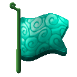
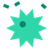

<!-- Generated by tools/build_pack_reference.py. Edit the pack sources and regenerate. -->

# Hira Hira no Mi

{ .entry-page-icon }

[Fruits](index.md) · [Missing Missing no Mi](../../reference/content/inomissing.md)

<!-- fruit inomissing:hira_hira_no_mi -->

| Stat | Value |
| --- | --- |
| Type | Paramecia |
| Tier | 2 |
| Fruit damage scaling | 1.00× at 10,000 Doriki → 2× at 50,000 Doriki |
| Abilities | 7 (6 active, 1 passive) |
| Fruit boxes | [Iron Box](../fruit-boxes.md) |

See [damage calculations](../combat-stats.md#damage-from-doriki).

!!! note "Reading the stats"
    Listed base damage is for the named part of the move. Pack and Doriki multipliers are shown separately. Times assume 20 ticks per second.

<!-- move inomissing:vipera_glaive -->

## Vipera Glaive

{ .entry-move-icon loading=lazy } *Active*

The user flattens the sword they hold. Vipera Glaive makes the blade stretch like a snake to cut the enemy the user is looking at, after which it comes back Corrida Glaive folds the sword into a bull-headed mace, the next sword hit deals more damage and sends the enemy flying

| Stat | Value |
| --- | --- |
| Base damage | 7 HP |
| Bleed | 3 s (60 ticks) |
| Vipera cooldown | 8 s (160 ticks) |
| Corrida cooldown | 12 s (240 ticks) |
| Punch damage | 45 HP |
| Cooldown | 8 s (160 ticks) |
| Pack multiplier when dealing damage | 5.65× |

<!-- move inomissing:army_bandera -->

## Army Bandera

{ .entry-move-icon loading=lazy } *Active*

Makes the ground around the user wave like a flag, all enemies standing on it lose their balance

| Stat | Value |
| --- | --- |
| Base damage | 4 HP |
| Cooldown | 15 s (300 ticks) |
| Pack multiplier when dealing damage | 5.65× |

<!-- move inomissing:death_enjambre -->

## Death Enjambre

{ .entry-move-icon loading=lazy } *Active*

Shoots confetti above where the user is looking at. Use the ability again to turn them back into spiked iron balls that falls on the enemies.

| Stat | Value |
| --- | --- |
| Ball damage | 7 HP |
| Cooldown | 30 s (600 ticks) |
| Pack multiplier when dealing damage | 5.65× |

<!-- move inomissing:steel_cape -->

## Steel Cape

{ .entry-move-icon loading=lazy } *Active*

The user needs to wear a cape. Turns the cape into a steel sheet in front of the user, which blocks the attacks from the front and damages the weapon that hit it

| Stat | Value |
| --- | --- |
| Min cooldown | 3 s (60 ticks) |
| Pack multiplier when dealing damage | 5.65× |

<!-- move inomissing:lock -->

## Lock

{ .entry-move-icon loading=lazy } *Active*

Hardens the item the user is holding, making it deal more damage and not lose durability.

| Stat | Value |
| --- | --- |
| Cooldown | 20 s (400 ticks) |
| Pack multiplier when dealing damage | 5.65× |

<!-- move inomissing:arma_bandera -->

## Arma Bandera

{ .entry-move-icon loading=lazy } *Active*

The next hit of the user's bare hand makes the enemy's weapon and armor soft like a flag, their armor protects less and the hits they do with what they hold deal less damage

| Stat | Value |
| --- | --- |
| Cooldown | 20 s (400 ticks) |
| Punch damage | 10 HP |
| Pack multiplier when dealing damage | 5.65× |

<!-- move inomissing:flag_body -->

## Flag Body

{ .entry-move-icon loading=lazy } *Passive*

While falling the user's body flattens like a flag and floats down slowly. Crouch to fall normally

| Stat | Value |
| --- | --- |
| Pack multiplier when dealing damage | 5.65× |

