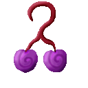

<!-- Generated by tools/build_pack_reference.py. Edit the pack sources and regenerate. -->

# Hiso Hiso No Mi

{ .entry-page-icon }

[Fruits](index.md) · [Mine Mine no Mi](../../reference/content/mineminenomi.md)

<!-- fruit mineminenomi:hiso_hiso_no_mi -->

| Stat | Value |
| --- | --- |
| Type | Paramecia |
| Tier | 1 |
| Fruit damage scaling | 1.00× at 10,000 Doriki → 2.25× at 50,000 Doriki |
| Abilities | 2 (2 active, 0 passive) |
| Fruit boxes | [Wooden Box](../fruit-boxes.md) |

See [damage calculations](../combat-stats.md#damage-from-doriki).

[Jump to awakening](#awakening)

!!! note "Reading the stats"
    Listed base damage is for the named part of the move. Pack and Doriki multipliers are shown separately. Times assume 20 ticks per second.

<!-- move mineminenomi:animal_forewarning -->

## Animal Forewarning

{ .entry-move-icon loading=lazy } *Active*

Allows the user to communicate with nearby animals and learn when the next rain or clear weathers will come.

| Stat | Value |
| --- | --- |
| Cooldown | 10 s (200 ticks) |
| Pack multiplier when dealing damage | 2.8× |

<!-- move mineminenomi:animal_lookout -->

## Animal Lookout

{ .entry-move-icon loading=lazy } *Active*

Allows the user to communicate with nearby animals and learn if other players passed near them.

| Stat | Value |
| --- | --- |
| Cooldown | 10 s (200 ticks) |
| Pack multiplier when dealing damage | 2.8× |

## Awakening

**Source** · Awaken Awaken no Mi

| Stat | Value |
| --- | --- |
| Doriki | 40,000 |
| Active time with the fruit | About 24 hours (1,728,000 ticks) |

<!-- move awakenawakennomi:ethereal_whisper -->

### Ethereal Whisper { #awakening-ethereal-whisper }

{ .entry-move-icon loading=lazy } *Active*

Fires a ghostly whisper that damages enemies and messes with their senses.

| Stat | Value |
| --- | --- |
| Cooldown | 25 s (500 ticks) |

<!-- move awakenawakennomi:call_of_the_wild -->

### Call of the Wild { #awakening-call-of-the-wild }

{ .entry-move-icon loading=lazy } *Active*

Calls every animal and monster nearby to hunt down one enemy Beasts that can't bite trample the target instead.

| Stat | Value |
| --- | --- |
| Cooldown | 90 s (1800 ticks) |
| Miss cooldown | 2 s (40 ticks) |

<!-- move awakenawakennomi:eavesdrop -->

### Eavesdrop { #awakening-eavesdrop }

{ .entry-move-icon loading=lazy } *Passive*

The user hears nearby enemies using their abilities, lighting them up and getting a burst of speed
