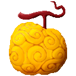

<!-- Generated by tools/build_pack_reference.py. Edit the pack sources and regenerate. -->

# Hito Hito no Mi, Model: Daibutsu

{ .entry-page-icon }

[Fruits](index.md) · [Mine Mine no Mi](../../reference/content/mineminenomi.md)

<!-- fruit mineminenomi:hito_hito_no_mi_model_daibutsu -->

| Stat | Value |
| --- | --- |
| Type | Mythical Zoan |
| Tier | 3 |
| Fruit damage scaling | 1.00× at 10,000 Doriki → 1.75× at 50,000 Doriki |
| Abilities | 2 (2 active, 0 passive) |
| Fruit boxes | [Golden Box](../fruit-boxes.md) |

See [damage calculations](../combat-stats.md#damage-from-doriki).

[Jump to awakening](#awakening)

After awakening, this fruit’s original damaging moves deal **1.5× damage**. The awakening techniques below have their own values.

Keep using your normal combat forms after awakening. See the [awakened Zoan form stats](../devil-fruits.md#what-changes-after-awakening) for the upgrade.

!!! note "Reading the stats"
    Listed base damage is for the named part of the move. Pack and Doriki multipliers are shown separately. Times assume 20 ticks per second.

<!-- move mineminenomi:daibutsu_point -->

## Daibutsu Point

{ .entry-move-icon loading=lazy } *Active · Transformation*

Allows the user to transforms into a Golden Buddha statue, which focuses on strength and defense.

| Stat | Value |
| --- | --- |
| Pack multiplier when dealing damage | 1.9× |

<!-- move mineminenomi:impact_blast -->

## Impact Blast

{ .entry-move-icon loading=lazy } *Active*

Launches a golden shock wave forward when punching an enemy or the air, hurting every entity in its path.

| Stat | Value |
| --- | --- |
| Cooldown | 6 s (120 ticks) |
| Pack multiplier when dealing damage | 1.45× |

## Awakening

**Source** · Awaken Awaken no Mi

| Stat | Value |
| --- | --- |
| Doriki | 40,000 |
| Active time with the fruit | About 24 hours (1,728,000 ticks) |

<!-- move awakenawakennomi:nyorai_shinsho -->

### Nyorai Shinshō { #awakening-nyorai-shinsho }

{ .entry-move-icon loading=lazy } *Active*

Drops a giant Buddha palm from the sky onto the aimed spot, crushing everything under it. Anything it lands on is pinned to the ground for 40 seconds, unable to walk, swim or jump

| Stat | Value |
| --- | --- |
| Cooldown | 90 s (1800 ticks) |
| Abort cooldown | 10 s (200 ticks) |
| Base damage | 120 HP |

<!-- move awakenawakennomi:sanctuary -->

### Sanctuary { #awakening-sanctuary }

{ .entry-move-icon loading=lazy } *Active*

Every hit aimed at an ally nearby hits the user instead. The hit stays the same kind so the user's armor still protects them. It breaks after the user took enough damage.

| Stat | Value |
| --- | --- |
| Cooldown | 90 s (1800 ticks) |

