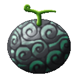
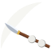
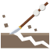

<!-- Generated by tools/build_pack_reference.py. Edit the pack sources and regenerate. -->

# Hito Hito no Mi, Model: Onyudo

{ .entry-page-icon }

[Fruits](index.md) · [Missing Missing no Mi](../../reference/content/inomissing.md)

<!-- fruit inomissing:hito_hito_no_mi_model_onyudo -->

| Stat | Value |
| --- | --- |
| Type | Mythical Zoan |
| Tier | 3 |
| Fruit damage scaling | 1.00× at 10,000 Doriki → 1.75× at 50,000 Doriki |
| Abilities | 8 (8 active, 0 passive) |
| Fruit boxes | [Golden Box](../fruit-boxes.md) |

See [damage calculations](../combat-stats.md#damage-from-doriki).

!!! note "Reading the stats"
    Listed base damage is for the named part of the move. Pack and Doriki multipliers are shown separately. Times assume 20 ticks per second.

<!-- move inomissing:onyudo_heavy_point -->

## Onyudo Heavy Point

{ .entry-move-icon loading=lazy } *Active · Transformation*

Transforms the user into an onyudo hybrid, a tall and strong warrior monk with a long reach.

| Stat | Value |
| --- | --- |
| Pack multiplier when dealing damage | 1.35× |

**Stats while transformed**

| Stat | Value |
| --- | --- |
| Movement speed | +5% of base |
| Punch damage | +11 HP |
| Armour | +14 |
| Toughness | +4 |
| Step height | +1 blocks |

<!-- move inomissing:onyudo_guard_point -->

## Onyudo Guard Point

{ .entry-move-icon loading=lazy } *Active · Transformation*

Transforms the user into an onyudo, a giant warrior monk as tall as 8 blocks, very strong, fast for its size and with a very long reach.

| Stat | Value |
| --- | --- |
| Pack multiplier when dealing damage | 1.35× |

**Stats while transformed**

| Stat | Value |
| --- | --- |
| Movement speed | +10% of base |
| Punch damage | +15 HP |
| Armour | +20 |
| Toughness | +8 |
| Step height | +2 blocks |

<!-- move inomissing:great_sweep -->

## Great Sweep

{ .entry-move-icon loading=lazy } *Active*

The user sweeps what they are holding in a wide arc in front of them, hitting all the enemies there and sending them away. A better weapon deals more damage

| Stat | Value |
| --- | --- |
| Cooldown | 8 s (160 ticks) |
| Pack multiplier when dealing damage | 1.35× |

<!-- move inomissing:long_thrust -->

## Long Thrust

{ .entry-move-icon loading=lazy } *Active*

The user thrusts what they are holding straight ahead with both hands, hitting all the enemies in a long line and pushing them back. A better weapon deals more damage

| Stat | Value |
| --- | --- |
| Cooldown | 9 s (180 ticks) |
| Pack multiplier when dealing damage | 1.35× |

<!-- move inomissing:monks_guard -->

## Monk's Guard

{ .entry-move-icon loading=lazy } *Active*

The user takes a guard stance that greatly reduces the damage coming from in front of them. While it holds the user is slowed and can't attack. Use the ability again to end it

| Stat | Value |
| --- | --- |
| Cooldown | 15 s (300 ticks) |
| Pack multiplier when dealing damage | 1.35× |

<!-- move inomissing:giants_stomp -->

## Giant's Stomp

{ .entry-move-icon loading=lazy } *Active*

The user stomps the ground, all nearby enemies standing on it are damaged and knocked down for a moment A target at least twice as small as the user stays pinned to the ground for longer

| Stat | Value |
| --- | --- |
| Base damage | 12 HP |
| Guard damage | 18 HP |
| Cooldown | 11 s (220 ticks) |
| Pack multiplier when dealing damage | 1.35× |

<!-- move inomissing:dread_gaze -->

## Dread Gaze

{ .entry-move-icon loading=lazy } *Active*

The user stares down the nearby enemies that are looking at them, weakening and slowing them. Enemies that look away are not affected

| Stat | Value |
| --- | --- |
| Cooldown | 14 s (280 ticks) |
| Pack multiplier when dealing damage | 1.35× |

<!-- move inomissing:earth_splitter -->

## Earth Splitter

{ .entry-move-icon loading=lazy } *Active*

While in the giant onyudo form, the user raises what they are holding above their head and brings it down, splitting the ground in a long line in front of them. Enemies on the line take heavy damage and are knocked down. A better weapon deals more damage

| Stat | Value |
| --- | --- |
| Cooldown | 32 s (640 ticks) |
| Pack multiplier when dealing damage | 1.35× |

