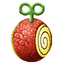

<!-- Generated by tools/build_pack_reference.py. Edit the pack sources and regenerate. -->

# Hobi Hobi no Mi

{ .entry-page-icon }

[Fruits](index.md) · [Missing Missing no Mi](../../reference/content/inomissing.md)

<!-- fruit inomissing:hobi_hobi_no_mi -->

| Stat | Value |
| --- | --- |
| Type | Paramecia |
| Tier | 2 |
| Fruit damage scaling | 1.00× at 10,000 Doriki → 2× at 50,000 Doriki |
| Abilities | 7 (6 active, 1 passive) |
| Fruit boxes | [Iron Box](../fruit-boxes.md) |

See [damage calculations](../combat-stats.md#damage-from-doriki).

!!! note "Reading the stats"
    Listed base damage is for the named part of the move. Pack and Doriki multipliers are shown separately. Times assume 20 ticks per second.

<!-- move inomissing:omocha -->

## Omocha

{ .entry-move-icon loading=lazy } *Active*

The next touch of the user's bare hand turns the target into a toy for as long as the curse lasts. A new toy only defends itself until Keiyaku is used on it.

| Stat | Value |
| --- | --- |
| Cooldown | 15 s (300 ticks) |
| Pack multiplier when dealing damage | 1.5× |

<!-- move inomissing:keiyaku -->

## Keiyaku

{ .entry-move-icon loading=lazy } *Active*

Makes a contract with a toy the user made. A creature then follows and fights for the user, and a player can no longer attack the user.

| Stat | Value |
| --- | --- |
| Cooldown | 1 s (20 ticks) |
| Conditional cooldown | 0.5 s (10 ticks) |
| Pack multiplier when dealing damage | 1.5× |

<!-- move inomissing:little_black_bears -->

## Little Black Bears

{ .entry-move-icon loading=lazy } *Active*

The user dashes around touching up to 8 nearby creatures and turns them into small black teddy bears, already under contract.

| Stat | Value |
| --- | --- |
| Cooldown | 45 s (900 ticks) |
| Pack multiplier when dealing damage | 1.5× |

<!-- move inomissing:atamawari_ningyo -->

## Atamawari Ningyo

{ .entry-move-icon loading=lazy } *Active*

Builds 8 of the user's toys under contract into a giant nutcracker that fights for the user. When its time is up or it is destroyed, it comes apart into the same toys.

| Stat | Value |
| --- | --- |
| Cooldown | 120 s (2400 ticks) |
| Conditional cooldown | 0.5 s (10 ticks) |
| Pack multiplier when dealing damage | 1.5× |

<!-- move inomissing:noroi -->

## Noroi

{ .entry-move-icon loading=lazy } *Passive*

The fruit keeps the user as a child, smaller and weaker. All the toys are turned back if the user dies, is knocked out, loses their powers or leaves.

| Stat | Value |
| --- | --- |
| Pack multiplier when dealing damage | 1.5× |

<!-- move inomissing:zettai_meirei -->

## Zettai Meirei

{ .entry-move-icon loading=lazy } *Active*

Gives an absolute order to every toy under contract near the user. For 10 seconds they hit harder, move faster and take less damage.

| Stat | Value |
| --- | --- |
| Cooldown | 30 s (600 ticks) |
| Conditional cooldown | 0.5 s (10 ticks) |
| Pack multiplier when dealing damage | 1.5× |

<!-- move inomissing:kaijo -->

## Kaijo

{ .entry-move-icon loading=lazy } *Active*

The user turns the toy they are looking at back into what it was. The other toys stay toys.

| Stat | Value |
| --- | --- |
| Cooldown | 5 s (100 ticks) |
| Conditional cooldown | 0.5 s (10 ticks) |
| Pack multiplier when dealing damage | 1.5× |

