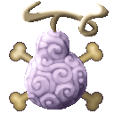
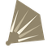
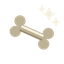

<!-- Generated by tools/build_pack_reference.py. Edit the pack sources and regenerate. -->

# Hone Hone no Mi

{ .entry-page-icon }

[Fruits](index.md) · [InoFruits](../../reference/content/inofruits.md)

<!-- fruit inofruits:hone_hone_no_mi -->

| Stat | Value |
| --- | --- |
| Type | Paramecia |
| Tier | 2 |
| Fruit damage scaling | 1.00× at 10,000 Doriki → 2× at 50,000 Doriki |
| Abilities | 6 (6 active, 0 passive) |
| Fruit boxes | [Iron Box](../fruit-boxes.md) |

See [damage calculations](../combat-stats.md#damage-from-doriki).

!!! note "Reading the stats"
    Listed base damage is for the named part of the move. Pack and Doriki multipliers are shown separately. Times assume 20 ticks per second.

<!-- move inofruits:hone_hone_point -->

## Hone Hone Point

{ .entry-move-icon loading=lazy } *Active · Transformation*

The user wears their skeleton on the outside, which makes the other bone abilities stronger while active

| Stat | Value |
| --- | --- |
| Cooldown | 30 s (600 ticks) |
| Pack multiplier when dealing damage | 5.5× |

**Stats while transformed**

| Stat | Value |
| --- | --- |
| Armor | +8 |
| Toughness | +2 |
| Punch damage | +4 HP |
| Movement speed | -10% of base |

<!-- move inofruits:bone_throw -->

## Bone Throw

{ .entry-move-icon loading=lazy } *Active*

Throws a bone that comes back to the user, hitting enemies both ways.

| Stat | Value |
| --- | --- |
| Cooldown | 7 s (140 ticks) |
| Pack multiplier when dealing damage | 5.5× |

<!-- move inofruits:bone_blade -->

## Bone Blade

{ .entry-move-icon loading=lazy } *Active*

Grows a long bone blade out of the user's arm that can be used as a sword.

| Stat | Value |
| --- | --- |
| Pack multiplier when dealing damage | 5.5× |

<!-- move inofruits:bone_shards -->

## Bone Shards

{ .entry-move-icon loading=lazy } *Active*

Shoots a burst of bone splinters in a short cone, which break apart at range

| Stat | Value |
| --- | --- |
| Cooldown | 5 s (100 ticks) |
| Pack multiplier when dealing damage | 5.5× |

<!-- move inofruits:bone_mend -->

## Bone Mend

{ .entry-move-icon loading=lazy } *Active*

The user knits their bones back together, healing while the ability is held.

| Stat | Value |
| --- | --- |
| Cooldown | 20 s (400 ticks) |
| Pack multiplier when dealing damage | 5.5× |

<!-- move inofruits:spare_bone -->

## Spare Bone

{ .entry-move-icon loading=lazy } *Active*

The user grows a spare bone and drops it in their hand

| Stat | Value |
| --- | --- |
| Cooldown | 0.5 s (10 ticks) |
| Pack multiplier when dealing damage | 5.5× |

