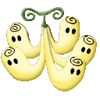

<!-- Generated by tools/build_pack_reference.py. Edit the pack sources and regenerate. -->

# Horo Horo no Mi

{ .entry-page-icon }

[Fruits](index.md) · [Mine Mine no Mi](../../reference/content/mineminenomi.md)

<!-- fruit mineminenomi:horo_horo_no_mi -->

| Stat | Value |
| --- | --- |
| Type | Paramecia |
| Tier | 2 |
| Fruit damage scaling | 1.00× at 10,000 Doriki → 2× at 50,000 Doriki |
| Abilities | 4 (4 active, 0 passive) |
| Fruit boxes | [Iron Box](../fruit-boxes.md) |

See [damage calculations](../combat-stats.md#damage-from-doriki).

[Jump to awakening](#awakening)

!!! note "Reading the stats"
    Listed base damage is for the named part of the move. Pack and Doriki multipliers are shown separately. Times assume 20 ticks per second.

<!-- move mineminenomi:negative_hollow -->

## Negative Hollow

{ .entry-move-icon loading=lazy } *Active*

The user launches a ghost that drains the target's will, debuffing them.

| Stat | Value |
| --- | --- |
| Cooldown | 4 s (80 ticks) |
| Pack multiplier when dealing damage | 2.2× |

<!-- move mineminenomi:mini_hollow -->

## Mini Hollow

{ .entry-move-icon loading=lazy } *Active*

Launches small ghosts at the opponent, exploding upon impact.

| Stat | Value |
| --- | --- |
| Cooldown | 9 s (180 ticks) |
| Pack multiplier when dealing damage | 3.35× |

<!-- move mineminenomi:toku_hollow -->

## Toku Hollow

{ .entry-move-icon loading=lazy } *Active*

Creates a huge ghost that causes a massive explosion upon impact.

| Stat | Value |
| --- | --- |
| Cooldown | 15 s (300 ticks) |
| Pack multiplier when dealing damage | 3.35× |

<!-- move mineminenomi:yutai_ridatsu -->

## Yutai Ridatsu

{ .entry-move-icon loading=lazy } *Active*

The user's spirit leaves their body, allowing them to freely explore the nearby areas.

| Stat | Value |
| --- | --- |
| Min cooldown | 5 s (100 ticks) |
| Max cooldown | 30 s (600 ticks) |
| Pack multiplier when dealing damage | 3.35× |

## Awakening

**Source** · Awaken Awaken no Mi

| Stat | Value |
| --- | --- |
| Doriki | 40,000 |
| Active time with the fruit | About 24 hours (1,728,000 ticks) |

<!-- move awakenawakennomi:hollow_shroud -->

### Hollow Shroud { #awakening-hollow-shroud }

{ .entry-move-icon loading=lazy } *Passive*

Surrounds the user in a ghostly aura that makes nearby enemies weaker, slower and blind. Every Negative the user inflicts lasts twice as long.

<!-- move awakenawakennomi:ghost_legion -->

### Ghost Legion { #awakening-ghost-legion }

{ .entry-move-icon loading=lazy } *Active*

Releases a legion of hollows, one for each enemy nearby, that fly through walls to hunt their target down. Each hollow that reaches its target makes it lose the will to fight, it can't move or attack for a while.

| Stat | Value |
| --- | --- |
| Base damage | 35 HP |
| Cooldown | 45 s (900 ticks) |
| Miss cooldown | 2 s (40 ticks) |

<!-- move awakenawakennomi:phantom_payload -->

### Phantom Payload { #awakening-phantom-payload }

{ .entry-move-icon loading=lazy } *Active*

Summons a huge hollow the user steers with their gaze, exploding when it touches anything or when the ability is used again. Everyone caught in the blast loses the will to move or fight.

| Stat | Value |
| --- | --- |
| Cooldown | 50 s (1000 ticks) |

